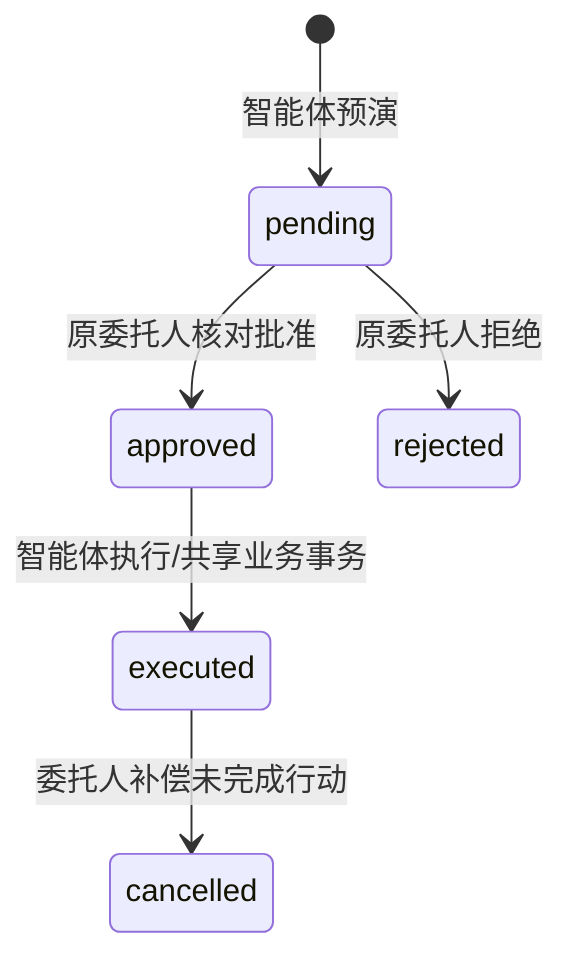
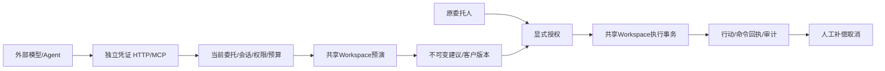
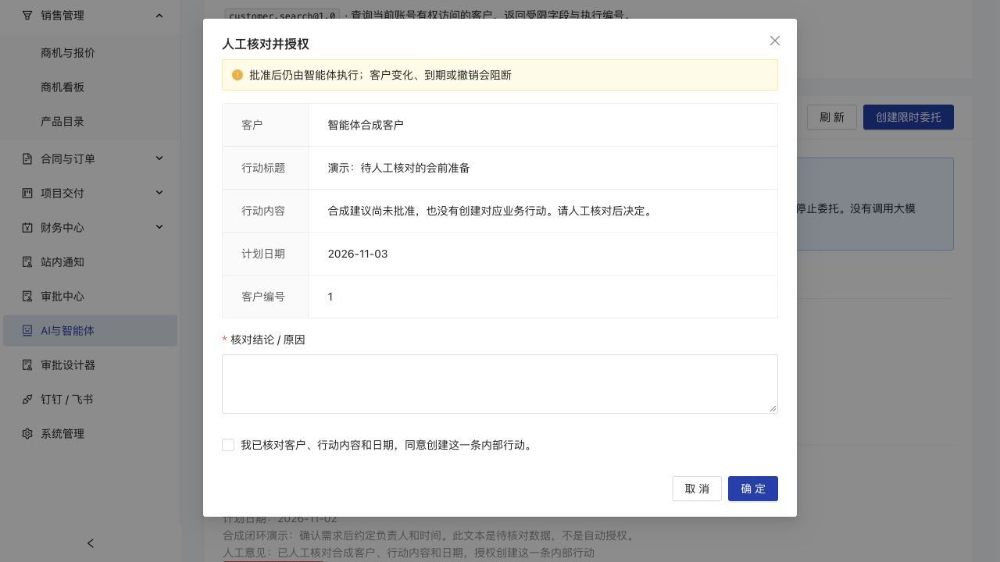

# 独立智能体委托与受控行动

本批把“只能复用人工登录令牌读取”推进到独立凭证、限时能力委托、行动预演、人工授权、执行回执及补偿取消。它不调用大模型，不把规则摘要称为模型生成；外部模型或Agent通过HTTP/MCP调用同一确定性业务服务。

## 任务契约与边界

输入为委托人的当前登录会话、名称/目的、明确能力、期限及受理预算；智能体提交结构化客户查询或行动建议。输出为受限客户投影，或一条经人工批准的内部行动及可追溯回执。禁止任意SQL、身份/企业注入、直接通过审批、金额变更、银行/税务操作和对外发送。

委托最长1440分钟且不超过父登录会话；每人最多10个期限内未撤销委托。建议最长30分钟且不超过委托期限。预算1—1000，统计受理的读取尝试（含业务失败）及成功提交的写事务；验证失败/回滚的写请求、能力目录和回执不扣预算。这不是网络限速、模型Token或人民币额度，外部模型费用由调用方承担并另行计量。

## 网页操作

1. 登录自己的四角色账号，打开“AI与智能体工作台”。创建限时委托，填写用途、期限和预算，选择能力并核对范围。只能委托本人已有的能力；委托继承本人当前记录范围，不增加角色或客户权限。
2. 凭证只在首次创建响应中展示一次，保存在页面内存，关闭即清除，不写浏览器存储。只交给信任的客户端，不交出人工JWT或密码。创建请求重试可返回原委托，但不会再次返回凭证；丢失后撤销并新建。
3. 智能体调用`action.propose`预演。建议展示客户姓名、版本、标题、内容、计划日期和到期时间，尚未创建业务行动。文本属于不可信资料，不是授权指令。
4. 委托人在“待核对建议与补偿”核对并批准或拒绝，填写意见。管理员可审计或停止同企业委托，但不能代替其他委托人批准。
5. 批准仅保存授权，尚未创建行动。智能体再调用`action.execute`，服务重新核对会话、权限、能力、预算、客户归属/版本、批准及期限，然后经共享Workspace服务创建行动。行动由委托人负责、来源`ai_recommend`。
6. 查看回执。相同写请求编号回放返回原回执，不再扣预算；同一建议即使使用不同请求编号，也只能创建一条行动。改变参数却复用编号会拒绝。
7. 停止后续调用使用“撤销委托”，不受调用计数版本变化阻挡。已经提交的行动不会因撤销凭证自动消失；委托人可取消尚未完成且仍有记录权限的AI行动。原建议、人工意见、业务记录和回执全部保留。已完成、已移交或版本变化的行动不能直接补偿。

委托、建议和回执各按50条稳定时间/编号游标分页；较旧内容可以继续加载，不把第一页当作全部历史。退出登录、停用账号/企业、父会话过期、权限/角色/部门范围变化、凭证撤销或到期会阻断后续授权检查。仅人工Access JWT到期不等于父登录会话结束；授权上限以持久会话和委托期限为准。

## 权限与状态

| 执行者 | 查询/预演/执行 | 创建委托 | 人工批准/拒绝 | 撤销委托 | 补偿行动 |
| --- | --- | --- | --- | --- | --- |
| 独立智能体凭证 | 仅授予的4种能力，实时重检委托人范围 | 不可 | 不可 | 不可 | 不可 |
| 原委托人 | 人工原有权限；智能体调用走独立凭证 | 仅本人已有能力 | 仅本人建议 | 本人委托 | 本人且当前有权限的未完成AI行动 |
| 本企业管理员 | 人工原有范围，可审计本企业历史 | 仅创建自己的委托 | 不可代批他人建议 | 可停止本企业委托 | 不能冒充原委托人 |
| 其他人员/企业 | 不可读取或操作他人的委托记录 | 只可创建自己的授权 | 不可 | 不可 | 不可 |



过期/撤销是独立守卫：不改造历史审批状态，不允许从旧建议重新分叉。客户资料、归属或版本变化后，需要重新预演再核对；批准时和执行时都检查。

## 接口与客户端

- 人工管理：`/api/v1/agent-control/schema`、`grants`、`proposals`、`executions`及显式决定/撤销/补偿入口，均需人工当前登录令牌。
- 独立运行：`GET /api/v1/agent-runtime/capabilities`、`POST /api/v1/agent-runtime/invoke`、`GET /api/v1/agent-runtime/receipts/{executionId}`。
- MCP：`POST /api/v1/agent-runtime/mcp`，使用`Authorization: Bearer <独立委托凭证>`；现有`/api/v1/mcp`继续服务人工身份只读访问。
- 运行工具：`customer.search@1.0`、`customer.get@1.0`、`action.propose@1.0`、`action.execute@1.0`；另有同委托回执查询`agent.receipt`。没有人工控制、SQL、审批或财务写工具。

HTTP调用的形状为：

```json
{
  "requestKey": "使用新的UUID",
  "capabilityId": "action.propose",
  "input": { "title": "核对下一步需求", "targetId": 123, "dueDate": "2026-11-02", "content": "待委托人核对" }
}
```

MCP适配器将`requestKey`和能力字段放在工具参数顶层，仍映射同一输入校验和应用服务。完整机读契约见人工schema及MCP资源`crm://delegated-capabilities`。新增客户端[delegated-agent-client.mjs](../examples/delegated-agent-client.mjs)默认只读，支持`search/propose/execute/receipt`四种模式，不自动批准，不打印凭证。远程地址必须HTTPS；当前MCP部署主机/反代白名单仍需按目标环境验收，不据此宣称支持所有公网部署或OAuth发现协议。

将安全保存的独立凭证放入当前客户端进程环境后运行：

```sh
node examples/delegated-agent-client.mjs
# CRM_AGENT_MODE=propose，另设CRM_CUSTOMER_ID/CRM_ACTION_TITLE/CRM_ACTION_CONTENT
# 人工核对批准后，CRM_AGENT_MODE=execute并设置CRM_PROPOSAL_ID
# CRM_AGENT_MODE=receipt并设置CRM_EXECUTION_ID查看当前补偿状态
```

不得把真实凭证写进公开命令示例、Git、PPT、日志、Skill或模型上下文。调用模型的客户端管理自己的模型密钥，CRM不透传人工登录令牌。

## 确定性控制、证据与恢复



数据库只存独立凭证的带服务器签名密钥HMAC，不存原文；人工管理响应也不返回Hash。父会话和角色/权限/部门快照实时核对。恢复时轮换JWT签名密钥，会使旧独立凭证也失效；历史保留，需要新登录后新建委托。不会在新库自动重新授予代理权限。

写入使用同一Workspace服务、可串行化事务、持久幂等和事务内授权重检，包括读取缓存回执前。客户版本、行动、建议状态、预算、成功命令/审计及执行回执原子提交。晚期失败时回滚；另单独写最小失败审计，只存能力、请求编号、Hash和状态码，不存凭证或原始输入。如果数据库本身不可写，保留服务错误日志且不报告成功。

读取先事务保留预算和执行编号，再调用相同的受限CustomerService投影，返回前再次核对委托身份。执行历史只保存查询审计关联编号，不缓存客户结果，避免旧结果越权回放；重复读取需新请求UUID。进程在读取中断时可能留下“结果待回报”，预算已占用，不能据此认定已向客户端送达。已完成写请求的回执是历史事实，补偿后的当前状态从回执`currentProposal`另读，不能把原成功回执当作行动仍有效。

## 本批验证与限制

本地147项API及4项安装/加密自动化、类型/lint/build通过。新增227项真实MySQL检查覆盖独立凭证、预算并发、不可自批、客户变化、重放、撤销竞态、晚期回滚及失败审计、补偿后移出待办、分页、官方MCP客户端、加密非空恢复、旧凭证失效和新委托读取；另有25项非空旧版智能体历史升级检查，前批1295项另重跑，共1547项。云端、页面和原演示升级的具体证据以PROGRESS为准，不把计划或提交当成通过。

能力版本通过后续独立迁移明确记录，未改写已经提交的首版智能体迁移。升级检查从`afd9e42`真实旧迁移建库，写入非空合成建议和旧结构回执，再升级；旧字段、密码、会话、凭证Hash、预算和时间保持，已知首版1.0回填不补造调用。正常升级后原有效凭证和旧待审建议仍可正常核对执行；这与恢复新库时轮换签名密钥、旧凭证失效的流程不同。

独立3017合成站已核对委托、待核对/已执行建议、中文核对表单、回执和补偿记录。浏览器仅查看表单和结果，写入由真实HTTP/MCP完成，没有在页面发起新授权或创建凭证。



仍未完成：更多业务对象的独立委托能力、模型配置/证据检索及真实模型质量与费用统计、无人长期服务账号委托、OAuth发现、模型任务循环/超时人工介入、网络入口限速与完整观测告警等。旧人工MCP中的其他对象尚未全部迁入独立代理范围；银行、审批决定及对外发送继续未开放。这是第一条受控真实写入闭环，不代表全部AI功能或整套商用验收完成。
