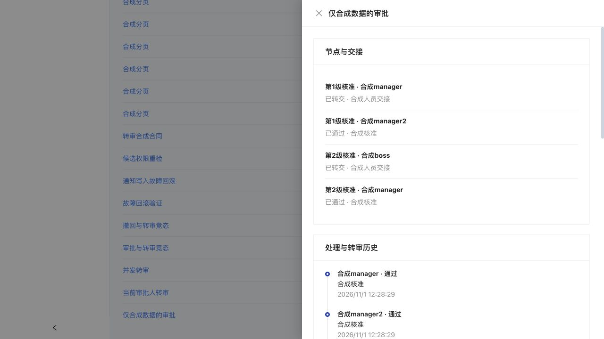

# 审批转审与人员交接

本批支持顺序审批的转审及管理员恢复流转，不是会签、加签、钉钉或飞书外部审批。转审只改变后续处理人，不代表审批通过，也不触发合同、订单或立项的业务回调。

## 日常转审

1. 打开审批中心，在“待我审批”选择“转审”，或者进入申请详情的“节点与交接”。
2. 选择具备审批通过和驳回权限的有效人员，填写原因。申请人、原审批人、其他企业、停用账号或停用部门人员不能接收。
3. 确认后，原节点标为“已转交”并保留原审批人、原因和处理时间。新节点继承原节点的顺序和名称，审批状态仍为待处理。
4. 当前节点转交后，原审批人不能再审批。新审批人收到站内通知，在“待我审批”处理；原审批人可在“我参与的审批”回看历史。
5. 接收人通过或驳回时，执行原有业务回调；申请人仍可撤回待处理申请。拒绝或撤回后不能继续转审。

候选人员每次扫描100人，并过滤实际权限；大企业可继续“加载更多候选人员”，即使某一页没有符合权限的人，也不会把仍有后续游标误报成结束。审批历史、审计事件每页50条，使用稳定编号游标加载，未把前50条当成全部历史。

## 离职、调岗与管理员恢复

管理员打开“企业审批与交接”，进入申请详情。管理员可以转交当前或尚未轮到的待审节点；普通审批人只能转交当前轮到自己的节点。后续节点转交不跳过当前节点，新接收人要等流程轮到该节点才能审批。

先转交该人员全部未完成节点，再到人员管理停用或调岗。尚有待处理审批时，人员管理仍拒绝停用或改变权限。紧急撤销访问可先重置密码，之后由管理员恢复待审流转。转审不会授予接收人新角色，也不会移交项目、客户或其他业务所有权。

## 历史与隔离

流程定义快照和业务表单不会随转审改写。处理事件额外保存操作者姓名、原/新审批人姓名、节点编号、节点顺序、原因，以及是否属于管理员恢复。原节点、转交节点和多次转交均保留。

申请人、曾被分配节点的参与者可以查看该申请及历史；管理员可在本企业内审计，其他人员和其他企业不可读取。这里采用“审批参与人能读完整申请”的策略，尚无字段级保密表单。旧审批不补造审计事件，原有节点处理记录照常可读。

## 事务和恢复

审批版本、当前会话及权限、节点状态、目标账号和部门、角色权限均在同一可串行化事务内重检。持久化请求标识支持相同请求回放；重复使用同一标识却改变参数会拒绝。并发转交不会分叉，转审与审批决定只有一个成功。

原节点、新节点、当前指针、审计事件、站内通知和命令回执原子提交；事件或通知写入失败时全部回滚。站内通知以数据库提交为准，不把外部请求发出当作送达。本批不发送外部消息；钉钉、飞书、邮件重试队列仍待建设。

迁移`202611010007_approval_events`只新增事件表，不改旧审批或审批节点。真实MySQL检查包含已有流程转审、合同回调、账号交接、并发、故障回滚、分页，以及加密备份到新库恢复后认证读取。恢复保留节点、事件、通知和命令，轮换会话签名，不覆盖或自动切换原库。

## 验证范围

本批本地175项新增MySQL检查通过；另跑业务365、身份126、安装恢复41、客户合同227、财务325和非空升级34项，共1293项。工程检查为127项API及4项安装/加密测试、类型、lint和构建。云端结果见PROGRESS；未运行的环境不算验收通过。

本批不包含并行会签、或签、加签、超时催办、外部通知投递、保密字段、受托智能体写入或最终商用验收。

独立3016合成站已核对企业审批分页、转出/接收节点、后续节点管理员恢复、最终两级审批及原流程快照；页面仅读取结果，转审和审批写入由真实HTTP/MySQL检查执行。

