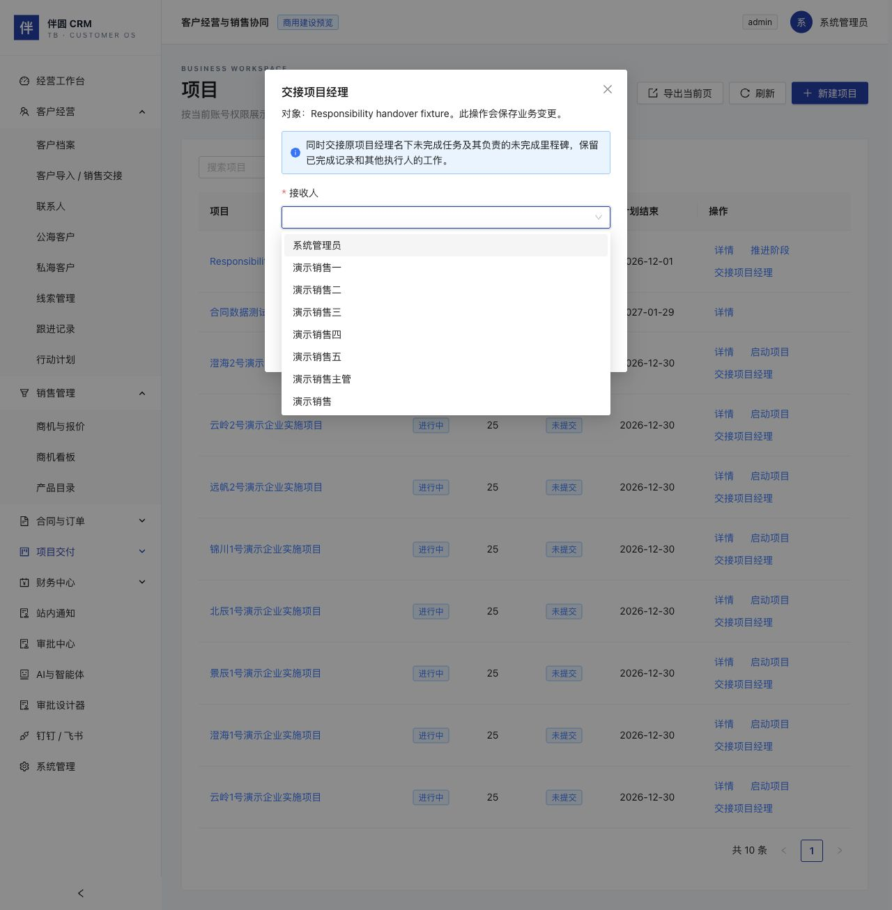
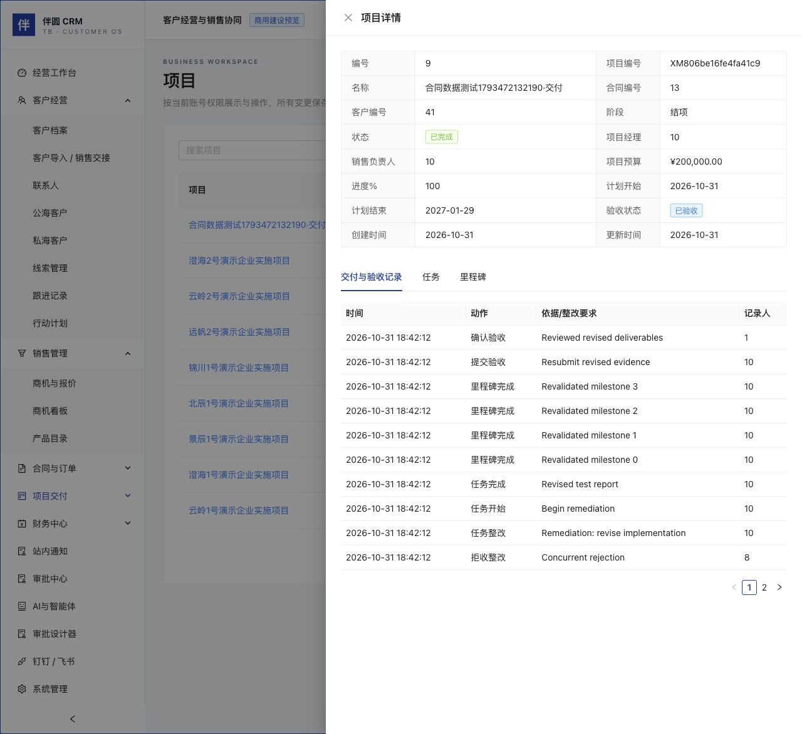

# 项目交付、验收与整改（C4 第一批候选）

本说明覆盖订单审批、确认、交付及合同生成项目后的执行主线和人员交接。后续C8售后工单、C10私有附件已另有操作说明；订单分批发货、取消补偿、大文件对象存储仍未实现，不能作为整套商用验收结论。

## 执行顺序

1. 已签约合同生成项目，或填写客户、起止日期新建项目；提交立项审批并通过。
2. 项目经理或具有该项目范围权限的主管/管理员启动项目。未启动、未批准或已关闭项目不能创建、修改或执行任务。
3. 在项目任务中新建任务，选择项目及可选的关联里程碑。只能关联该项目未完成的里程碑；未关联任务在最终交付里程碑前统一检查。新任务由创建人执行，项目经理或有范围权限的主管可从任务列表转派。
4. 开始任务时填写工作说明；完成任务填写结果/依据及累计实际工时（0.1—9999.9小时，最多一位小数）。工时为本任务累计值，整改完成时填写新的累计值，不是追加扣费、工资核算或完整工时单。已完成任务不可直接改写。
5. 从项目推进当前里程碑，填写交付结果和依据。系统按顺序检查当前里程碑关联任务；最终交付还检查未关联任务。不允许跳过未完成任务。里程碑及任务记录在同一事务保留操作者、时间、说明及工时等证据。
6. 全部里程碑和任务完成后提交验收，填写本次验收材料说明。验收处理中冻结任务创建、编辑、执行与里程碑推进，防止依据漂移。
7. 另一名有项目范围权限的主管或管理员确认验收，或填写拒收及整改要求。项目经理和提交人不能确认本人项目；老板仍保持业务只读，不能通过本入口代替主管。至少需要另一位合格复核人，单管理员不能自验收。

## 拒收与整改

拒收后项目保持进行中，验收状态显示已驳回。项目经理或有项目范围权限的主管可以对已完成任务“发起整改”，必须说明整改内容。

系统重新打开该任务所属里程碑及其后续里程碑，重算进度；未绑定里程碑的任务重新打开最后一个里程碑。整改不删除历史完成、工时或验收记录。任务重新开始并完成后，按顺序重新确认里程碑并提交验收。拒收也可针对验收材料补充，允许保留已完成任务并以新的说明重新提交。

最终确认后项目进入已完成，阶段关闭，记录验收日期、结束日期与结项说明；不能再从任务入口改写交付。已通过新版验收的项目可进入独立售后工单流程，工单不重开或改写原项目验收。

## 查看记录与权限

项目详情的“交付与验收记录”展示启动、任务执行/整改、里程碑及历次验收决定。任务详情只展示该任务的记录。接口返回最近100条事件；完整历史保留在本地数据库，分页导出后续提供。C10增加受控PDF/PNG/JPEG附件及不可变文件摘要快照，详见PRIVATE_ATTACHMENT_OPERATIONS；仍不提供外部客户签署或电子签章。

网页、HTTP 和现有只读 MCP 共用 WorkspaceService。`/workspace/schema` 的项目/任务操作契约升级为2.0，列明必填说明、工时与版本参数；身份来自认证上下文，写入执行实时会话/权限重检、租户/记录范围、Serializable事务、幂等和乐观版本检查。审批与任务的事件均不开放独立写入入口，智能体写操作仍未开放。

## 升级

先备份，应用增量迁移 `202611010003_delivery_acceptance`，再启动匹配的新前后端。新增项目验收状态和交付事件表，不删除原数据、不重设账号。

迁移前已完成项目标记“历史完成（无新版验收记录）”，不补造验收事件；旧项目仍保留实际状态。未完成旧项目开始采用新的任务、里程碑和双人验收规则。操作请求升级为2.0后，旧客户端直接点击验收或无说明完成任务会被拒绝，需使用新版页面。

可靠外发通知、完整工时单、跨项目批量交接、订单与项目取消补偿和生产容量测试仍待后续批次。私有文件权限及内部售后已分别由C10、C8提供。没有把文本或文件记录当作客户外部签署。

## 人员交接增量

项目列表 → 交接项目经理：管理员或主管选择接收人并说明原因。系统同事务交接项目经理、原经理名下未完成任务及其负责的未完成里程碑；其他执行人的任务、已完成任务的执行人、创建人及历史证据不随之改写。审批或验收处理中及已关闭项目不能交接。

任务列表 → 转派任务：项目经理或有项目管理范围的主管选择接收人，填写待办及原因。普通执行人不能自行转派，已完成/取消任务不能转派。验收处理中不可转派。

接收人必须为本企业有效账号、有效部门，并具备适用角色及项目读写权限；主管及项目经理限定适用部门，管理员可明确安排跨部门协作。任务接收人仅在持有未完成任务时获得项目读取，不获得项目管理或他人任务管理权限；完成后若无其他归属则收回这一项目读取范围，自己的历史任务仍可查看。项目经理交接不改变销售负责人及客户归属，原经理如仍为销售负责人仍可按该职责读取项目。

账号停用、离职、调岗或移出适用交付角色前，会检查未结束项目经理职责及未完成交付任务，有未交接工作则拒绝。紧急撤销访问可由管理员先重置密码，业务随后交接；不会为交接自动启用旧停用账号。

正式安装销售缺少订单/项目继续操作权限的问题通过`202611010004_delivery_responsibility`修复：只对已有读/创建路径的内置销售补齐相应更新权限，未配置创建权限的角色不扩权。新安装使用修复后的默认定义，仍受本人/团队、项目职责及状态限制。迁移后重新登录。

候选人员列表最多200人；批量离职交接、复杂项目团队和完整跨部门协作权限配置仍待后续。交接事件保存当时操作者姓名、目标人员及转移数量，网页时间明确显示北京时间。

独立3012合成站已读取核对交接入口、影响说明、有效接收人及交接原因必填字段，未在网页最终转派权限。实际交接、访问变化及停用由真实HTTP/MySQL集成检查执行。另修复未绑定任务整改时的阶段显示：始终回到最早未完成里程碑，避免进度为0却显示验收阶段。

## 页面核对

独立3011合成测试站已登录核对项目列表“已验收”状态及详情中的拒收、整改、重新交付、再次提交和最终确认历史。本次页面核对为读取检查，完整写入链由真实HTTP/MySQL集成检查执行。

