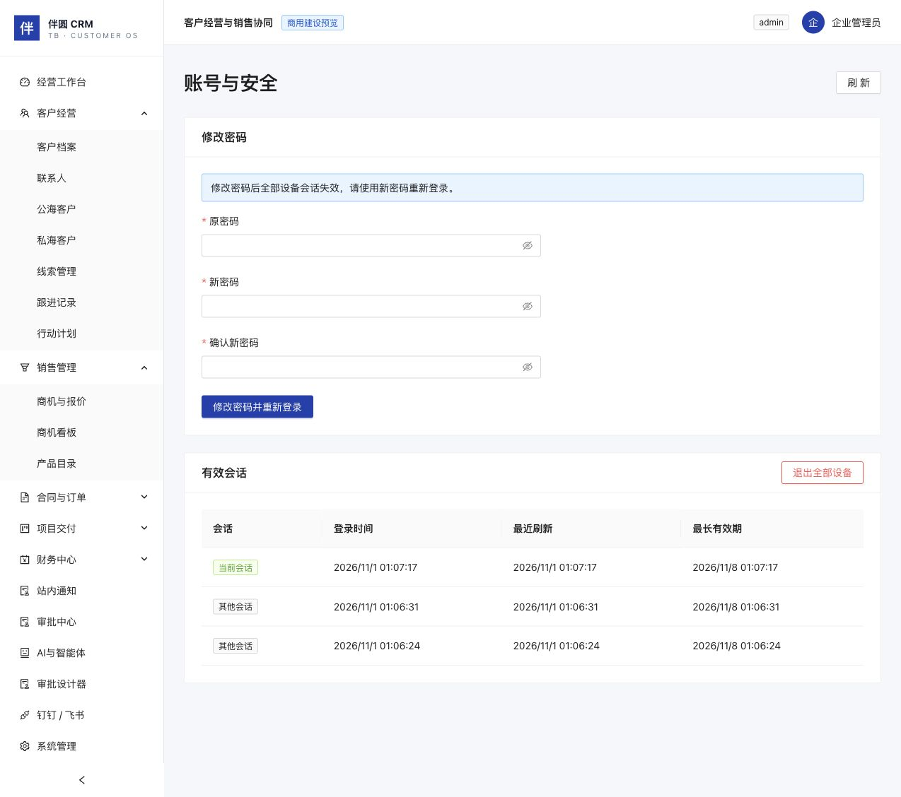

# 人员、部门与会话操作

本批为 C2 人员与会话基础闭环。当前只支持管理员、销售主管、销售、老板四种预置角色，每个新建或变更账号选择一种角色，避免混合角色导致数据范围与写权限意外叠加。自定义角色定义写入暂不开放。

## 空企业首次配置

1. 用安装时设置的企业编码、管理员账号和密码登录。
2. 系统管理 → 组织部门 → 新建部门。可设置编码及上级；禁止跨企业引用、循环层级、同企业重复编码。新部门先不设置负责人。
3. 系统管理 → 新建用户。设置账号、姓名、部门、角色及唯一初始密码；密码至少12位，含大小写字母和数字，最多72个 UTF-8 字节。创建用户和分配角色在同一事务中完成，不会留下创建一半的账号。
4. 用户分配到部门后，编辑该部门设置有效成员为负责人。审批设计器仍会检查负责人实际审批权限；人员迁出、停用或失去适用角色后会清除旧负责人引用，管理员需重新指定负责人。
5. 配置并发布所需审批流。正式安装不会自动创建同名演示人员或预置审批人，不能把管理员当作默认自动审批人。

人员列表支持服务端分页、账号/姓名查询和刷新；角色列表展示四种预置权限；业务审计显示已完成的人员与组织变更。

## 调岗、变更角色及离职

系统管理 → 用户账号 → 编辑/停用：修改部门、角色、姓名或状态。保存使用版本校验；其他管理员或新登录造成版本变化时，刷新后重新编辑。更改角色、部门或状态会撤销目标用户全部会话，下一次请求必须重新登录。

不能停用自己或移除自己的管理员角色。多人同时操作也必须保留至少一名有效管理员；不会因为并发互相停用而将企业全部管理员关闭。新增和重新启用账号检查企业有效账号额度。

仍有待处理审批节点的用户暂不能调岗、换角色或停用，应先完成、撤回或转审相关审批，避免留下无人处理的审批。紧急撤销访问可先重置其密码，系统会撤销全部会话并清除登录失败锁定。C6/C11已提供单人及会签待办转审和管理员恢复。

停用和离职不删除客户、合同、订单或审计历史。先使用客户整体归属交接、项目经理/任务交接、审批转审和售后转派分别处理未完职责；销售归属交接不替代其他职责交接。部门仍有有效成员或下级部门时不能停用。

## 密码与会话

- 右上角 → 账号与安全：输入原密码、新密码及确认值，成功后全部设备会话失效，使用新密码重新登录。
- 管理员展开用户行 → 重置密码：设置新密码，撤销该用户全部设备会话，清除其登录失败锁定。不返回原密码或密码哈希。
- 右上角 → 退出登录：服务端撤销当前会话，其他已登录设备继续有效。服务器未确认时会提示重试，不把仅清除浏览器状态视为服务端退出成功。
- 账号与安全 → 退出全部设备：撤销本人全部会话；列表只显示本人有效会话，不显示访问令牌、刷新令牌或刷新哈希。
- 同一账号最多保留20个有效会话。每个会话最长7天（默认配置），刷新令牌轮换不会延长数据库中的绝对到期时间。
- 访问令牌失效时浏览器仅发起一次共享刷新请求，刷新成功后重试原请求；刷新令牌重复使用时，服务端撤销整个相关会话，要求重新登录。
- 同企业编码与用户名的失败记录按大小写不敏感归一，15分钟窗口失败8次后暂限登录；失败记录在数据库中持久化，重启不绕过。该限制不能替代正式网络入口的流量限制和监控。

密码更改、登录/退出、刷新与重放、安全会话撤销都有审计或持久化状态；密码、令牌和密码哈希不进入业务变更结果及幂等回执。

## 升级与接口

升级前做备份并保留对应源码版本，按安装入口执行迁移。`202611010001_auth_sessions` 新增会话与失败记录表，不重置用户密码。旧版没有会话编号的 JWT 在升级后不再接受，所有用户需重新登录。

恢复新库时会把旧会话标为撤销，并生成新的签名密钥；业务加密密钥保留。恢复旧 schema 的备份应使用旧源码恢复，再按经过验证的迁移升级。

`GET /auth/capabilities` 按当前身份过滤能力契约；管理员还可读取 `GET /system/users/capabilities`。契约提供稳定ID、版本、JSON输入/输出 schema、权限、效果、状态条件及证据。身份与企业来自当前认证上下文。网页调用与业务服务共享事务、幂等及审计，写入事务开始时重新核对会话与完整授权上下文，防止已经撤销的旧身份继续写入；本批人员写入不向 MCP 暴露，独立智能体委托在 C7 建设。

仍未完成：邮件邀请/身份验证、MFA、OAuth发现、完整会话设备指纹、入口网络流量治理及一次操作的跨业务批量离职编排。C7已提供绑定人工父会话的独立限时智能体凭证，不是无人长期服务账号。不得把本批测试视作全部商用安全验收。

## 页面验证截图

以下为独立合成测试企业的实际页面，展示密码修改入口及本人会话列表；不含真实企业数据或凭证。

