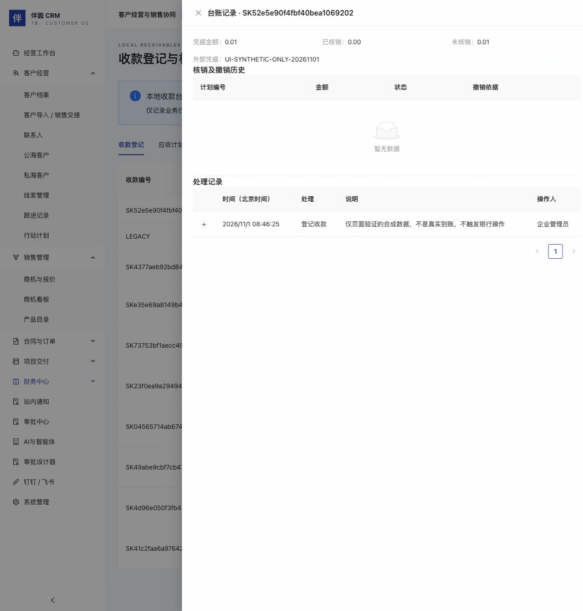
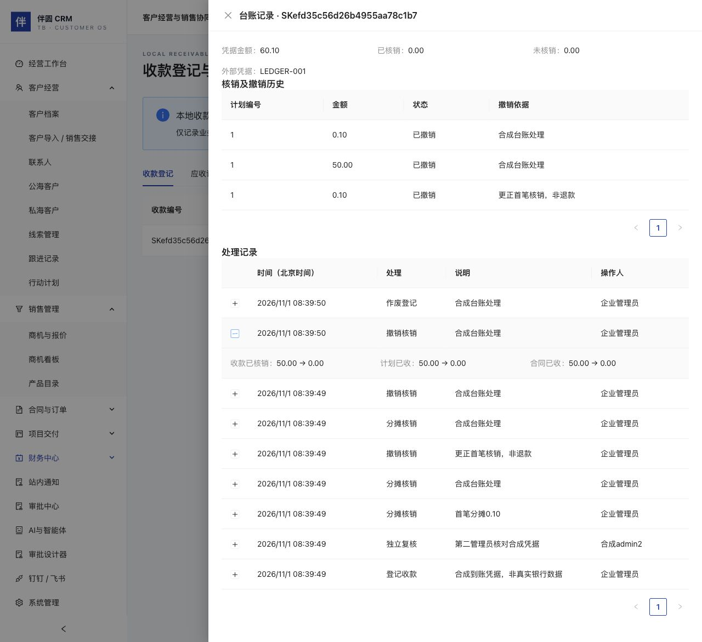

# 本地收款登记、核销与更正（C5 / C5.1 候选）

本批支持人民币银行转账凭据的人工登记、另一管理员复核、分摊核销、撤销核销及作废。系统只维护本地业务台账，不拉取或核验银行流水，不发起转账、退款、税务开票或会计凭证。发票、总账及外部对账仍为未开放功能，整套系统尚未商用验收。

## 使用前提

- 企业至少有两位有效管理员：一人登记，另一人核对凭据。管理员可在人员管理创建第二个管理员；正式账号使用独立强密码，不设置共享演示密码。
- 销售、主管、老板仍仅按原有本人/团队/企业范围读取财务数据，本批不额外授予财务写权限。所有写入口仅管理员可用。
- 合同已经签约，回款计划合计、已收、剩余金额及有效核销明细一致。合同变更审批中不能核销。
- 历史演示或外部导入记录保持只读，不自动变成本批可写台账，不根据演示数字伪造复核或银行证据。

## 登记与独立复核

财务中心 → 收款登记与核销 → 登记收款，选择客户、填写凭据金额、到账日期、外部到账凭据编号和登记说明。可选绑定合同，绑定后只允许该合同的回款计划核销；不绑定合同则可在同一客户的不同合同计划之间分摊。

金额以十进制文本传输，最多13位整数及2位小数，必须为正数；目前仅人民币，不提供币种或汇率转换。日期为有效YYYY-MM-DD。凭据编号最多50字，执行NFKC全角规范化及首尾空白去除；大小写保留，重复编号含已作废历史一律拒绝。已知历史记录中的相同编号也会阻断；历史未保存编号的记录无法自动查重，复核人仍需核对原始材料。

登记后为“待独立复核”，金额和客户等信息不允许直接改写。另一位管理员登录后核对凭据，再填写复核说明并确认。登记人本人不能复核；前端禁用本人记录的复核按钮，服务端再次检查身份。没有自动银行鉴权或自动到账确认。

## 分摊核销

已复核收款 → 核销，选择同客户计划和本次金额，核对收款可用余额、计划剩余及处理依据后提交。

系统在同一Serializable事务检查：

1. 当前用户/企业/会话和管理员身份有效，收款为本批登记且已复核。
2. 收款、计划及合同属于同一企业、同一客户，且满足可选合同绑定。
3. 收款与计划版本没有变化，合同没有待处理变更，计划未取消。
4. 收款已核销等于有效明细之和，未核销余额正确；每个计划的已收、剩余及合同合计一致。
5. 本次金额不超过收款可用余额或计划剩余。

提交后同步更新收款已核销/可用、计划已收/剩余与状态、合同累计已收/剩余，并保留核销记录、前后金额、操作者、依据、命令回执及审计。同一收款可多次分摊到同一计划，每笔单独留痕。并发争抢同一收款或计划只有符合当前版本及余额的请求可成功。

发现旧账不平时拒绝操作，不静默重算或抹平差异。需先核对原始记录，不能通过修改浏览器金额绕过。

## 撤销核销与作废

已复核收款 → 撤销核销，选择一笔有效核销并填写原因。第一版整笔撤销该核销，不提供部分撤销。原记录标记已撤销，保留时间、操作者和原因，余额同事务退回到收款、计划和合同。重复或并发撤销不能重复恢复余额。之后可重新分摊，生成新的明细，原历史不删除。

**撤销核销不代表退款**，不会向银行发出任何付款指令。

全部有效核销撤销后，可作废收款登记；待复核收款也可作废。作废后金额原值保留，可用余额为0，不能复核或核销；编号仍占用，防止同一到账凭据重复入账。需更正内容或重新开立时使用下述显式流程，不伪造新凭据编号绕过去重。真实退款与会计冲销仍未实施。

## 登记更正与同凭据重开

1. 管理员从当前登记点击“更正 / 重开”。若已经有后续更正，先从“记录”的凭据链进入当前登记。历史演示/外部导入记录不能直接转为可更正台账。
2. 先撤销全部有效核销；原合同审批变更处理中也需先完成或撤回。核销撤销不触发退款。
3. 修改客户、合同绑定、金额或到账日期，填写更正原因。须明确选择有效合同或清除绑定。原凭据编号不能修改；更正后的合同必须与客户一致并满足签约、余额和审批守卫。原绑定合同已经终止时，可以明确解除绑定，但不能继续向该终止合同核销。
4. 确认后系统在一个事务中作废原登记、创建同凭据的新待复核登记、推进凭据当前指针，并为两张记录保留前后对照和更正原因。原客户、合同、金额、日期、复核人、已撤销核销与原作废说明保留；不会覆盖成新值。
5. 新登记的录入人为本次更正管理员，复核状态清空，需另一管理员重新核对确认。更正人不能复核本人新登记；原登记人可以复核由另一人更正的新登记，仍保持本次录入与复核分离。

普通重复登记始终拒绝同一凭据。原登记永久保留唯一凭据指纹，另用凭据主记录指向唯一当前登记；更正不会释放编号或同时产生两张可用登记。已作废且没有后续更正的当前记录，可填原因按相同内容重开；未作废记录若内容没有变化则拒绝。多次更正形成可导航的链，不能从中间历史版本分叉。

更正并发、陈旧版本、跨企业引用或写后事件失败时，整个更正回滚，不留下孤立新登记、错误指针或成功回执。更正不改变此前撤销后的合同、计划余额；新登记必须重新复核后才可核销。

管理员与老板可按企业权限读取完整更正审计链，老板仍不能写入。销售和主管按原有记录范围读取；更正对照、跨客户原因、原始备注中的更正说明与链路指针不会通过另一客户的旧记录泄漏。网页、HTTP 与只读MCP使用同样的投影规则。

本流程只在同一实际银行凭据下更正登记分类和内容，不支持修改原银行凭据编号、合并不同银行凭据、真实退款或会计冲销。编号本身录错时保留错误登记及作废依据，再按真实有效凭据独立登记；跨凭据关联更正与合并后续提供。

## 查询、AI与边界

台账展示收款最近100条，明细及事件各最近100条，计划最近100条。历史完整保留在数据库；大规模分页、导出和账龄报表后续提供，当前列表不是全量汇总。客户/合同下拉也限最近100个可见对象。

处理记录显示北京时间、当时操作者姓名、依据及核销前后余额。原财务列表只读；税务开票、会计、银行、退款、完整财务期结和数据迁移更正仍未实施。

`/finance-ledger/schema` 提供版本化能力ID、输入输出schema、权限、效果、状态与证据。身份及企业只能来自认证上下文，写入共用持久幂等、版本、事务、会话重检和审计。既有只读MCP `workspace.get` 可按当前范围读取收款核销/撤销及财务事件；本批未增加智能体写工具或独立财务委托身份，未调用大模型。

## 升级与恢复

先备份，依次应用`202611010005_receivable_ledger`及`202611010006_receipt_corrections`，再启动匹配的新前后端。新增财务事件、收款管理标识/凭据指纹、核销撤销字段、更正前驱和凭据主记录；历史核销初始仍为有效，旧演示/外部收款保持不可写。不删除旧核销，不回填虚构到账编号。

更正迁移只为C5已经登记、具有指纹的台账建立原始/当前凭据关联，包含已作废记录；不把旧外部记录标为可写，不伪造复核或更正事件。已用上一版实际建立非空收款后执行升级检查，并验证更正链、凭据占用、事件及新待复核状态能经加密备份恢复到新库，旧会话不能访问恢复副本。

新核销支持同一收款/计划多笔历史，不能把旧版代码直接连接升级后的数据库；跨版本回退需按原版本备份恢复到新库并验证，不覆盖当前账。附件、自动银行/税务联调、独立财务角色和授权及全部商用验收仍待后续。

## 页面验证记录

独立3013合成测试站已核对待复核、本人复核禁用、历史只读、已作废及核销/撤销历史。页面实际提交一笔0.01合成登记，凭据`UI-SYNTHETIC-ONLY-20261101`，数据库精确保存0.01并保持待独立复核；不是真实到账、未触发银行操作。复核、核销、撤销及故障回滚的写入由真实HTTP/MySQL集成检查执行。

