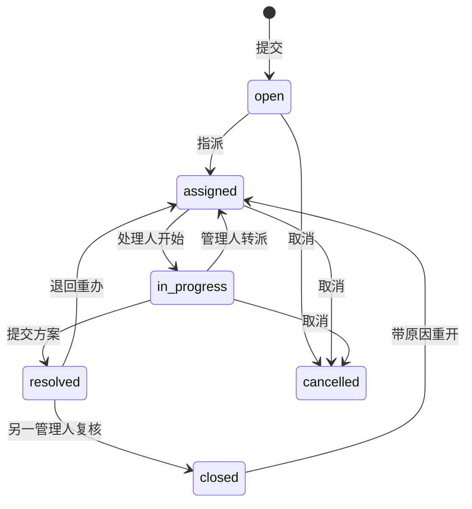
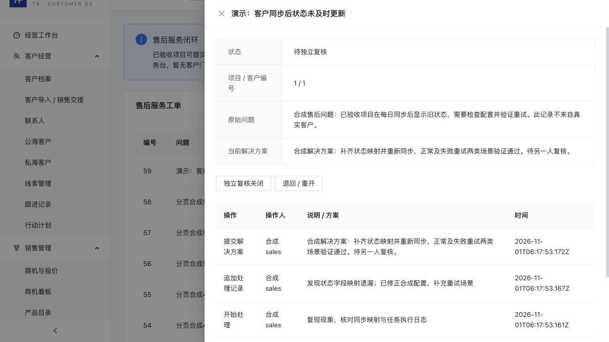

# 售后服务工单 · 第一批候选

这是内部售后服务台。只允许已通过新版独立验收、状态为已完成的项目提交工单；历史“已完成但无新版验收”项目不能跳过验收直接进入售后。工单不修改原项目验收、财务余额或合同。

## 操作

1. 在“项目交付 → 售后服务工单”点击“提交工单”，选择有权读取的已验收项目，填写标题、优先级、问题与复现步骤。
2. 项目经理、项目经理所在部门主管或管理员指派接收人。接收人必须是本企业有效账号、有有效部门及项目读写执行权限；非管理员只能选择相应部门人员。
3. 当前处理人点击“开始处理”，随时追加处理记录，再提交解决方案和验证结果。
4. 另一位有该项目管理权限的人核对记录后关闭。解决人即使是管理员也不能自己关闭；老板角色只读。
5. 复核不通过可退回；关闭后也可带原因重开。原解决方案与解决人保留在历史事件中，当前方案清空，重新处理并提交。
6. 未解决前可转派；转派回到已指派状态，新处理人开始处理。取消必须提供原因，取消后不再开放修改或重开。没有删除工单/历史的接口。
7. 离职、停用、调部门或取消执行权限前，需转派其所有未关闭/未取消工单。紧急撤销访问仍可重置密码，避免为了交接继续保留旧会话。

指派只授予这条工单的协作读取与处理权限，不授予完整项目、客户或其他工单。旧处理人转派后如没有其他可见基础，将失去读取和处理权限。主管不能利用工单协作权限管理其他部门项目。列表及历史每页50条，可继续加载。

## 状态与责任

所有成功写入在同一Serializable事务中保存工单、追加事件、幂等回执与审计；事件包含操作人姓名快照、前后状态和原因，重开另保留原方案。版本过期拒绝，重试相同请求返回原回执，同请求不同输入拒绝。回执重放仍校验实时人工会话和工单可见范围。说明文本始终作为数据，不解析其中的指令。

## 能力契约与边界

`GET /api/v1/service-tickets/schema`提供1.0版本的列表、详情、人员选择和八类写入JSON Schema、路由、权限、状态及证据要求。Web与未来代理适配器应复用ServiceTicketService；本批没有将售后写入开放到委托代理或MCP，也不允许机器人代替人工复核。

创建和处理需要project:update及实际业务编辑角色，读取需要project:read且满足企业/记录范围。身份由当前登录上下文提供，传入tenantId、createdBy等额外字段会被拒绝。

## 部署与验证

增量迁移`202611010010_service_tickets`仅新增工单与事件两张表，不改写历史项目、验收或人员。需要迁移后再启用新API；不要对现有数据重跑演示种子。正式加密SQL备份包含这两张表；恢复新库后重新登录，原库不会被自动替换。备份整体SQL128MiB上限仍适用。

`pnpm check`包含独立复核与状态边界自动化；`SMOKE_ALLOW_WRITES=true node scripts/service-ticket-smoke.mjs`只允许独立tb_crm_test_*数据库，使用明确标记的合成已验收项目，验证真实HTTP/权限/并发/故障回滚、人员交接、分页及非空加密恢复。上游完整立项到验收由既有业务回归覆盖；合成项目不代表客户验收签署。

本批暂无客户门户、客户签名、附件、SLA自动计时/升级、外发通知、费用/退款或自动派单。优先级为内部人工标记，不能作为承诺的响应时限。附件存储及恢复必须另行建设后验证，不能把文本工单历史当成附件备份。

