# 伴圆CRM演示手册

天雨阀门案例版

供主讲人和演示操作员使用。先选5分钟、20分钟或45分钟路线，再按12幕脚本操作。每幕列出账号、入口、检索词、点击步骤、讲解话术、可见结果和替代路径。

适用版本 0.3.0  源码 be9d011  资料日期 2026年11月16日

公司、人员、单据和沟通均为虚构演示数据。本手册所有操作图均取自天雨测试帐套。

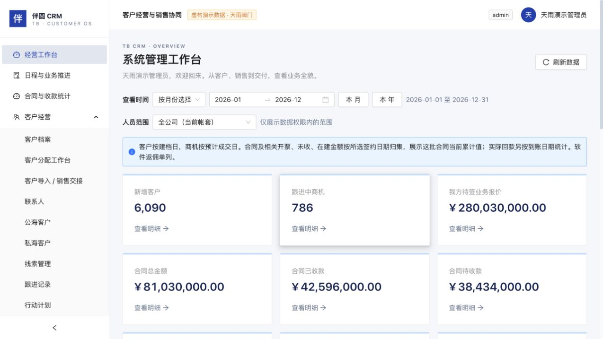

## 目录

- 一 选一条适合观众的演示路线
- 二 开场前准备和角色账号
- 第01幕  确认帐套和演示范围
- 第02幕  AI怎样把授权资料整理成客户经营过程
- 第03幕  过去的记录与未来的行动日程分开呈现
- 第04幕  客户归属与主管团队视图以及看板穿透
- 第05幕  多轮报价和未签草稿保留业务语义
- 第06幕  漏斗掉单明细帮助解释资源损失
- 第07幕  让合同开票回款数字说得清楚
- 第08幕  36类审批展示表单和人员处理全程
- 第09幕  从项目任务到验收和售后
- 第10幕  让AI在权限内提出建议并留下执行回执
- 第11幕  钉钉协同有配置对照和同步结果
- 第12幕  手机H5和下一步采用方式
- 三 天雨案例检索和金额依据
- 四 36类审批和16个业务字段
- 五 回答观众常见问题
- 六 演示结束后复盘

## 一 选一条适合观众的演示路线

### 5分钟产品亮点

**适合观众：** 首次接触产品的管理者

| 幕次 | 分钟 | 展示内容 |
| --- | --- | --- |
| S02 | 1 | 一份资料如何形成线索、报价版本和来源 |
| S03 | 1 | 过去跟进与未来行动日程 |
| S04 | 1 | 客户名字清楚的看板与团队范围 |
| S07 | 1 | 合同开票回款口径与穿透明细 |
| S08 | 1 | 或签结果及未审核人员状态 |

**操作取舍：** 不现场创建委托、导入新资料、修改权限或发起外部审批。

### 20分钟业务闭环

**适合观众：** 业务负责人及采购评估人员

| 幕次 | 分钟 | 展示内容 |
| --- | --- | --- |
| S02 | 4 | AI怎样把授权资料整理成客户经营过程 |
| S03 | 2 | 过去的记录与未来的行动日程分开呈现 |
| S04 | 3 | 客户归属与主管团队视图以及看板穿透 |
| S06 | 2 | 漏斗掉单明细帮助解释资源损失 |
| S07 | 3 | 让合同开票回款数字说得清楚 |
| S08 | 4 | 36类审批展示表单和人员处理全程 |
| S10 | 1 | 让AI在权限内提出建议并留下执行回执 |
| S11 | 1 | 钉钉协同有配置对照和同步结果 |

**操作取舍：** AI委托只展示真实只读查询和授权回执机制；现场写入、项目全验收与真实平台联调另约专项。

### 45分钟角色与协同深度演示

**适合观众：** 销售主管、管理层、财务及系统管理员

| 幕次 | 分钟 | 展示内容 |
| --- | --- | --- |
| S01 | 2 | 确认帐套和演示范围 |
| S02 | 5 | AI怎样把授权资料整理成客户经营过程 |
| S03 | 3 | 过去的记录与未来的行动日程分开呈现 |
| S04 | 4 | 客户归属与主管团队视图以及看板穿透 |
| S05 | 3 | 多轮报价和未签草稿保留业务语义 |
| S06 | 4 | 漏斗掉单明细帮助解释资源损失 |
| S07 | 4 | 让合同开票回款数字说得清楚 |
| S08 | 7 | 36类审批展示表单和人员处理全程 |
| S09 | 4 | 从项目任务到验收和售后 |
| S10 | 4 | 让AI在权限内提出建议并留下执行回执 |
| S11 | 3 | 钉钉协同有配置对照和同步结果 |
| S12 | 2 | 手机H5和下一步采用方式 |

**操作取舍：** 只有提前准备好的独立测试单可进行实际写入，真实企业连接仍需另行授权。

## 二 开场前准备和角色账号

1. 确认本机服务已启动、TIANYU用途为测试，基础v2、AI故事和审批追加包均安装；不要切入实际经营帐套。

2. 开场前依次检查“耐腐蚀调节阀三轮报价”“AI行动计划核对或签”“TY-HT-00010”“TY-XM-0008”能找到，避免临场翻找。

3. 预设日期为2026年；跨度核对可用2010至2060年，但讲解时用有业务意义的年度或月份，说明当前余额与历史日期口径。

4. 至少准备管理员、华东销售1、华东主管、老板四种角色的相互隔离浏览器配置；做项目和财务时增加ty_pm、ty_finance。没有隔离环境时依次退出重登，不在共享登录存储的多个标签中混用账号。

5. 所有公开测试账号密码12345；真实公司不得沿用。ty_finance是演示管理员，讲解时不得称其已经实现最小财务权限。

6. 如果演示新材料，事先准备一份完全虚构文本和对应预演清单；明确授权仅限此资料，不把材料中出现的指令当成新增授权。

7. 如果演示AI写入，先连接受信的外部客户端并准备独立测试客户；创建限时能力委托，不投屏密钥、密码或访问凭证。

8. 一般产品讲解不启用真实钉钉、飞书外发，不连接真实企业组织，不发送群消息、客户会议或财务操作。

9. 手机验证使用同一局域网的服务器IP；若只用浏览器窄屏，提前注明是布局展示。

10. 演示前做快照或备份并记录所用数据版本；不可现场运行初始化脚本覆盖已有帐套。

| 账号 | 人员编号 | 角色及使用场景 |
| --- | --- | --- |
| admin | TY00001 | 天雨演示管理员  管理员 |
| ty_boss | TY00002 | 天雨经营负责人  老板 |
| ty_mgr_east | TY00003 | 华东销售主管  销售主管类型 |
| ty_mgr_south | TY00004 | 华南销售主管  销售主管类型 |
| ty_sales01 | TY00005 | 华东销售1  销售类型 |
| ty_sales02 | TY00006 | 华东销售2  销售类型 |
| ty_sales03 | TY00007 | 华东销售3  销售类型 |
| ty_sales04 | TY00008 | 华南销售1  销售类型 |
| ty_sales05 | TY00009 | 华南销售2  销售类型 |
| ty_sales06 | TY00010 | 华南销售3  销售类型 |
| ty_pm | TY00011 | 项目交付负责人  销售主管类型 |
| ty_engineer | TY00012 | 技术协作演示  销售类型 |
| ty_channel | TY00013 | 渠道业务演示  销售类型 |
| ty_finance | TY00014 | 财务复核演示管理员  管理员 |

**账号说明：** 以上天雨演示账号密码统一为12345。它们只用于独立测试帐套，正式公司按实际权限与密码规则设置。

**财务角色：** ty_finance是具备管理员角色的演示财务复核账号；收款双人复核须换另一位管理员实际处理。它不代表已提供独立的最小权限财务角色。

**资料准备：** 完整场景由基础v2数据、12个AI资料故事、36类丰富审批、基础商机行动与合同路径组成。只装基础数据时，请先按公开包README补齐；不要借用真实公司数据填补演示缺口。

## 第01幕  确认帐套和演示范围

**操作准备：** 账号 admin  建议 2 分钟。入口：登录页 → 天雨阀门 → 经营工作台

**检索词：** 天雨阀门 TIANYU

**本幕目标：** 让观众先知道演示对象、角色和时间范围，避免用空筛选误判系统没有数据。

**讲解话术：** 这套展示用的是天雨阀门虚构业务。我们重点看AI如何把资料转成客户记录和下一步，再由权限、审批和经营台账承接结果。先把日期和人员范围说清楚，后面每个数字都能继续查到明细。

1. 打开本机 http://127.0.0.1:3000/login?company=TIANYU，确认公司为天雨阀门。

2. 用admin和密码12345登录，核对页头“虚构演示数据”和当前账号。

3. 经营工作台选择本年或指定日期；若已超出演示基准年，改为2026年或2010至2060年的核对区间。

4. 人员范围保持“全公司（当前帐套）”，指出老板和管理员默认全公司。

5. 将其他角色预先放在独立浏览器配置或隐私窗口，避免同一登录存储覆盖账号。

**让观众看到：** 工作台显示有权限的客户、商机、合同与收款卡片；页头标注天雨虚构数据。

**讲解员备用路径：** 若无法登录，先核对公司与密码；若服务不可用，使用手册截图讲解流程，不切到真实公司展示。

**讲解员提示：** 此步骤只读。所有演示账号密码12345仅用于专用测试帐套。；本手册针对be9d011功能版本和v2天雨数据，独立安装若只装基础包，没有后续12故事及246张丰富审批。

## 第02幕  AI怎样把授权资料整理成客户经营过程

**操作准备：** 账号 admin  建议 5 分钟。入口：销售管理 → 产品报价与项目知识 → 客户项目历程 / 会议与听记

**检索词：** 耐腐蚀调节阀三轮报价 或 泵站扩建初步选型

**本幕目标：** 从原始材料、事实、未知项和未来动作展示AI工作方式，而不是从静态客户列表开场。

**讲解话术：** 使用人不必把一次沟通拆成很多张表。他把获授权的资料交给AI，AI先分清这是谁的项目、发生过什么、哪些还不确定，然后生成待核对的历史记录和未来计划。这里能看到相同来源如何落到不同业务对象。

1. 在“产品报价与项目知识”的“客户项目历程”页签搜索“耐腐蚀调节阀三轮报价”，点资料标题。

2. 展开结构化内容，讲解客户、事项、关键问题、报价版本、来源日期和下一步；向下展示“来源与核实依据”。

3. 切到“会议与听记”页签，用同一事项关键词查看沟通和听记摘要，指出其来源编号与发生日期。

4. 再搜索“泵站扩建初步选型”，说明只有选型PPT、沟通和需求纪要，金额待核，所以先形成线索。

5. 对照云澜化工的三轮报价144000、156800、152600元，解释报价修订保留版本，当前152600元是报价，不是已签合同应收。

6. 若需现场新增材料，展示准备好的“仅本演示资料授权”文本，先由已连接的外部AI整理为预览清单；当场核对来源、客户和日期后再决定是否导入。不要在没有接好AI客户端时假装页面已经完成新推理。

**让观众看到：** 已安装的12故事、58份合成材料和82条知识中，可看到来源、事项、日期、版本及建议；未知价格保留待核状态。

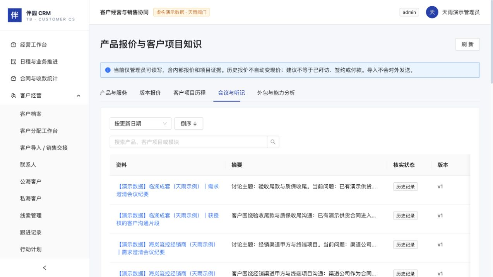

**讲解员备用路径：** 知识页只对管理员开放；若普通销售打不开，切回管理员讲资料整理，再用销售账号查看已分配的正式业务记录。若未安装追加包，使用公开workflow.json与本手册案例说明，不能声称现场已入库。

**讲解员提示：** 本场展示的是已安装的可复演合成结果，不是现场后台自动监听聊天或调用真实大模型。；PPT制作、报价修订属于内部工作，不冒充实际客户拜访。；知识导入页面只保存知识条目；它不会仅凭一段JSON自动生成全部客户、商机、合同和财务单据。业务对象由相应受控导入服务另行处理。

## 第03幕  过去的记录与未来的行动日程分开呈现

**操作准备：** 账号 ty_sales01 或 admin  建议 3 分钟。入口：客户经营 → 跟进记录 / 行动计划；日程与业务推进

**检索词：** 耐腐蚀调节阀三轮报价 泵站扩建初步选型

**本幕目标：** 展示AI整理的价值如何落到可执行的责任、日期和日程。

**讲解话术：** 过去发生过的沟通用原资料日期保存；未来要做的动作明确交给谁、准备什么时候做。日程是工作安排，不会被写成客户已确认的会议，也不会把催款计划写成已到账。

1. 在跟进记录中检索事项名或客户名，查看沟通摘要、内部修订记录、实际资料日期和下一步。

2. 打开行动计划，按事项关键词查找“待核对/待执行”的具体动作，展示执行人、拟定日期、内容和来源。

3. 把排序字段改为日期，用正序和倒序分别说明近期工作与较晚工作，不要求观众翻到最后一页。

4. 打开“日程与业务推进”，选择“列表”或“周视图”，查看相应日程主题、负责人和拟定时段。

5. 打开一项CRM计划日程，点击“查看对应行动计划”验证行动与日程关联，指出“行动已完成”和日程状态的联系。

**让观众看到：** 12故事追加34条历史跟进，36项AI建议行动对应36项本地日程；基础进行中商机另有1752项下一步，已签合同有240份成交路径。

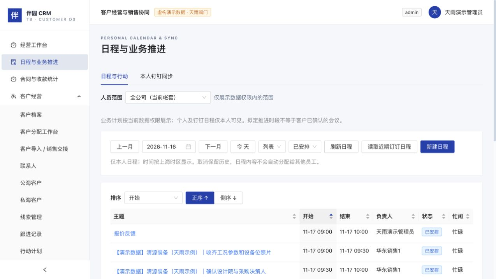

**讲解员备用路径：** 日程没出现在本周时，切换列表或下一周并核对人员范围。演示数据基准与现场日期不同，应先说明日期，不把无数据说成同步失败。

**讲解员提示：** 公开基础包与追加包数量不同；后续人工操作也会改变现场数量。；默认演示只用本地日程，不点击发送钉钉、创建外部会议或邀请客户。；展示计划时可读详情，避免随手点击“完成”改变后续演示状态。

## 第04幕  客户归属与主管团队视图以及看板穿透

**操作准备：** 账号 ty_sales01 → ty_mgr_east → ty_boss  建议 4 分钟。入口：销售管理 → 商机看板；客户经营 → 客户档案

**检索词：** 云澜化工 或 TY-KH-000002；华东销售主管

**本幕目标：** 用同一客户在不同角色下的可见范围说明功能权限与数据权限。

**讲解话术：** 数据权限沿客户和经营责任传递。销售看自己负责的业务，主管看自己团队，老板看公司。看板不是只有产品和金额，点客户或商机就能了解跟进过程和下一步。

1. 先用ty_sales01打开客户档案，检索云澜化工；核对客户负责人为华东销售1。

2. 进入商机看板，保持本人范围，卡片上展示商机名称、客户名称、金额、阶段与下一步。

3. 点击卡片上的客户名称进入档案，返回后点击“商机详情”或“查看跟进”，展示从看板进入业务过程。

4. 在主管窗口使用ty_mgr_east，按默认部门及下属范围查看；说明华东销售1至3的业务属于团队范围。

5. 在老板窗口使用ty_boss，选择全公司，再选华东销售主管；解释选择主管汇总其责任团队，显式选“本人”才收窄到主管本人。

6. 补充说明管理员通过客户分配工作台管理归属，能打开菜单并不等于能读取所有客户。只演示已有归属，不现场改变主案例负责人。

**让观众看到：** 主管看到的团队范围大于单个销售；老板可在授权范围内切换公司、部门或人员；卡片始终显示客户或“客户名字待核实”。

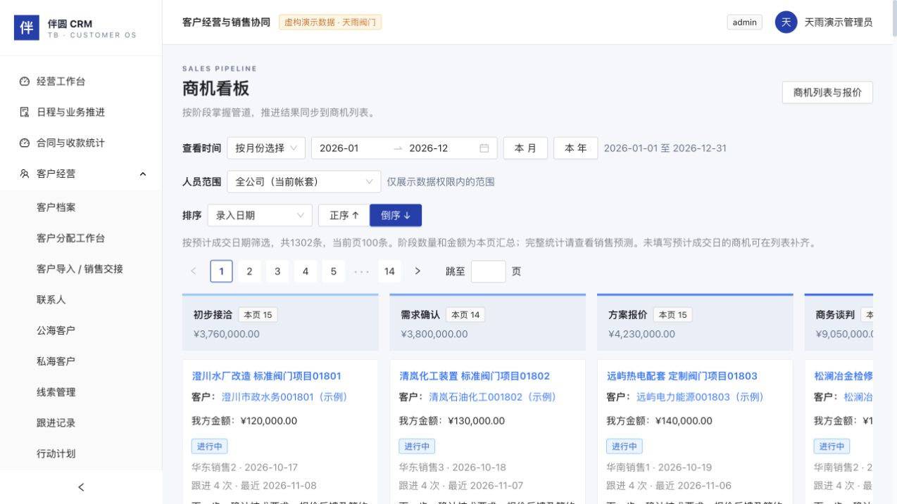

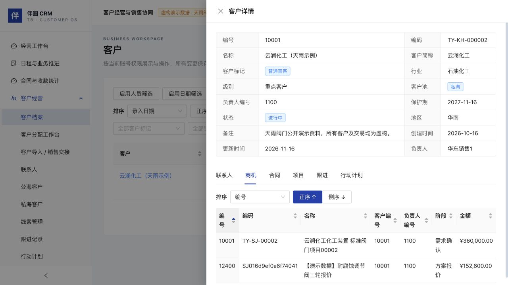

**讲解员备用路径：** 若看不到同一记录，先检查日期和显式人员筛选，再检查客户当前归属与角色。不要为了显示数据临时给所有人超级管理员。

**讲解员提示：** 客户归属变更不会把过去的跟进作者改成新负责人。；联系人、合同、财务和附件还各自受模块权限约束。；若客户主体待核实，只展示潜在线索、初步接洽或需求确认，不用不明客户冒充已确认方案或成交。

## 第05幕  多轮报价和未签草稿保留业务语义

**操作准备：** 账号 ty_sales01 或 admin  建议 3 分钟。入口：销售管理 → 商机与报价；合同与订单 → 合同管理

**检索词：** 耐腐蚀调节阀三轮报价；非标阀组试制服务合同草稿

**本幕目标：** 展示报价、合同草稿和正式应收的区别，保留变更过程。

**讲解话术：** 我们把销售推进过程保存下来，但不把报价直接当收入。多轮报价能解释范围变化，草稿能说明准备到了哪里；老板看到的应收只应来自有效的合同和单据。

1. 在商机与报价检索“耐腐蚀调节阀三轮报价”，打开事项。

2. 查看报价版本与对应的内部修订依据，依次展示144000、156800、152600元；核对当前版本。

3. 查看相关跟进记录，说明每一次修订在历史中保留，不覆盖旧报价，也不虚构客户拜访。

4. 在合同管理查找“非标阀组试制服务合同草稿”，展示17400元的草稿金额及未签状态。

5. 指出只有完成实际审批、签署和回款依据确认后，才进入对应正式业务状态；这份草稿不产生确定应收或已收款。

**让观众看到：** 三轮报价均可回溯；试制服务草稿明确未签，不混入有效合同应收。

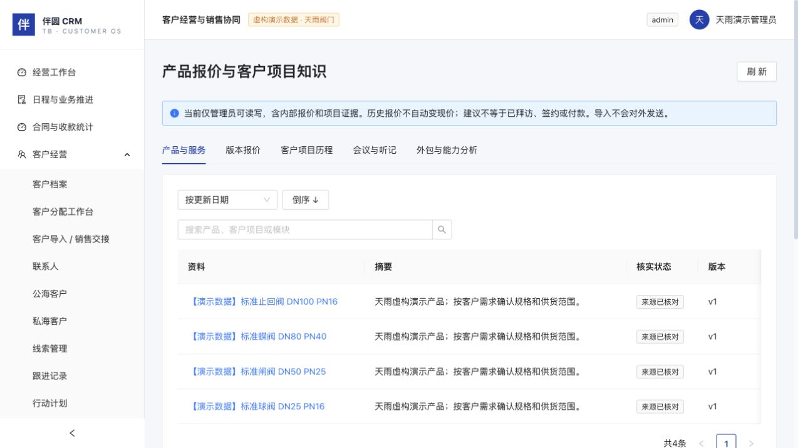

**讲解员备用路径：** 如果列表日期把导入事项过滤掉，清除日期过滤或选择宽区间；如果只找到基础合同，按完整事项名检索以免混淆云澜化工的另一份基础供货合同。

**讲解员提示：** TYAI-02报价事项与TY-HT-00002基础合同是不同事项，不把152600元改称基础合同金额。；17400元是12人天×1450元/人天的合成试制服务草稿总额，不是已回款。

## 第06幕  漏斗掉单明细帮助解释资源损失

**操作准备：** 账号 ty_boss 或 admin  建议 4 分钟。入口：合同与收款统计 → 商机报价与阶段参考 → 销售漏斗

**检索词：** 高温阀组紧急改造资源掉单；成套阀门商务评估掉单

**本幕目标：** 用一张漏斗统计穿透到商务掉单，说明技术资源不足造成的机会损失。

**讲解话术：** 掉单不是简单把状态改成失败。我们要看当时推进到了哪里、最后报价是多少、为什么放弃。这里两项独立机会的虚构报价合计575400元，但它代表未成交机会规模，不是已经亏损或应收坏账。

1. 打开合同与收款统计的“商机报价与阶段参考”页签，选择覆盖2026年资料日期的区间，并设置全公司或华东团队。

2. 找到销售漏斗表，按阶段查看数量和金额，点击掉单数量进入明细。

3. 在明细中搜索“高温阀组紧急改造资源掉单”，展示最后到达商务评估的依据、报价和丢单原因。

4. 再查看“成套阀门商务评估掉单”，指出报价316800元及能力/资源窗口问题；前者最终报价258600元。

5. 从对应记录返回商机、历史跟进或外包与能力分析，说明“不会接/暂时没有人手”也应形成可复盘资料。

6. 切换同一范围的排序，展示按名称或允许日期/金额排序及向后分页，避免只看第一页。

**让观众看到：** 漏斗中点击掉单后能看到具名客户、事项、最后阶段、报价和原因，并继续进入业务明细。

**讲解员备用路径：** 如果统计选择了太窄范围，使用2010至2060年核对范围；如果没有追加包，先用基础商机TY-SJ-01209、TY-SJ-01210演示明细，不报TYAI的金额。

**讲解员提示：** 两项TYAI最终报价258600+316800=575400元，仅指这两个合成案例，不能称全公司总掉单。；金额未知的事项单列，不用零或估价混进确定汇总。；不要把渠道来源项目金额都算成渠道甲方付给我们的收入。

## 第07幕  让合同开票回款数字说得清楚

**操作准备：** 账号 ty_finance 或 ty_boss  建议 4 分钟。入口：合同与收款统计 → 合同与回款经营统计；合同管理；财务中心 → 收款登记与核销 / 收款计划 / 发票记录

**检索词：** TY-HT-00010；TY-HT-00012；TY-HT-00007

**本幕目标：** 用通俗口径解释签了多少、开了多少、收了多少、还要收多少，再追到单据和下一步。

**讲解话术：** 老板最关心的是签了多少、已收到多少、合同还要收多少，以及开出去的票还有多少没收回。每个数字都能进入单据。渠道给我们的实施或外包费用属于我方业务，软件返佣和终端整体金额分别看。

1. 在合同与收款统计的“合同与回款经营统计”页签选择同一日期与人员范围，依次指认合同总金额、合同已收款、合同待收款、已开票金额、已开票已收款、已开票待收款。

2. 说明合同等指标按所选签约日期归集这批合同的当前累计值；按收款日期查看的已收款是另一口径，不能强行相减。

3. 点击相应数字或明细入口，定位TY-HT-00010雁川冶金合同，查看合同、开票、回款计划及实际收款的关联。

4. 再查TY-HT-00012青屿水利，展示质保尾款的下一步安排；金额以现场详情为准，避免把未来计划当实际收款。

5. 打开TY-HT-00007海岚流控经销商，说明它可以是付给我方钱的渠道甲方；终端680万元项目背景不能并入我方96万元基础合同，软件产品奖励单列。

6. 查看“收款登记与核销”，讲清登记、复核、分配核销和更正历史。正式演示以读为主，不实际作废或改写展示中的财务单。随后返回经营统计的谨慎预计收款表，按预计时间分组展示，解释已开票、已回过款、验收、逾期及日期完整性如何影响参考权重。预测不是承诺到账日期，也不是“100%一定成交”。

**让观众看到：** 统计可穿透到合同及收款依据，下一步行动能对应未收事项；不同金额口径有清晰说明。

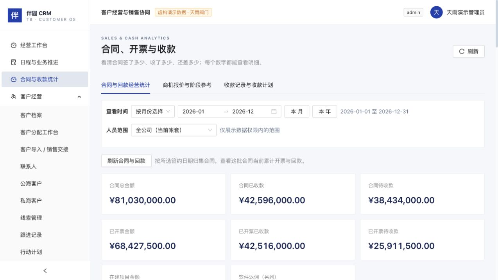

**讲解员备用路径：** 现场合成账号若没财务菜单，切ty_finance。没有看到金额时先核对日期、人员和业务分类，不能在演示中随意重新分类所有记录。

**讲解员提示：** ty_finance当前为演示管理员权限，不是权限最小化后的正式财务角色。；已开票待收款与合同待收款可能重叠，不能相加当作两笔收入。；界面有本地业务台账不等于已连接银行、税务或完整会计系统。

## 第08幕  36类审批展示表单和人员处理全程

**操作准备：** 账号 admin 查看；ty_sales01 发起；ty_mgr_east 或 ty_boss 按职责处理  建议 7 分钟。入口：审批设计器；审批中心 → 企业审批与交接

**检索词：** 天雨｜AI行动计划核对或签；技术图纸变更会签；部分已审仍在流转；转审后继续处理

**本幕目标：** 既展示能配流程，也展示一张申请的内容、多人规则与处理历史。

**讲解话术：** 审批不只是一个按钮。申请把要决定什么、变了什么、风险在哪里、批准后谁做和拿什么证明做完写明白。或签是一位有权人员同意即可，其他人留下未审核状态；会签要全部同意，管理员也不能替别人作决定。

1. 管理员打开审批设计器，查看已发布的天雨流程；按列表页码、排序和浏览器查找定位“技术图纸变更会签”及“AI行动计划核对或签”。

2. 打开可查看的流程定义或复制修改窗口，只展示16项业务字段、节点顺序和人员规则，展示结束关闭窗口，不发布无意修改。

3. 进入审批中心“企业审批与交接”，使用“加载更多审批”和浏览器查找定位AI行动计划或签的“已通过”或“补齐资料后重提通过”申请。

4. 打开申请，展示申请说明、来源、规格图纸、数量、付款条件、变更前后、风险和完成依据。金额作为通用申请信息单独展示，流程定义另有16个业务字段。

5. 在节点与交接中展示一人实际同意、同组另一人“未审核（或签已结束，无需处理）”；再打开会签或“部分已审仍在流转”申请，解释必须全员同意。

6. 查看同类事项的驳回、撤回、补齐资料后重提和转审记录，指出原记录、处理人、原因和时间都保留。

7. 如要现场发起新单，必须使用【现场测试】前缀的独立申请；由实际轮到的演示账号处理。原预置主案例用来只读讲解，不连续点同意把后续状态改掉。

**让观众看到：** 36类追加流程、246张申请覆盖待审102、通过72、驳回36、撤回36；含重提、部分已审和转交历史。基础合同、订单、立项流程另有记录。

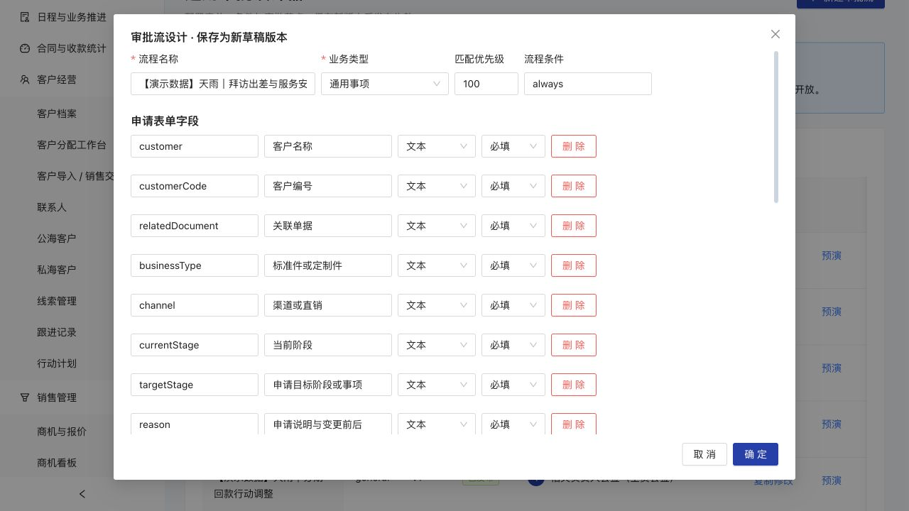

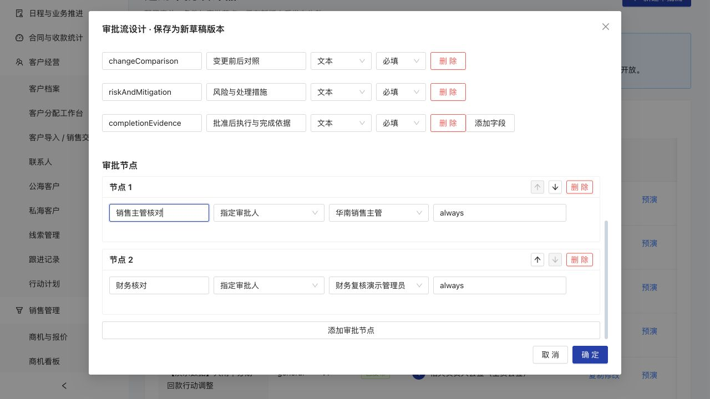

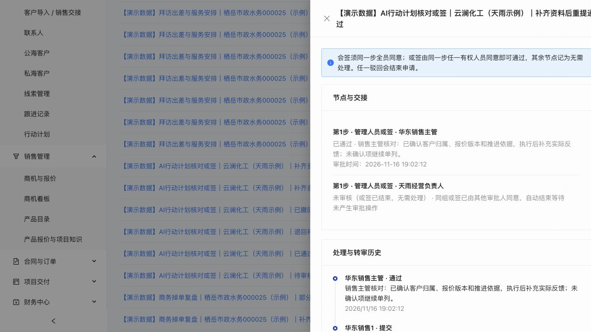

**讲解员备用路径：** 当前管理员“待我审批”为0并不代表没有审批：管理员默认不代替审批人，切“企业审批与交接”查看。审批中心没有通用搜索框，使用加载更多和浏览器查找。若要本人待办，切换到对应主管或老板账号。

**讲解员提示：** 当前通用申请的批准不自动等于已经发货、开票、到账或验收，业务命令各自校验。；申请人不能审批自己；转交不是代批。；测试帐套不连接真实外部审批，不发送群消息。

## 第09幕  从项目任务到验收和售后

**操作准备：** 账号 ty_pm；需要独立复核时另用ty_finance管理员  建议 4 分钟。入口：项目交付 → 项目总览 / 项目任务 / 售后服务工单

**检索词：** TY-XM-0002；TY-XM-0008；沧海化工；青屿水利

**本幕目标：** 把销售承诺之后的任务、交付、验收和售后连接起来。

**讲解话术：** 从商机进入交付，下一步不再是笼统“继续跟进”，而是具体任务、负责人、里程碑和验收依据。拒收后有整改，整改后重新提交；项目关闭后的问题用售后工单继续处理，原验收历史保留。

1. 用ty_pm检索TY-XM-0002沧海化工交付协同项目，打开项目和当前里程碑。

2. 在项目任务查看负责人、关联里程碑、任务状态、说明、结果和累计实际工时，解释按顺序推进。

3. 在项目详情查看交付与验收记录，说明未完成任务不能直接跨到最终验收；提交验收后冻结任务变更。

4. 查TY-XM-0008青屿水利的已验收状态，并说明项目负责人/提交人与独立验收复核人的职责分开。

5. 打开售后服务工单，展示已有工单及其项目关系，讲解售后不改写原验收事实。若无针对这一项目的工单，展示有记录的其他合成已验收项目，不临时虚构原工单。

**让观众看到：** 项目、任务、里程碑和交付记录关联可查；已验收项目进入售后而不是把旧事实覆盖掉。

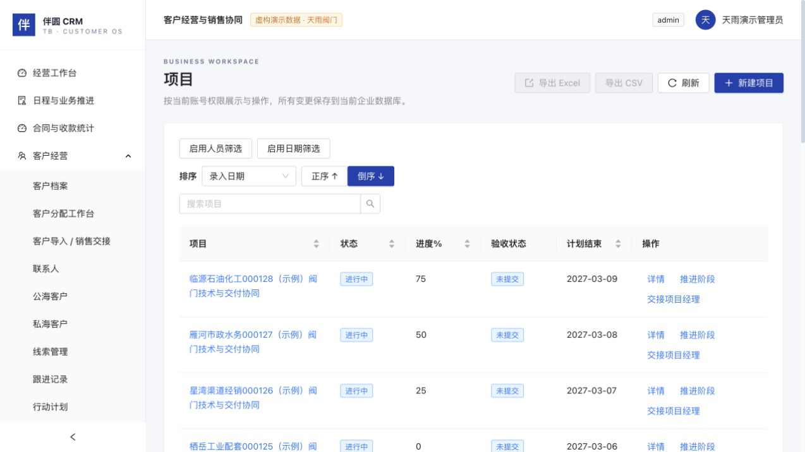

**讲解员备用路径：** 若当前任务尚未具备推进条件，只读展示约束说明，不以管理员跳过任务。要现场走完整写入链，应事先准备一个独立小测试项目、一个任务、一个里程碑和另一名合格验收人。

**讲解员提示：** 本场默认读取预置记录，不承诺现场几分钟完成长周期项目。；TY-XM-0008是预置已验收项目，不把其记录说成今天刚由两位用户完成。；工时是任务累计实际工时，不是工资核算或收费账单。

## 第10幕  让AI在权限内提出建议并留下执行回执

**操作准备：** 账号 admin 或有相应能力的本人账号  建议 4 分钟。入口：AI与智能体 → 真实能力接口调用 / 委托与停止开关 / 待核对建议与补偿 / 执行回执

**检索词：** 客户关键词 云澜；智能体委托 授权与执行回执

**本幕目标：** 用真实受控调用而非一张聊天示意图说明AI能够安全操作业务。

**讲解话术：** AI能做多少，由使用人授权多少，并且仍然受本人数据范围约束。建议、人工核对和执行分开，最后有业务记录和回执。我们既能追查AI做了什么，也能停止它继续调用。

1. 先在“真实能力接口调用”输入“云澜”并执行查询，展示当前账号权限内结果与执行编号；不把规则摘要按钮当作模型推理。

2. 打开“智能体委托、授权与执行回执”卡片，展示委托用途、能力、期限、预算和当前状态。

3. 若已准备安全的外部客户端，用独立限时委托提出一项【现场测试】行动建议；凭证只交给受信客户端，讲解时不投屏、截图或粘贴真实令牌。

4. 原委托人在“待核对建议与补偿”核对客户、日期、内容和版本，批准或拒绝；批准只表示授权，尚未创建业务行动。

5. 客户端执行已经批准的建议后，在“执行回执”和行动列表验证同一行动；展示重放同一请求不重复创建。

6. 演示结束撤销此次临时委托。若要取消尚未完成的测试行动，使用本人补偿入口，保留原建议与执行历史。

**让观众看到：** 真实客户能力查询有受限结果和执行编号；连接客户端时可展示预演、原委托人核对、执行和回执闭环。

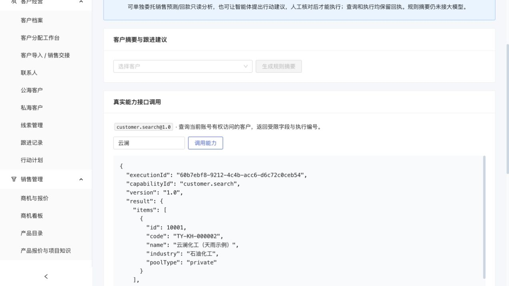

**讲解员备用路径：** 没接外部客户端时，完成真实只读查询并展示已有委托/回执（如果有）；没有已有回执就用本手册流程图说明执行方式，不能伪造一条“刚刚AI自动执行”的结果。

**讲解员提示：** 目前独立委托不开放任意SQL、财务改款、审批决定或无限对外发送。；预算是服务受理次数额度，不是模型Token或人民币费用。；撤销委托停止后续调用，不会自动删除已经执行的行动。

## 第11幕  钉钉协同有配置对照和同步结果

**操作准备：** 账号 admin；个人日程用本人账号授权  建议 3 分钟。入口：钉钉 / 飞书

**检索词：** 钉钉组织同步；本人日程与审批提醒；钉钉原生审批（局域网）

**本幕目标：** 展示组织同步、个人日程、待办和原生审批是分别可配置和验证的连接。

**讲解话术：** 和钉钉协作不仅是发群消息。我们把组织对照、个人日程、审批待办和原生审批分别配置，并保存结果。天雨是独立虚构帐套，今天只展示配置和流程；真实连接要用企业自己的应用与本人授权来验证。

1. 打开“钉钉 / 飞书”的“钉钉组织同步”，展示本机同步配置、部门人员对照表和历史结果区域。

2. 说明组织导入需核对人员映射、归属部门和账号状态；新增同步人员不会自动获得全公司权限。

3. 切到“本人日程与审批提醒”，讲解本人授权、当日起今后范围、日程去重、待办/提醒以及失败处理。

4. 切到“钉钉原生审批（局域网）”，展示本地流程与钉钉模板映射、校验/预演、后台读取和需人工核查状态。

5. 说明局域网CRM可通过服务器出站接口发送原生审批并读取结果；外部手机不必先直接访问本地CRM页面才能在钉钉实际审批。

6. 最后展示“企业应用接口（高级）”中的平台配置区域，说明飞书需按实际企业应用能力授权，不把组织预览自动等同于所有日程审批双向同步。

**让观众看到：** 配置、人员部门对照、预演、同步记录或未配置状态可清楚识别；不把未配置写成连接成功。

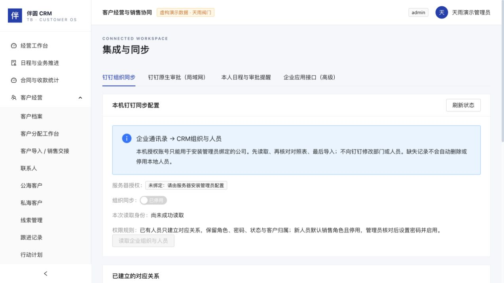

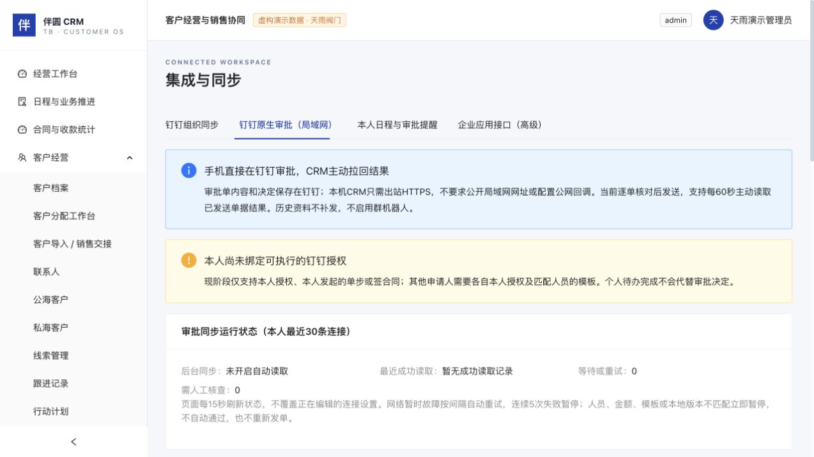

**讲解员备用路径：** 天雨没有真实企业凭证时，保持未配置界面，只展示字段与流程说明。使用此前已核验并可对外展示的合成截图作为辅助，不切入真实公司或把真实人员列表投屏。

**讲解员提示：** 本场不填写企业密钥，不点击真实外发，不临时拉群。；如果要进行真实原生审批联调，应另选明确标注的测试合同，取得本人发起授权，等待实际审批人决定。；日程和审批同步成功以回执为准，群机器人不是本次标准演示前提。

## 第12幕  手机H5和下一步采用方式

**操作准备：** 账号 ty_sales01 或ty_boss  建议 2 分钟。入口：同一CRM地址的手机浏览器H5

**检索词：** 手机导航 客户 行动 审批

**本幕目标：** 让观众理解桌面与手机是同一数据和同一权限，并知道怎样开始实际使用。

**讲解话术：** 销售在手机上也能看客户、记录推进和处理自己职责内的事项。今天的演示数据与桌面是同一套。正式启用先把组织权限和资料授权配好，再从一组真实客户开始验证，不需要一次搬完所有历史。

1. 手机连接与服务器相同的局域网，使用服务器局域网IP地址和端口登录天雨；手机不能用127.0.0.1访问另一台电脑。

2. 打开折叠导航，依次展示客户档案、行动计划和审批中心中的一项详情。

3. 说明手机与桌面共用当前公司、人员归属与状态校验，不因手机端而放宽权限。

4. 介绍系统管理中的外网入口配置可供将来设置VPN或HTTPS；当前未配公网入口时只讲局域网，不宣称外出已经可用。

5. 收尾回到一个客户的未来行动：授权资料、核对整理结果、执行下一步、看经营结果，说明这就是采用顺序。

**让观众看到：** H5能打开相同业务及详情，窄屏导航与列表正常；未来远程入口的状态明确。

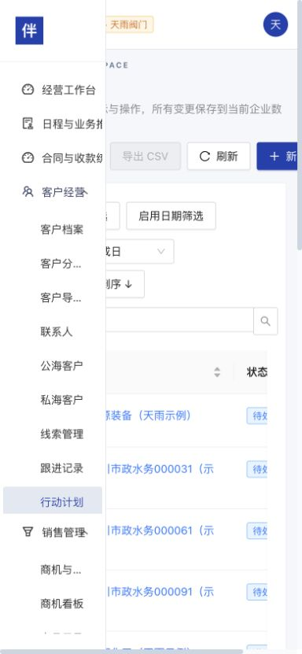

**讲解员备用路径：** 没有可用手机或同一局域网时，用浏览器窄屏展示H5布局并明确这是桌面窄屏核对，不冒称已完成异地手机联通。

**讲解员提示：** 外网入口保存不等于HTTPS证书、路由或VPN已真实联通。；结束后退出所有测试账号，撤销临时AI委托，并记录现场新增测试单据，勿清空整个帐套。

## 三 天雨案例检索和金额依据

### TYAI-01  泵站扩建初步选型

**客户：** 清源装备（天雨示例），编号TY-KH-000001，负责人华东销售1

**金额依据：** 金额未确认，先核对资料。金额待核，不填0，不年化

- 收齐工况参数和设备位照片

- 确认设计院与采购决策人

- 形成选型建议后再评估报价

### TYAI-02  耐腐蚀调节阀三轮报价

**客户：** 云澜化工（天雨示例），编号TY-KH-000002，负责人华东销售1

**金额依据：** 152,600.00元。本次独立事项的虚构报价总额；不是已确认应收

- 确认最终配置清单与图纸C版

- 核对152600元报价反馈及付款条件

- 技术确认后准备供货合同草稿

### TYAI-03  高温阀组紧急改造资源掉单

**客户：** 慕源电力（天雨示例），编号TY-KH-000003，负责人华东销售1

**金额依据：** 258,600.00元。本次独立事项的虚构报价总额；不是已确认应收

- 归档报价与客户要求的交付窗口

- 补齐高温密封试验和控制联调资源

- 有新窗口后先做产能评审再决定重启

### TYAI-04  非标阀组试制服务合同草稿

**客户：** 溪原水利（天雨示例），编号TY-KH-000004，负责人华东销售1

**金额依据：** 17,400.00元。本次独立事项的虚构报价总额；不是已确认应收

- 核对试制样件、测试标准及12人天范围

- 确认含税金额与两期付款约定

- 签章完成后另走正式签约与收款计划

### TYAI-05  水务阀组分期交付回款

**客户：** 澄源水务（天雨示例），编号TY-KH-000005，负责人华东销售1

**金额依据：** 沿用既有合同，不重复报价或成交。沿用既有演示合同；核对当前单据，不重复新增成交

- 核对供货批次签收与付款触发条件

- 跟进已开票部分的付款审批

- 取得到账凭据后由另一管理员复核核销

**关联单据：** 对应合同ID 10004；按当前单据核对金额、已收和未收，不将资料引用重复记业绩。

### TYAI-06  长周期装置项目技术变更

**客户：** 沧海化工（天雨示例），编号TY-KH-000006，负责人华东销售1

**金额依据：** 沿用既有合同，不重复报价或成交。沿用既有演示合同；核对当前单据，不重复新增成交

- 评审图纸D版对材料和交期的影响

- 形成变更前后范围及费用对照

- 按现有审批流程确认后再修改正式单据

**关联单据：** 对应合同ID 10005；按当前单据核对金额、已收和未收，不将资料引用重复记业绩。

### TYAI-07  经销渠道甲方与终端项目

**客户：** 海岚流控经销商（天雨示例），编号TY-KH-000007，负责人渠道业务演示

**金额依据：** 沿用既有合同，不重复报价或成交。沿用既有演示合同；核对当前单据，不重复新增成交

- 核对渠道甲方、终端业主与付款主体

- 按本公司合同核对开票和未收余额

- 产品奖励与服务供货收入分别记录

**关联单据：** 对应合同ID 10006；按当前单据核对金额、已收和未收，不将资料引用重复记业绩。

### TYAI-08  维保续费价格冲突核对

**客户：** 远澜能源（天雨示例），编号TY-KH-000008，负责人华东销售1

**金额依据：** 金额未确认，先核对资料。金额待核，不填0，不年化

- 与采购确认两份版本的先后和适用范围

- 明确维保期间、备件及响应约定

- 确认最终金额后形成新版报价

### TYAI-09  历史开票资料缺合同

**客户：** 星屿装备（天雨示例），编号TY-KH-000009，负责人华东销售1

**金额依据：** 金额未确认，先核对资料。金额待核，不填0，不年化

- 核对开票抬头与签约及付款主体

- 寻找订单、验收或历史协议依据

- 证据齐备后补合同草稿并按正常审批处理

### TYAI-10  成套阀门商务评估掉单

**客户：** 雁川冶金（天雨示例），编号TY-KH-000010，负责人华东销售1

**金额依据：** 316,800.00元。本次独立事项的虚构报价总额；不是已确认应收

- 整理低温测试与现场调试技能要求

- 复盘缺少的合格人员和排期窗口

- 建立合作资源清单，后续重新评审

### TYAI-11  验收尾款与质保收尾

**客户：** 临澜成套（天雨示例），编号TY-KH-000011，负责人华东销售1

**金额依据：** 沿用既有合同，不重复报价或成交。沿用既有演示合同；核对当前单据，不重复新增成交

- 核对验收报告和遗留问题清单

- 逐笔核对开票、已收与合同未收金额

- 与客户确认尾款及质保释放条件

**关联单据：** 对应合同ID 10010；按当前单据核对金额、已收和未收，不将资料引用重复记业绩。

### TYAI-12  渠道复购与现场服务报价

**客户：** 青屿水利（天雨示例），编号TY-KH-000012，负责人华东销售1

**金额依据：** 44,800.00元。本次独立事项的虚构报价总额；不是已确认应收

- 核对现场服务地点和停机窗口

- 确认44800元报价、人员及差旅范围

- 客户接受后准备独立服务订单

## 四 36类审批和16个业务字段

流程定义包含上述16个业务字段；通用申请金额另行展示。申请不是发货、开票、到账或验收事实。

| 序号 | 流程 | 规则 |
| --- | --- | --- |
| 1 | 天雨客户六步推进｜前期拜访 | 任意一人同意 |
| 2 | 天雨客户六步推进｜确定教练 | 按顺序审批 |
| 3 | 天雨客户六步推进｜核心公关 | 按顺序审批 |
| 4 | 天雨客户六步推进｜方案提供 | 按顺序审批 |
| 5 | 天雨客户六步推进｜达成合作 | 按顺序审批 |
| 6 | 天雨客户六步推进｜重复购买 | 按顺序审批 |
| 7 | 天雨｜客户建档申请 | 按顺序审批 |
| 8 | 天雨｜客户公海领取申请 | 全员同意 |
| 9 | 天雨｜客户转移申请 | 按顺序审批 |
| 10 | 天雨｜公司价值客户申请 | 任意一人同意 |
| 11 | 天雨｜户头资料变更 | 按顺序审批 |
| 12 | 天雨｜户头启用申请 | 按顺序审批 |
| 13 | 天雨｜户头停用申请 | 按顺序审批 |
| 14 | 天雨｜购货单位资料变更 | 按顺序审批 |
| 15 | 天雨｜购货单位启用 | 全员同意 |
| 16 | 天雨｜购货单位停用 | 按顺序审批 |
| 17 | 天雨｜项目预计金额变更 | 按顺序审批 |
| 18 | 天雨｜项目公海领取 | 按顺序审批 |
| 19 | 天雨｜定制阀门技术评审 | 任意一人同意 |
| 20 | 天雨｜报价与折扣评审 | 按顺序审批 |
| 21 | 天雨｜信用账期发运放行评审 | 按顺序审批 |
| 22 | 天雨｜分期回款行动调整 | 全员同意 |
| 23 | 天雨｜技术图纸变更会签 | 全员同意 |
| 24 | 天雨｜样件试验与验证 | 按顺序审批 |
| 25 | 天雨｜分批供货及交期调整 | 按顺序审批 |
| 26 | 天雨｜质量整改与复验 | 按顺序审批 |
| 27 | 天雨｜验收遗留事项收尾 | 全员同意 |
| 28 | 天雨｜质保金释放评审 | 按顺序审批 |
| 29 | 天雨｜渠道甲方供货与服务金额确认 | 全员同意 |
| 30 | 天雨｜渠道产品奖励核对 | 按顺序审批 |
| 31 | 天雨｜维保续费价格冲突核对 | 按顺序审批 |
| 32 | 天雨｜历史单据缺合同补录 | 按顺序审批 |
| 33 | 天雨｜资源不足放弃承接 | 全员同意 |
| 34 | 天雨｜商务掉单复盘 | 按顺序审批 |
| 35 | 天雨｜AI行动计划核对或签 | 任意一人同意 |
| 36 | 天雨｜拜访出差与服务安排 | 按顺序审批 |

246张丰富申请包含待审102、已通过72、驳回36、撤回36；其中包含重提、部分已审和实际转交。基础合同、订单及立项审批另有数据，不与这246张混为同一统计。

| 字段 | 类型 | 录入重点 |
| --- | --- | --- |
| 客户名称 | 文本 | 按申请事实与依据填写 |
| 客户编号 | 文本 | 按申请事实与依据填写 |
| 关联单据 | 文本 | 按申请事实与依据填写 |
| 标准件或定制件 | 文本 | 按申请事实与依据填写 |
| 渠道或直销 | 文本 | 按申请事实与依据填写 |
| 当前阶段 | 文本 | 按申请事实与依据填写 |
| 申请目标阶段或事项 | 文本 | 按申请事实与依据填写 |
| 申请说明与变更前后 | 文本 | 按申请事实与依据填写 |
| 依据与附件说明 | 文本 | 按申请事实与依据填写 |
| 拟定执行日期 | 日期 | 按申请事实与依据填写 |
| 阀门规格及图纸版本 | 文本 | 按申请事实与依据填写 |
| 数量及分批交付 | 文本 | 按申请事实与依据填写 |
| 付款及渠道往来口径 | 文本 | 按申请事实与依据填写 |
| 变更前后对照 | 文本 | 按申请事实与依据填写 |
| 风险与处理措施 | 文本 | 按申请事实与依据填写 |
| 批准后执行与完成依据 | 文本 | 按申请事实与依据填写 |

通用金额另作为申请输入，不属于上表16个自定义业务字段。顺序审批、或签和会签必须按本流程定义讲解，不能把或签免审人员说成已同意。

## 五 回答观众常见问题

### 01  这是不是只换一个界面的传统CRM

重点在工作入口。使用人把明确授权的沟通、听记、方案、报价和合同交给AI，AI整理来源、历史与下一步，再通过权限和状态受控的服务进入系统。传统客户、合同与财务页面仍负责核对和执行结果。

### 02  系统会自动读取所有钉钉飞书和录音吗

不会。外部智能体和连接工具只读取使用人已授权的范围。录音需要先取得使用授权并转写；天雨展示用的是独立虚构资料，不连接实际个人账号。

### 03  这里的历史记录是刚刚由AI现场生成的吗

标准路线展示已安装的确定性合成结果，便于复演和核查。现场新输入演示需要已连接的AI客户端、明确授权和导入预演，不能把预置结果说成刚刚的模型输出。

### 04  为什么生成规则摘要上写着未调用大模型

这个按钮根据系统记录生成规则摘要，主要用于快速概览。真正的模型理解发生在使用人选择并连接的外部AI入口，二者应分别说明。

### 05  有了知识资料导入是否就自动有合同和财务单据

知识导入保存资料、版本和来源。正式客户、商机、草稿合同、跟进、行动或财务单据各有自己的应用服务、权限和状态要求，不能只导入知识就假装签约或收款。

### 06  主管为什么能看销售而销售看不到其他人

主管按部门及下属责任团队读取；销售按本人及明确授权客户读取。功能权限控制能做什么，数据权限控制能对哪些记录做。导出和穿透沿用相同范围。

### 07  为什么渠道项目不全算渠道业绩

区分渠道来源、付款甲方和终端背景。若渠道作为甲方付给我方实施或外包服务费，这是我方业务；终端全部合同额不算我方收入，软件返佣另行统计。

### 08  或签后另一人为什么仍显示未审核

或签只需要同一步任一有权审批人同意。其他人没有作出决定，系统如实保留“未审核，或签已结束无需处理”，不能写成他们也同意。

### 09  审批通过是不是就代表已经到账或交付

通用事项审批表示内部决定。发货、验收、开票与收款各需要对应业务单据和实际依据；批准申请不会凭空产生交易事实。

### 10  局域网系统如何让外出的人在钉钉审批

可配置钉钉原生审批，由本地服务器出站调用并读取结果；实际决定在钉钉由本人作出。直接远程打开CRM页面则另需VPN或HTTPS入口，配置保存不等于已经联网验证。

### 11  这是财务软件吗

系统提供合同、发票记录、收款计划及本地收款复核核销台账，服务销售经营闭环。银行、税务、总账等外部财务能力须另行连接和验收。

### 12  能否让AI直接通过审批并代收款

不能。AI可以在被授予的业务能力内查询、提出建议并执行经过核对的内部行动；真实审批、签约、验收及银行到账由有权人员和相应依据决定。

### 13  手机端需另装App吗

CRM提供浏览器H5，同一公司数据和同一权限。局域网内可用手机浏览器访问服务器地址；外出访问需要实际配置并验证VPN或HTTPS入口。

### 14  新公司可以直接复制天雨当正式数据吗

天雨用于测试演示。正式公司应新建独立数据库和连接账号，配置组织与角色，逐批核对导入真实资料，不将虚构交易作为正式经营数据。

## 六 演示结束后复盘

1. 观众能说清AI的输入授权、历史整理、未来计划和受控执行分别发生在哪里。

2. 看板能看到客户名字，并进入商机与跟进。

3. 销售、主管、老板范围展示正确，没有临时扩成全部管理员。

4. 至少展示一个报价版本、一个掉单原因、一笔合同与收款的明细关系。

5. 至少展示一种或签免审、一个会签或部分已审记录、一次驳回/转交历史。

6. 已区分合同金额、合同未收、开票未收、已回款与未来计划，未把重叠金额相加。

7. 钉钉和飞书已配置与未配置状态如实说明，没有假称真实同步成功。

8. 演示结束退出测试账号、撤销临时AI委托，保留必要的现场测试回执。

9. 仅清理自己新增且可回退的现场测试单，不清空预置数据或影响实际经营帐套。

收尾时记录本次操作涉及的天雨记录编号。保留审批、核销与AI回执，不为恢复画面而直接删除历史。对外传播只使用本套虚构材料，不带真实经营资料或连接配置。
