# 伴圆CRM完整操作手册

天雨阀门案例版

供管理员、老板、销售主管、销售以及项目协作人员使用。每个任务按入口、前提、具体步骤、完成结果和排查方法编写，可按目录直接查找。

适用版本 0.3.0  源码 be9d011  资料日期 2026年11月16日

公司、人员、单据和沟通均为虚构演示数据。本手册所有操作图均取自天雨测试帐套。

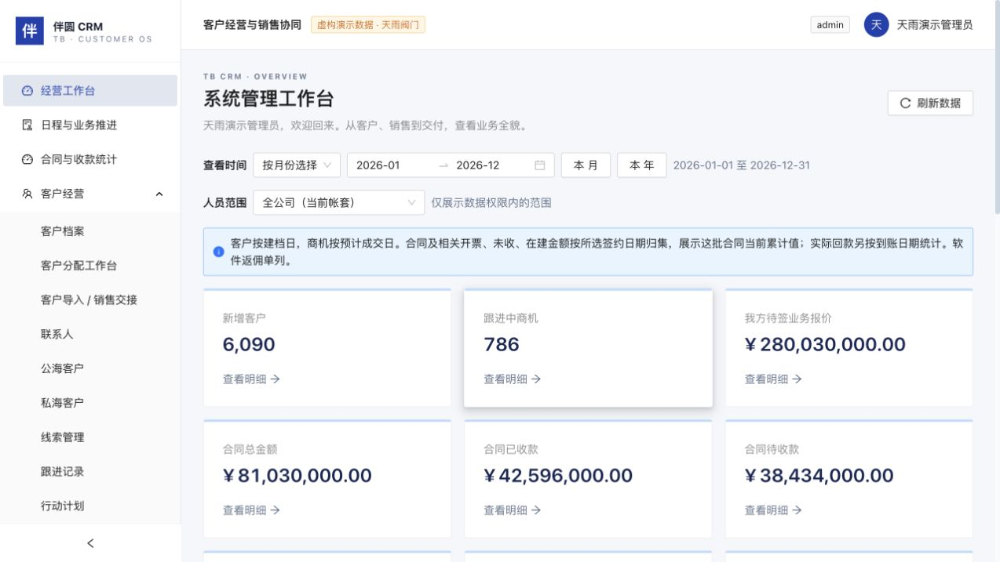

## 先学会使用这本手册

第一次使用，先读登录和查询筛选；管理人员再读组织权限和客户分配。按客户、商机、报价、合同、交付、开票、收款、行动的顺序理解业务。AI资料整理和审批独立成章，避免把一条建议当作已发生事实。

| 读者 | 推荐阅读顺序 |
| --- | --- |
| 销售 | 登录 → 查询筛选 → 客户联系人 → 商机报价 → 跟进与行动 |
| 销售主管 | 销售操作 → 团队范围 → 分配交接 → 审批与漏斗 |
| 老板 | 工作台与统计 → 合同开票收款 → 重点商机 → 审批 |
| 管理员 | 全部章节，重点组织权限、资料导入、连接配置、备份恢复 |

**使用原则：** 页面出现按钮取决于角色和记录状态；能够打开页面不等于能操作每张单据。金额来源、实际业务日期和拟定行动日期分别核对。

## 天雨演示账号

| 账号 | 人员编号 | 角色及使用场景 |
| --- | --- | --- |
| admin | TY00001 | 天雨演示管理员  管理员 |
| ty_boss | TY00002 | 天雨经营负责人  老板 |
| ty_mgr_east | TY00003 | 华东销售主管  销售主管类型 |
| ty_mgr_south | TY00004 | 华南销售主管  销售主管类型 |
| ty_sales01 | TY00005 | 华东销售1  销售类型 |
| ty_sales02 | TY00006 | 华东销售2  销售类型 |
| ty_sales03 | TY00007 | 华东销售3  销售类型 |
| ty_sales04 | TY00008 | 华南销售1  销售类型 |
| ty_sales05 | TY00009 | 华南销售2  销售类型 |
| ty_sales06 | TY00010 | 华南销售3  销售类型 |
| ty_pm | TY00011 | 项目交付负责人  销售主管类型 |
| ty_engineer | TY00012 | 技术协作演示  销售类型 |
| ty_channel | TY00013 | 渠道业务演示  销售类型 |
| ty_finance | TY00014 | 财务复核演示管理员  管理员 |

**账号说明：** 以上天雨演示账号密码统一为12345。它们只用于独立测试帐套，正式公司按实际权限与密码规则设置。

**财务角色：** ty_finance是具备管理员角色的演示财务复核账号；收款双人复核须换另一位管理员实际处理。它不代表已提供独立的最小权限财务角色。

## 目录

- 先学会使用这本手册
- 天雨演示账号
- 01  登录与个人安全
- 02  查找筛选排序与导出
- 03  公司组织与访问权限
- 04  客户档案联系人与归属
- 05  线索商机报价与日常推进
- 06  AI资料整理和受控执行
- 07  审批设计和实际流转
- 08  合同签约订单与变更
- 09  项目任务交付验收与售后
- 10  开票资料收款登记核销与更正
- 11  经营统计预测漏斗与回款分析
- 12  钉钉和飞书连接
- 13  部署维护与故障处理
- 附录一 业务闭环核对表
- 附录二 70个操作任务索引

## 01  登录与个人安全

先选对公司，再使用唯一账号登录。电脑和手机共用同一套身份与权限，显示姓名不作为登录身份。

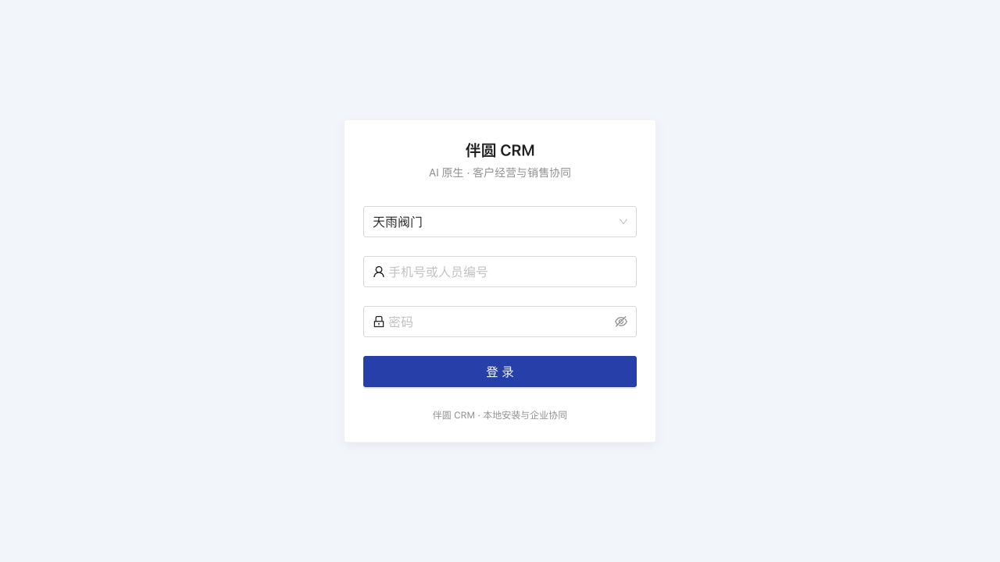

### A01  登录与切换公司帐套

**适用人员：** 全体人员。入口：登录页；右上角账号菜单 → 切换公司帐套

**完成目标：** 进入正确公司的业务空间，避免把资料录入另一家公司。

**开始之前：** 服务器已启动；公司帐套和个人账号有效。

1. 打开管理员提供的网址。本机可用http://localhost:3000，远程设备使用实际局域网或HTTPS地址。

2. 在“公司帐套”选择中文公司名称；演练时选择“天雨阀门”。

3. 输入唯一人员编号、已登记的完整手机号，或保留的兼容账号，再输入密码并登录。

4. 登录后核对页头公司名称、当前人员与可见菜单；发现公司不符时停止录入。

5. 切换公司时使用右上角“切换公司帐套”，结束当前会话后重新选择公司登录。

**完成后核对：** 页头显示正确公司与人员；该公司客户、审批及报表按当前权限显示。

**遇到问题：** 中文姓名不能登录：姓名仅展示，请改用人员编号或完整手机号。；号码没有返回或尚未登记：由管理员核对人员编号，不猜测钉钉脱敏号码。；连续失败被限制：核对公司和账号，等待限制解除或请管理员重置密码。

**操作提示：** 天雨预设测试账号密码为12345；正式新建及重置密码遵守系统强密码要求。；公司编码用于路由，不是访问其他公司数据的授权。

### A02  修改密码与退出设备

**适用人员：** 全体人员；管理员可重置其他人员。入口：右上角账号菜单 → 账号与安全

**完成目标：** 保护自己的会话，并在设备丢失或人员风险时停止访问。

**开始之前：** 知道原密码；修改时仍保持有效登录。

1. 进入“账号与安全”，先查看本人有效会话。

2. 在“修改密码”填写原密码、新密码及确认值；新密码至少12位，含大小写字母和数字。

3. 提交成功后，全部设备会话失效，使用新密码重新登录。

4. 仅结束本机使用时选择“退出登录”；需要清除所有本人设备时使用“退出全部设备”。

5. 管理员为他人处理风险时，进入“系统管理 → 用户账号”，展开人员行，选择“重置密码并撤销全部会话”，核对人员后确认。

**完成后核对：** 修改或重置后，旧会话不能继续访问；人员需使用新密码重新登录。

**遇到问题：** 保存提示版本变化：刷新后重新填写，不反复提交旧表单。；退出未获服务器确认：按提示重试，不能只关闭页面就认定会话已撤销。

**操作提示：** 系统不会显示原密码或密码哈希。；离职账号停用前仍须完成客户、审批和交付责任交接；重置密码可先紧急撤销访问。

### A03  用手机H5访问与核对

**适用人员：** 全体人员。入口：手机浏览器 → 实际服务器地址

**完成目标：** 在手机上查看业务、处理权限内的工作。

**开始之前：** 手机与服务器在同一局域网，或已具备有效VPN/HTTPS入口。

1. 向管理员取得帐套管理页显示的局域网地址，不把手机自己的localhost或127.0.0.1当服务器地址。

2. 手机浏览器打开地址，选择公司，使用与电脑相同的个人账号登录。

3. 展开导航进入客户、行动、日程或审批；小屏日程优先使用列表。

4. 对宽表格横向滚动查看完整字段；先核对客户和单据标题，再做允许的编辑或审批。

5. 操作完成后刷新核对结果，需要结束使用时退出登录。

**完成后核对：** 手机与电脑看到同一公司、同一权限下的记录和最新状态。

**遇到问题：** 手机打不开：核对是否同网、服务器是否开机、IP是否改变和系统防火墙设置。；外出访问不了局域网地址：需管理员完成VPN或HTTPS配置；不能靠输入局域网IP实现外网访问。

**操作提示：** H5是浏览器界面，不要求安装原生手机App。；浏览器响应式验证不等于所有实体手机、Wi-Fi和外网环境均已验收。

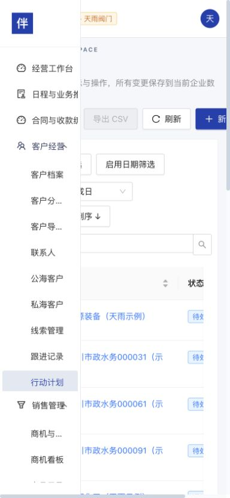

## 02  查找筛选排序与导出

先把公司、人员、日期及显示顺序选对，再解释列表和金额。筛选只缩小已有权限，不能增加查看权限。

### B01  查找记录并限定日期与人员

**适用人员：** 管理员、老板、销售主管、销售。入口：各业务列表及合同与收款统计

**完成目标：** 快速定位自己的记录或有权查看的团队数据。

**开始之前：** 已进入正确公司帐套；当前角色拥有对应模块读取权限

1. 在客户、商机、合同或行动等列表的搜索框输入名称或编号，执行搜索。

2. 需要限定时间时点击“启用日期筛选”，选择日期依据；例如合同用签约日期，行动用计划完成日。

3. 选择起止月份或日期，可用“本月”“本年”；支持2010至2060年。

4. 需要限定人员时点击“启用人员筛选”；在有权范围内选本人、人员、部门或全公司。统计页直接使用“人员范围”。

5. 核对筛选条件、总条数和当前页；从工作台或统计点进来的明细会携带相应条件，不要漏看这些条件。

**完成后核对：** 列表重新加载并回到第一页，显示当前权限与筛选共同限定的数据。

**遇到问题：** 有全公司权限却显示少：先检查是否显式选了本人、旧日期或搜索词。；主管默认看本部门及下属；管理员或老板选择另一位主管姓名（标注含下属团队）可看其经营责任团队；显式“本人”只看本人。

**操作提示：** 老板、管理员在统计页默认公司，主管默认部门及下属，销售默认本人。；个人手建和钉钉来源日程仍仅本人可见，不因公司经营权限而公开。

### B02  将最新记录排到前面

**适用人员：** 管理员、老板、销售主管、销售。入口：业务列表或统计表的排序区

**完成目标：** 按日期、金额或名称正序和倒序查看，不必翻到最后一页。

**开始之前：** 当前页面已有匹配记录

1. 找到“排序依据”，按实际目的选择录入日期、更新日期、计划日期、金额或名称等可选项。

2. 要把最近的记录放在前面，选相应日期并点击“倒序”；要按最早计划先办，点击“正序”。

3. 支持排序的列也可点击表头箭头切换方向。

4. 翻到下一页核对，分页列表是先排序匹配结果再取当前页；切换排序会回到第一页。

**完成后核对：** 日期可早到晚或晚到早，金额可小到大或大到小；空日期、未知金额在末尾。

**遇到问题：** 某日期不在排序选项：该资源没有开放此字段，使用页面提供的选项。；商机看板显示的是当前100条卡片的阶段汇总，不是公司全量合计。

**操作提示：** 行动计划默认计划日期正序，普通业务列表通常默认录入日期倒序。；“最近30条”等关联记录的排序只覆盖明确显示的限量范围。

### B03  导出当前页Excel或CSV

**适用人员：** 管理员、老板、销售主管、销售。入口：业务列表或支持导出的统计明细

**完成目标：** 把已核对的当前页记录导出给同事使用。

**开始之前：** 拥有页面读取权限；已选好日期、人员、排序和页码

1. 先核对当前筛选、显示字段和记录行，必要时先调整排序。

2. 点击“导出 Excel”；表格带列名，金额通常可求和，编号和前导零按文本保留。

3. 需要CSV时点击“导出 CSV”；使用Excel查看优先采用Excel文件。

4. 需要其他页时先在页面翻页，再分别导出；收到文件后核对行数和首末记录。

**完成后核对：** 文件仅包含当前权限、当前筛选下的当前页数据，文件名含“当前页”。

**遇到问题：** 导出条数比总数少：本功能不是全量导出，需先翻页。；超长精确金额可能按文本保存，避免表格软件丢失有效位。

**操作提示：** 导出不会改变业务数据，也不能代替数据库备份。；不要去掉CSV中的文本保护标记后随意执行公式。

## 03  公司组织与访问权限

公司隔离、功能权限和数据范围分别控制。客户归属决定业务责任；看到页面或成为部门负责人，并不等于可以代替其他人员作决定。

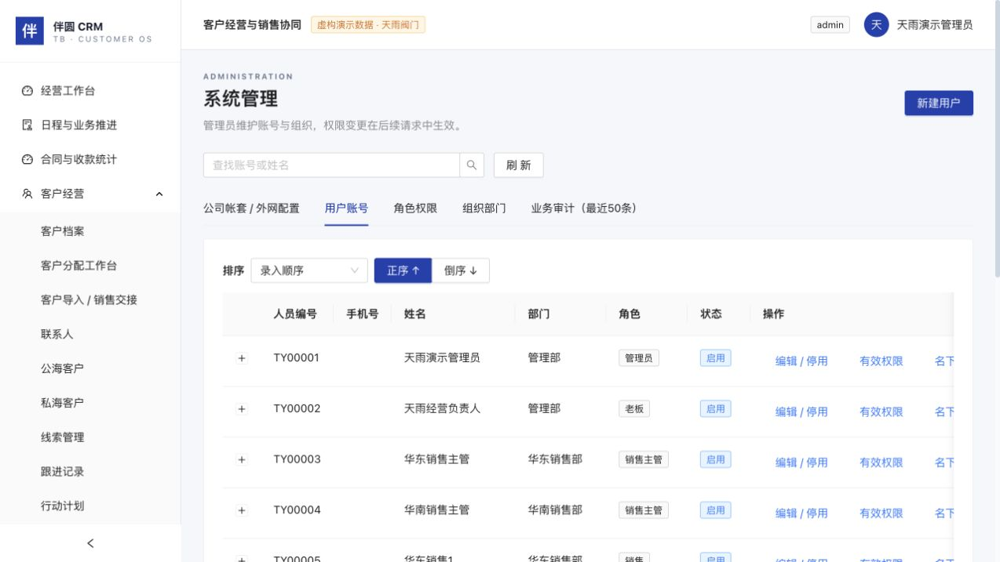

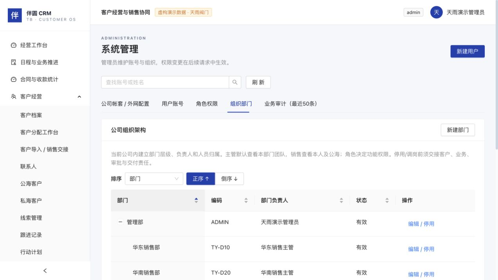

### A04  建立独立公司帐套

**适用人员：** 服务器本机安装管理员。入口：服务器本机 http://localhost:3000/__accounts

**完成目标：** 为新公司创建独立MySQL数据库、独立数据库账号和空业务空间。

**开始之前：** 完成Node24、pnpm11.25.0和MySQL8安装；具有本机独立管理口令。

1. 在服务器本机打开帐套管理页，使用本机管理口令验证；员工CRM账号不能替代该口令。

2. 填写2至30位大写公司编码、中文公司名称，并选择正式业务或测试验证用途。

3. 点击“创建独立帐套”，等待数据库、连接账号、结构迁移和首个管理员初始化完成。

4. 妥善保存创建结果及本机账号说明文件中的初始管理员账号；不要发布口令和连接文件。

5. 公司显示就绪后进入登录页，用该公司管理员登录，再建立部门和人员。

**完成后核对：** 出现独立公司入口，正式业务表为空，不带其他公司的客户、合同或凭证。

**遇到问题：** 编码已存在：不能覆盖原帐套，先核对是否已建立。；初始化未完成：保留失败资源和日志，由运维核查，不删除其他公司或把失败目录当空安装。

**操作提示：** 每家公司独立MySQL数据库和连接账号，共用本机MySQL服务；不是同库加一个公司字段。；当前默认安装配置最多10个帐套，不作为容量承诺。

### A05  建立部门层级和负责人

**适用人员：** 管理员。入口：系统管理 → 组织部门

**完成目标：** 形成公司内部部门树，供人员归属、团队查看和负责人审批使用。

**开始之前：** 当前公司管理员已登录。

1. 点击“新建部门”，填写部门名称、编码和可选上级部门。

2. 先保存部门；尚无有效成员时暂不指定负责人。

3. 将人员创建或调整到该部门，再返回部门行点击“编辑”。

4. 选择本部门有效成员作为负责人，核对上级关系后保存。

5. 查看组织列表，核对层级、负责人、有效状态；用主管账号核对所管理团队的业务范围。

**完成后核对：** 部门层级无循环，人员和负责人清楚；主管团队统计能按当前组织关系展开。

**遇到问题：** 上级或编码冲突：检查是否重复、跨公司或造成循环。；部门无法停用：先迁移有效成员和下级部门。；负责人不能选择：确认该人员属于当前部门且有效。

**操作提示：** 组织负责人和销售负责人是不同概念，指定部门负责人不会把下属客户改归其名下。；部门负责人节点仍校验实际审批权限；人员调岗后应重新核对负责人。

### A06  添加人员并设置角色

**适用人员：** 管理员。入口：系统管理 → 用户账号 → 新建用户

**完成目标：** 建立可登录、可承担业务责任的真实人员账号。

**开始之前：** 已有有效部门；已决定该人员的岗位角色。

1. 点击“新建用户”，填写唯一账号、真实姓名及可用完整手机号；姓名只用于展示。

2. 设置至少12位且含大小写字母和数字的初始密码，通过安全方式交给本人。

3. 选择部门，并在“角色（四选一）”中选管理员、销售主管、销售或老板之一。

4. 保存后查询人员，核对系统人员编号、手机号、部门、角色及状态。

5. 让该人员实际登录，确认看到正确公司和菜单；钉钉导入的新人员须先核定部门、重置密码并启用。

**完成后核对：** 人员获得唯一编号及确定角色；不会仅因与外部管理员同名而获得CRM管理员权限。

**遇到问题：** 手机号重复或跨账号歧义：核对完整号码后更正，不以中文姓名替代。；账号停用不能登录：确认启用依据及未完成交接，再由管理员调整状态。

**操作提示：** 一人当前选择一个预置角色；不支持随意叠加多个角色规避权限规则。；老板定位是公司业务查看与有权审批，不等于管理员维护权限。

### A07  配置功能权限并核对数据范围

**适用人员：** 管理员。入口：系统管理 → 用户账号 → 有效权限；角色权限

**完成目标：** 把“能做什么”与“能看谁的数据”分别配置并实际核对。

**开始之前：** 已建立人员、部门及角色；了解该角色有哪些未完成职责。

1. 在人员行点击“有效权限”，核对所属角色、部门、数据范围、业务权限和名下客户数量。

2. 点击“配置所属角色权限”或进入“角色权限”，选择销售或销售主管。

3. 按业务勾选查看、新增、编辑及特殊操作，再选择角色数据范围。

4. 保存前核对影响人员数量；配置影响该角色所有成员，并撤销他们的旧会话。

5. 让受影响人员重新登录；分别用普通销售、主管和老板核对客户、看板、报表及明细。

6. 在统计页显式选择本人、部门、主管团队或公司范围，确认候选和结果均在当前授权内。

**完成后核对：** 功能和数据范围一致：销售看本人及已授权记录，主管看管理团队，老板或管理员可看当前公司业务。

**遇到问题：** 列表或看板没数据：先核对当前公司、日期、人员筛选和客户当前负责人，再查功能读取权限。；撤权被拒绝：先转交待审或交付责任，不跳过职责检查。

**操作提示：** 当前统计默认：管理员和老板全公司，部门范围本部门及子部门，个人范围本人；显式“本人”仍只看自己。；选中主管时可统计其管理团队，不改变下属记录归属。人员筛选不能授予额外权限。；管理员和老板保留固定职责；尚无任意自定义角色、逐字段权限或逐人独立权限覆盖。

### A08  批量给销售分配客户

**适用人员：** 管理员；有权销售主管。入口：客户经营 → 客户分配工作台

**完成目标：** 把尚无关联销售业务的客户整体分配到合适销售。

**开始之前：** 接收人有效、部门有效，并具备客户查看及编辑资格。

1. 按客户名称、当前负责人和公私海筛选；可从人员“名下客户”进入同一工作台。

2. 勾选本页1至50个客户，检查客户当前归属。

3. 在“选择接收销售”选择人员，并填写必填分配原因。

4. 点击“预览分配影响”，核对前后负责人、公私海及会受影响的范围。

5. 确认后刷新客户和分配记录，再以接收人身份核对可见性。

**完成后核对：** 客户、部门、公私海及私海持有记录同步更新，保留分配原因和前后归属。

**遇到问题：** 提示有关联业务：转到“有关联业务：整体交接”，不能只改客户负责人。；接收人不可选：核对其启用、部门、销售资格及当前操作者范围。

**操作提示：** 主管只能在当前授权范围处理，管理员可跨部门分配；不会向其他公司分配。；最近50条分配记录只显示当前有权查看的客户，历史记录不扩大数据权限。；主管接收销售仅限自己所在的同一直接部门；跨部门或子部门接收人由管理员处理。统计可见范围不等同于分配操作范围。

### A09  调岗离职前完成职责交接

**适用人员：** 管理员；有权销售主管。入口：客户导入 / 销售交接；审批中心；项目及售后；系统管理

**完成目标：** 在停止账号前移交全部未完责任，同时保留历史作者和决定。

**开始之前：** 已确认接收人员和交接范围。

1. 在人员“有效权限”和“名下客户”查清客户及当前销售责任。

2. 无关联业务用客户分配；已有商机、合同、订单等用“客户导入 / 销售交接”预览并执行整体交接。

3. 分别移交项目经理、未完成任务与售后工单；销售归属交接不替代这些职责。

4. 进入“审批中心 → 企业审批与交接”，转交当前及后续尚未处理的节点。

5. 确认未完职责已处理后，编辑人员部门、角色或停用／离职状态，并让接收人核对待办。

**完成后核对：** 旧人员不能继续访问；新人员承担其对应职责；历史跟进作者、审批意见和业务单据保留。

**遇到问题：** 停用或调岗被拒绝：按提示逐项处理仍归该人员的业务、待审或交付职责。；紧急访问风险：先由管理员重置密码撤销全部会话，再完成交接。

**操作提示：** 不要删除人员和单据来消除未完责任。；转交审批不会同时转移客户或项目归属；各类职责独立核对。；主管整体交接限同一直接部门；子部门或跨部门接收人及关联业务由管理员处理。

## 04  客户档案联系人与归属

客户既是业务主体，也是联系人、商机、合同和跟进的关系入口。客户负责人、历史作者、项目经理各有独立含义。

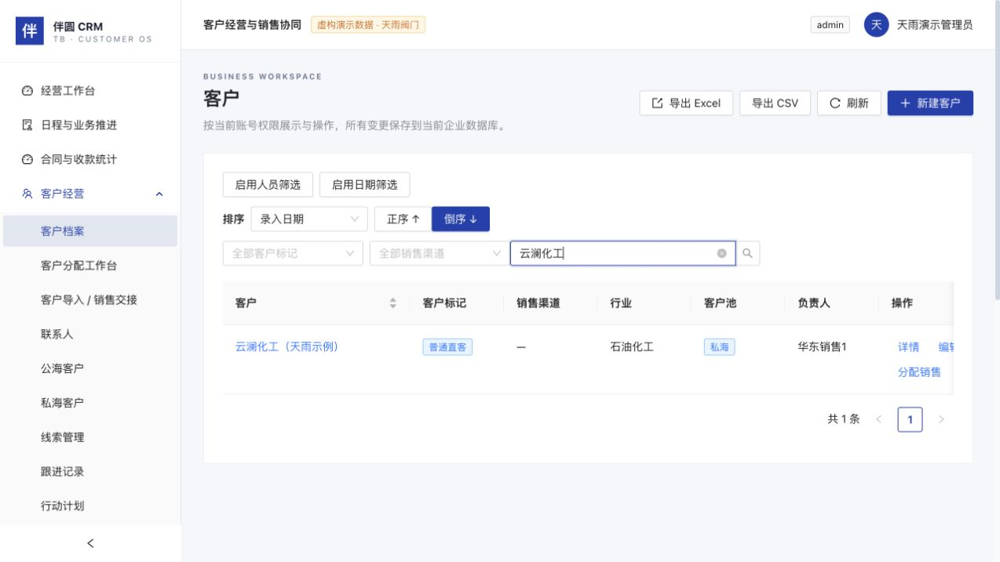

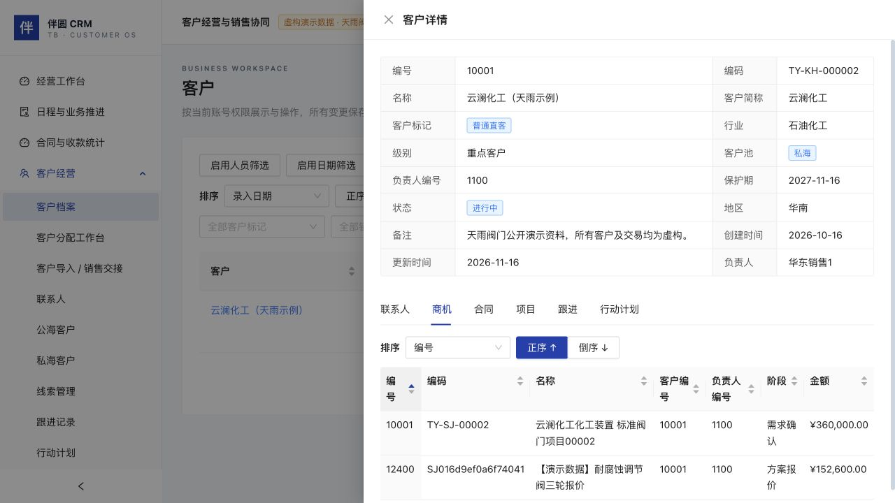

### B04  新建客户并核对重复主体

**适用人员：** 管理员、销售主管、销售。入口：客户经营 → 客户档案 → 新建客户

**完成目标：** 建立归本人负责的客户，避免同名或同证照重复建档。

**开始之前：** 有客户创建权限；已有客户名称及可确认的主体资料

1. 点击“新建客户”，填写客户名称，可补充简称、行业、级别、地区、企业电话和地址。

2. 掌握证照时填写18位统一社会信用代码；不知道的内容先留空，不编造号码。

3. 实际由渠道公司作为交易甲方时可选“销售渠道客户”，并选钉钉、用友、阿里或其他；普通终端客户保持普通直客。

4. 点击确定，先看重复校验；同名或同信用代码会阻止保存，须联系主管核对。

5. 出现相似名称、共享电话、域名等提示时核实法人主体；确认不同主体才点“确认不同主体，继续保存”。

6. 保存后打开客户详情，核对负责人、客户池和主体字段。

**完成后核对：** 客户进入当前创建人的私海，并关联创建人及所在部门。

**遇到问题：** 提示权限外相似记录：联系主管处理，页面不会泄露该客户资料。；同名客户已存在时不要通过加空格、全半角改字规避查重。

**操作提示：** 查重只在当前公司内进行，不查其他帐套。；信用代码格式通过不代表已通过工商真实性查询。

### B05  维护客户联系人

**适用人员：** 管理员、销售主管、销售。入口：客户经营 → 联系人

**完成目标：** 把商务、技术和付款联系人放到同一客户名下。

**开始之前：** 客户已经建立且在当前可见范围内；有联系人创建或编辑权限

1. 进入“联系人”，点击“新建联系人”。

2. 选择所属客户，填写姓名；按已确认资料补充职务、电话和邮箱。

3. 保存后搜索联系人姓名或在列表检查客户名称，防止误挂同名公司。

4. 从“客户档案”进入客户详情的“联系人”页签，检查联系人是否关联正确；有变更时从联系人列表编辑。

**完成后核对：** 联系人绑定正确客户，随客户权限读取，不是独立可自由公开的通讯录。

**遇到问题：** 选不到客户：先核对归属、客户池及模块权限，不用新建重复客户代替。；某人调岗时应按实际情况更新职务和联系方式，保留必要业务说明。

**操作提示：** 客户列表中的企业电话与个人联系人电话分开维护。；只录业务必要联系方式，不把无关个人隐私写入备注。

### B06  用CSV批量导入客户

**适用人员：** 管理员。入口：客户经营 → 客户导入 / 销售交接 → 客户导入

**完成目标：** 按模板预检后导入客户，同时明确重复记录处理。

**开始之前：** 准备UTF-8 CSV；每批最多200条且不超过1MiB

1. 点击“下载模板”，按模板列填写客户名称、行业、级别、地区、地址、官网、备注，以及可选简称、信用代码、企业电话、法人。

2. 使用“选择CSV文件”，或把带表头内容粘贴到文本框；不要添加负责人、银行等未支持列。

3. 点击“预检数据”，逐行核对可导入、重复跳过及错误；有错误时修正并“重新预检”。

4. 确认数量后点击“确认导入N条，跳过重复M条”；预检过期或资料有变化时须重新预检。

5. 查看成功回执，再在私海客户中查询；需要他人负责时另做分配或整体交接。

**完成后核对：** 新客户归本次导入人的私海；同名或同证照记录明确跳过，整批错误不会只写入一半。

**遇到问题：** 导入按钮禁用：检查是否已完成预检、存在错误或该批已提交。；不能直接上传XLSX到此入口；先按模板转CSV。原件历史资料使用单独的管理员来源归档入口。

**操作提示：** 当前版本归属是导入人私海，不是旧版文档所述自动进入公海。；普通客户CSV导入只建客户，不会自动创建合同、开票或实际回款。

### B07  领取公海客户或退回公海

**适用人员：** 管理员、销售主管、销售。入口：客户经营 → 公海客户 / 私海客户

**完成目标：** 把未开展关联业务的公共客户交由明确销售负责。

**开始之前：** 有公海领取或退回权限；客户没有需整体交接的下游业务

1. 进入“公海客户”，搜索并打开客户详情核对主体与跟进背景。

2. 确认由自己经营时点击“领取”，提交后到“私海客户”核对归属。

3. 确需释放本人客户时，在私海客户列表点“退回公海”。

4. 遇到“有关联业务需整体交接”提示时停止单条退回或分配，请主管从销售交接入口处理。

**完成后核对：** 领取后客户和私海持有关系指向领取人；退回后可按公海规则再次经营。

**遇到问题：** 客户刚被其他人领取：刷新后重新核对，不重复点击强占。；已经有商机、合同、项目等时不能只改客户池绕过业务归属关系。

**操作提示：** 公海可见不意味着能编辑公海下全部销售业务。；系统保持原跟进作者和已有记录，不因领取改写历史。

### B08  单条或批量分配无下游业务客户

**适用人员：** 管理员、销售主管。入口：客户经营 → 客户分配工作台

**完成目标：** 先核对人员名下客户，再交给有效销售。

**开始之前：** 接收人已启用、已分配部门且有相应客户权限；一批最多50个无关联业务客户

1. 按“当前客户负责人”、客户池或名称筛选待分配客户；可按录入或最近跟进日期排序。

2. 勾选本页客户，选择接收销售并填写分配原因。

3. 点击“预览分配影响”，逐条核对原负责人、目标负责人和分配数量。

4. 核对无误后点击“确认整批分配”；回到列表重新查询接收人名下客户，并查看分配记录。

5. 有商机、合同、订单、项目或线索关联时，改点“有关联业务：整体交接”。

**完成后核对：** 客户归属与私海关系同步更新，整批成功或整体回滚。

**遇到问题：** 接收人不在候选中：核对其启用状态、部门、客户权限，以及主管管理范围。；主管只可选自己所在的同一直接部门的接收销售；跨部门或子部门接收人由管理员处理。统计可见子部门不等于可向子部门分配。

**操作提示：** 列表只改客户归属，不会把有下游业务的客户拆散。；分配数据权限与给人员功能权限是两件事，接收人仍须有模块使用权。

### B09  整体交接客户及销售归属

**适用人员：** 管理员、销售主管。入口：客户经营 → 客户导入 / 销售交接 → 销售归属交接

**完成目标：** 人员调整时同步转移客户相关销售业务，避免旧销售仍负责下游单据。

**开始之前：** 接收销售有效且在允许范围内；相关合同、订单或立项审批须先结束或撤回

1. 在“交接客户”下拉按客户名称检索，核对选项显示的原负责人，再选择“接收销售”。

2. 在“交接原因”中说明需接续事项，点击“预检交接范围”。

3. 查看商机、合同、订单、项目销售归属、已转化线索及原销售未完成行动的影响数量。

4. 核对后确认；若预检后原记录或关联范围变了，重新预检，不能覆盖他人修改。

5. 用接收人重新登录核对客户和商机，再检查原销售是否仍有其他独立项目职责。

**完成后核对：** 客户及关联销售归属、私海持有关系和适用未完成销售行动一并交接；历史作者不改。

**遇到问题：** 跨部门关联业务提示拒绝：请管理员核对完整范围。；转移销售负责人不会自动转移项目经理、交付任务执行人或审批待办，需分别交接。

**操作提示：** 主管整体交接限同一直接部门；涉及子部门、跨部门的接收人或关联业务，由管理员核对完整范围后处理。；旧销售若仍是项目经理，可能仍有独立项目读取权，这不代表客户销售交接失败。

### B10  从客户详情穿透完整业务过程

**适用人员：** 管理员、老板、销售主管、销售。入口：客户经营 → 客户档案 → 详情

**完成目标：** 围绕一家客户查看联系人、机会、合同和行动，不来回找散表。

**开始之前：** 拥有该客户及所需关联模块的读取权限

1. 在客户档案中搜索客户，点击客户名称或“详情”。

2. 核对客户主体、负责人、标记和最近跟进情况。

3. 切换联系人、商机、合同、项目、跟进和行动计划等可见页签。

4. 从相应业务模块按名称或编号继续打开商机、合同或项目；看板上的客户名也可直接进入客户详情。

5. 发现没有某页签或数据不足时，先核对该模块读取权，再联系管理员确认分配关系。

**完成后核对：** 客户关联过程在当前账号权限下统一呈现，不因穿透而扩大可见范围。

**遇到问题：** 有客户权限不代表有财务权限；合同的回款计划、开票和收款需财务读取权。；关联跟进最多显示最近30条，完整历史到“跟进记录”列表查。

**操作提示：** 跟进作者保留历史身份；经营统计通常按客户当前负责人归集。；不能把“未获授权”理解为公司业务为零。

## 05  线索商机报价与日常推进

把材料形成的机会、实际沟通和未来动作连在一起。商机阶段用于管理推进，不能代替正式签约或实际到账。

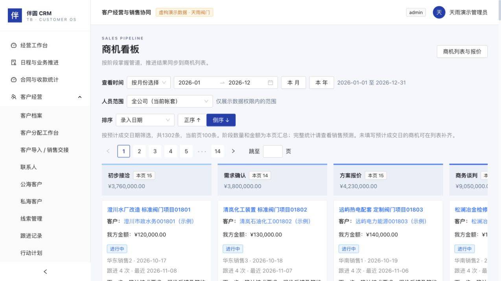

### B11  建立线索并转成客户

**适用人员：** 管理员、销售主管、销售。入口：客户经营 → 线索管理

**完成目标：** 先记录尚未完全确认的需求，再在主体核实后建立正式客户。

**开始之前：** 有线索创建权限；已知企业或暂定项目名称

1. 点击“新建线索”，填写企业名称、来源及已知需求，可补充联系人和行业。

2. 资料不足时在名称或需求中明确“客户名字待核实”，不要随意填写精确金额或签约结论。

3. 核实主体后在对应线索点“转为客户”，确认操作。

4. 到客户档案核对新客户及由线索联系人生成的联系人；再根据实际报价建立商机。

**完成后核对：** 线索显示“已转化”，新客户进入操作者私海；转换不会自动产生已赢商机或合同。

**遇到问题：** 目标客户已同名或同证照存在时会阻止转换，先由主管核对，避免重复建档。；已转化线索不能继续当作可反复转化的草稿编辑。

**操作提示：** 做过PPT可作为线索依据；报价才支持进入金额商机判断。；线索转客户与创建商机是两个业务步骤。

### B12  建立有依据的商机

**适用人员：** 管理员、销售主管、销售。入口：销售管理 → 商机与报价 → 新建商机与报价

**完成目标：** 把明确客户、需求和预计金额的销售事项纳入推进。

**开始之前：** 客户已建档且可见；手工新建商机已有可以说明依据的预计金额

1. 点击“新建商机与报价”，填商机名称并选择客户。

2. 填写预计金额、预计成交日期、需求摘要和下一步行动；同一客户的不同项目分别建商机。

3. 确认金额对应我方范围，渠道整包报价可稍后由管理员确认拆分。

4. 保存后打开详情，核对客户名、阶段、负责人和金额；在看板中再次定位。

**完成后核对：** 商机以进行中状态进入客户销售过程，按当前经营归属控制可见范围。

**遇到问题：** 手工表单预计金额必填；金额不清楚时不要填0凑数，可先留在线索，或由管理员走来源整理通道。；不能选到客户时检查客户归属和模块权限，不新建同名客户代替。

**操作提示：** 预计成交日期是计划，不是已签日期；估算日期和待核事项要写明。；客户身份待核的事项应停在潜在、初步接洽或需求确认，不能仅凭文件名称认定方案已确定。

### B13  用商机看板查看客户并推进阶段

**适用人员：** 管理员、老板、销售主管、销售。入口：销售管理 → 商机看板

**完成目标：** 在阶段卡片中同时看到客户、机会和跟进，不只看到产品。

**开始之前：** 有商机读取权限；推进者另有更新权限

1. 设置日期和人员范围，检查是否选中了本公司、团队或本人；按预计成交日或更新日排序。

2. 在阶段列查看商机名称、客户名、金额、负责人、跟进和下一步。

3. 点客户名查看客户；点“商机详情”或商机名称进入机会，点“查看跟进”查看记录。

4. 实际已满足下一阶段条件时，由可编辑角色点“推进阶段”，核对当前对象后确认。

5. 需要全量数量或掉单统计时转到“合同与收款统计”的商机参考页，不把本页卡片合计当全公司总数。

**完成后核对：** 卡片按当前页100条分组；阶段推进保存业务变化并可在详情核对。

**遇到问题：** 老板可看全公司但默认不能改销售业务；没有推进按钮通常是权限或状态不允许。；商机不在第一页时先搜索、筛选或翻页，不据此判断没有数据。

**操作提示：** 未知客户名显示“客户名字待核实”，应结合证据回到早期阶段核对。；推进阶段不代表合同签署、项目验收或客户付款已完成。

### B14  报价并保留每轮版本

**适用人员：** 管理员、销售主管、销售。入口：销售管理 → 商机与报价 → 产品报价

**完成目标：** 把标准件或服务明细、数量和单价沉淀为可追溯报价。

**开始之前：** 有商机编辑权限；产品目录中已有可用产品或服务

1. 在进行中商机点“产品报价”，逐行选产品并填写整数数量、两位小数单价。

2. 需要多项范围时点“添加产品”，错误行点“移除”；核对数量和税费、服务范围的说明。

3. 确认提交，系统根据数量与单价重新计算合计，不手填另一个合计数。

4. 进入商机详情的“报价历史版本”，展开版本核对产品名称、数量、价格和合计。

5. 客户要求调整时再次“产品报价”形成新版本；比较旧版说明变化依据，勿删除旧版掩盖过程。

**完成后核对：** 新报价成为当前报价，旧版本快照保留；已保存合同选用的报价不会跟随新报价自动漂移。

**遇到问题：** 目录中没有合适服务先由有权限人员维护产品，不用近似名称混淆交付范围。；新报价改变整包金额后，原我方/厂商金额拆分可能失效，需重新确认分类。

**操作提示：** 反复报价可作为跟进工作依据，但不能自动说成发生过客户拜访。；产品报价的整数数量不是合同人天明细的全部表达，合同范围仍须按实际材料核对。

### B15  记录商机跟进并同时安排下一步

**适用人员：** 管理员、销售主管、销售。入口：商机详情 → 新增商机跟进

**完成目标：** 把实际沟通结果与未来行动连接，不再只写一句“继续跟进”。

**开始之前：** 有跟进创建权限；勾选生成行动还需要行动创建权限

1. 从商机详情点“新增商机跟进”，先核对弹窗标题中的商机。

2. 选择电话、拜访、即时沟通、邮件、会议或其他方式。

3. 填写“本次实际沟通或工作记录”，包含需求变化、客户反馈、报价版本、待确认问题和结果。

4. 填写下一步行动及下次跟进日期；确需同步安排时勾选“同时生成负责人行动计划和拟定本地日程”。

5. 保存后在商机“跟进”页签、行动计划和日程中核对关联结果。

**完成后核对：** 实际记录进入该客户及商机；勾选项按商机负责人生成下一步和拟定工作时段。

**遇到问题：** 创建行动需要具体下一步及日期；缺少相应权限时不会显示勾选项。；历史录音或听记补录应走有来源的管理员整理通道，保留原发生日期及估算标记，不能把今天的新建时间当历史拜访日。

**操作提示：** 拟定日程不是客户已确认的会议，也不会因此自动向所有人发送邀请。；商机关联跟进显示最近30条，完整记录在跟进列表查。

### B16  执行行动计划并查看本地日程

**适用人员：** 管理员、老板、销售主管、销售。入口：客户经营 → 行动计划；日程与业务推进

**完成目标：** 把销售下一步变成能检查完成状态的责任事项。

**开始之前：** 有行动读取权限；新建或完成另需相应操作权

1. 进入“行动计划”，搜索客户或项目，按计划完成日正序优先看最早需处理事项。

2. 手动新建时填行动名称、客户、计划完成日及内容；说明要完成什么和以什么作为完成依据。

3. AI整理或商机跟进生成的行动，先检查来源、责任人和日期，实际执行后再点“完成”。

4. 在“日程与业务推进”切换月历、周视图或列表，查看关联的业务计划时段；点日程里的“查看对应行动计划”回到任务。

5. 个人日程需单独安排时点“新建日程”，填主题、上海时区起止、地点和忙闲；只改本人可编辑日程。

**完成后核对：** 行动有明确完成状态；业务计划完成时关联计划日程同步结束，历史仍保留。

**遇到问题：** 在别人的个人或钉钉日程中看不到内容属于隐私规则，不能用老板身份绕过。；从来源同步的日程和业务计划可能只读，应从对应来源或行动入口处理。

**操作提示：** 手动新建行动并不等于自动创建或外发钉钉日程。；业务计划日程可按业务管理范围读取；个人手建和钉钉来源日程仅本人可见。

### B17  记录输单原因并保留商务过程

**适用人员：** 管理员、销售主管、销售。入口：商机与报价 → 标记输单

**完成目标：** 保留到过什么阶段、报价多少、为何未成交，便于复盘资源损失。

**开始之前：** 商机仍为进行中；已掌握本次放弃或失败的实际原因

1. 打开商机详情，核对最终报价版本、已到阶段、最后跟进和对方反馈。

2. 在列表点击“标记输单”，填写具体原因；资源不足可说明缺的模块、人员、交付窗口等。

3. 确认后重新打开记录，核对输单状态及原因，不把未知客户预算当作已确定损失额。

4. 进入统计的销售漏斗，点击未成交数量，核对客户、阶段、报价及掉单原因。

**完成后核对：** 机会退出进行中管道，历史报价和跟进继续保留用于复盘。

**遇到问题：** 没有按钮：检查是否已关闭或没有更新权限。；客户可能另有新项目，输单的是该机会，不代表永久停用整家客户。

**操作提示：** 输单金额表示该机会的已知报价或估算范围，不是已发生收入。；人手不足原因应写事实和范围，不把全部技术能力永久描述为不可交付。

### B18  维护标准产品与按范围核价服务

**适用人员：** 管理员。入口：销售管理 → 产品目录

**完成目标：** 让报价人员选择统一名称、编码和价格依据。

**开始之前：** 使用管理员账号，具备产品维护权限；已确认名称、单位和定价依据

1. 点“新建产品目录”，填产品名称和唯一编码，补分类、单位、说明与规格报价依据。

2. 有可执行标准价时选择“固定目录价”并填写目录单价；未确定的服务选择“按范围核价”。

3. 税率只填已确认口径；未知价格或税率不随意用0代替。

4. 保存后在列表检查定价状态；报价时仍按本次范围和有效报价依据填写交易单价。

5. 需要版本报价与更多产品知识，由管理员进入“产品报价与项目知识”继续维护。

**完成后核对：** 目录能区分固定价和待核价，未知目录价显示按范围核价。

**遇到问题：** 非管理员即使有产品读取权，也不能维护目录；由管理员核对产品维护入口。；历史报价版本保存当时快照，改目录不会自动改已发报价或已签合同。

**操作提示：** 产品目录是销售依据，不是厂商当前价格的自动在线抓取。；内部成本及客户证据不应放入普通销售可见的产品说明。

### B19  区分我方业务金额与软件返佣

**适用人员：** 管理员。入口：商机或合同详情 → 交易性质与业绩口径

**完成目标：** 避免把厂商整包产品报价或终端项目背景都计为我方服务业绩。

**开始之前：** 有管理员交易分类权限；已核对实际付款方和金额拆分依据

1. 打开商机或合同详情，在“交易性质与业绩口径”点“确认分类 / 金额口径”。

2. 选“我方业务（含甲方渠道的实施/外包）”或“软件返佣（单列，不计业务业绩）”。

3. 商机如含厂商产品部分，分别填我方业务金额和厂商产品报价部分；已知两部分合计须等于原报价。

4. 我方金额不清楚时勾选“我方金额尚待核实，暂不计金额预测”，不要直接填0。

5. 填写核对依据并保存；回到合同与回款统计核对业务与返佣分列，原合同及原报价金额保持原值。

**完成后核对：** 统计按已确认性质处理；渠道作为甲方付给我方的实施、开发和外包收入纳入业务，软件返佣单独列示。

**遇到问题：** 报价又变了：原拆分需重新核对，不能自动用原比例套新报价。；普通终端项目虽由用友或钉钉推荐，不应因此把客户改成渠道甲方。

**操作提示：** 未分类合同当前暂按业务统计并标待核，管理员应逐笔确认。；该操作只调整经营统计性质，不创建银行收款或会计收入。

## 06  AI资料整理和受控执行

外部AI在用户授权范围内读取资料并理解，CRM负责有权限和状态约束的业务保存。既有网页核对、管理员批量整理与独立智能体委托是不同入口。

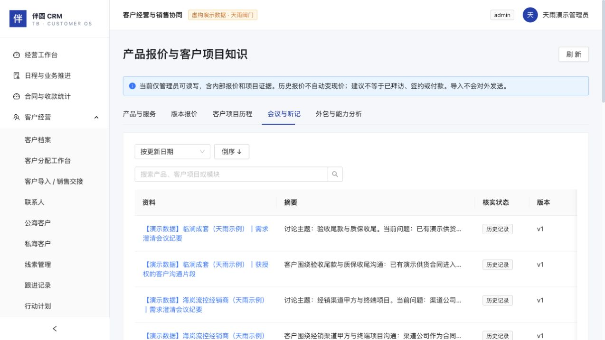

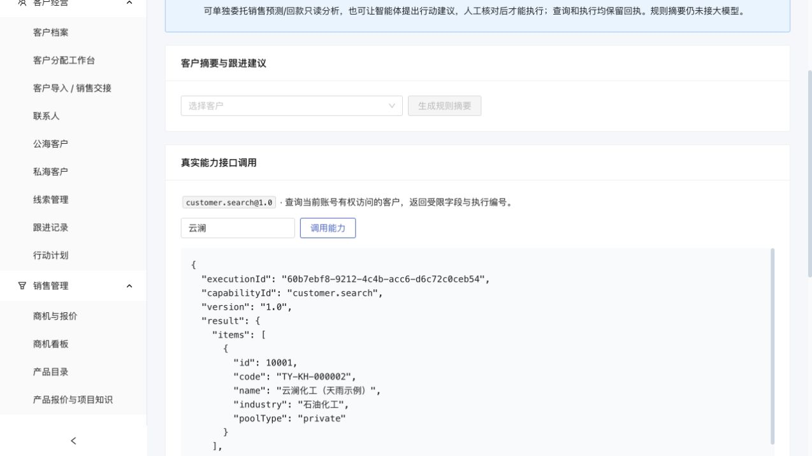

### A16  把授权资料整理成历史和未来计划

**适用人员：** 资料所有人；获授权管理员；外部AI操作人员。入口：外部AI工作入口；CRM客户／跟进／行动／知识资料页

**完成目标：** 把已经做过的客户工作沉淀为记录，再为未完成事项制定下一步。

**开始之前：** 明确授权资料范围和用途；能区分已发生、待核实与拟定内容。

1. 把明确获授权的PPT、报价版本、合同、沟通、听记或录音转写交给AI；未授权资料不纳入。

2. 让AI先列客户、资料日期、来源和当前阶段：PPT支持线索，报价支持商机，多轮报价保留版本和内部修订过程。

3. 把真实沟通与内部文件制作分别记录；日期或主体不清时标待核实，不把报价制作写成客户拜访。

4. 再整理下一步动作、当前负责人和拟定工作日期；对未收合同核对付款条件和所缺依据。

5. 管理员通过受控导入或现有业务服务核对后写入；业务用户在客户、跟进、行动和日程页逐条回看。

**完成后核对：** 历史有来源和原始日期，未来行动有负责人和建议日期，既有成交和财务不重复生成。

**遇到问题：** 不能识别客户：先形成待核实线索，不强行建成确定主体或后期方案阶段。；金额版本冲突：保留各版本及待核状态，不能随意加总、年化或填零当真实报价。

**操作提示：** CRM不会自动获得所有钉钉、飞书账号，也不无限监听聊天；资料连接和模型由实际AI工作入口授权配置。；天雨故事是虚构资料的可复演样例；不把样例导入声称为现场刚调用真实模型。

### A17  创建限时智能体委托

**适用人员：** 具备相应业务能力的登录人员。入口：AI与智能体 → 智能体委托、授权与执行回执 → 创建限时委托

**完成目标：** 只把本次任务需要的能力和数据范围交给可信客户端。

**开始之前：** 已经选定可信AI客户端及具体任务；原人工会话有效。

1. 点击“创建限时委托”，填写智能体名称和本次委托目的。

2. 选择所需能力，只勾选实际任务需要的客户查询、报表读取或行动能力。

3. 设置期限和调用预算；期限最多1440分钟、预算1至1000次，并受本人父会话期限限制。

4. 核对用途、数据范围、期限和预算，勾选授权确认后创建。

5. 只在可信客户端安全保存首次展示的独立凭证；不要把人工密码或登录令牌发给客户端。

6. 返回“委托与停止开关”，核对期限、能力和预算消耗。

**完成后核对：** 产生限时、限能力、继承本人当前权限的独立委托。

**遇到问题：** 凭证窗口关闭后找不到：凭证不会再次明文显示，应撤销旧委托再创建。；能力不可选：本人缺少该业务权限，不能通过委托获得额外权限。

**操作提示：** 调用预算不是模型Token或人民币额度，外部AI费用另计。；每人最多10个期限内未撤销委托；撤销、过期、父会话结束或权限收回都会阻止后续调用。

### A18  核对AI建议并执行行动

**适用人员：** 原委托人；获授权智能体。入口：AI与智能体 → 待核对建议与补偿／执行回执

**完成目标：** 把建议经过本人核对后变成可追踪的内部行动。

**开始之前：** 委托包含行动预演和执行能力；客户当前在授权范围内。

1. 由可信客户端调用行动预演；网页没有收到建议前，不把外部聊天中的计划视为已入库。

2. 原委托人进入“待核对建议与补偿”，核对客户、标题、内容、计划日期和授权到期时间。

3. 需要调整时拒绝该建议并让AI重新预演；认可时点击“核对并批准”并填写意见。

4. 批准只是保存授权，还没有创建行动；由原客户端在有效期内调用执行。

5. 打开“执行回执”核对成功状态，再进入行动计划查看负责人、来源与业务内容。

**完成后核对：** 同一建议最多生成一条行动；建议、人工意见、执行结果和业务记录可追踪。

**遇到问题：** 批准后没看到行动：检查客户端是否真正执行，不能只看批准状态。；客户归属、内容版本或权限改变：重新预演再核对，不强行使用旧建议。

**操作提示：** 管理员不能代替其他委托人批准建议。；审批决定、财务金额、银行操作和任意外发不在本条独立行动委托能力内。

### A19  停止AI委托并取消未完成行动

**适用人员：** 原委托人；管理员可停止本公司委托。入口：AI与智能体 → 委托与停止开关／待核对建议与补偿

**完成目标：** 及时停止后续调用，并在允许条件下补偿错误的未完成AI行动。

**开始之前：** 已明确要停止的委托或行动；保留原业务和回执。

1. 在“委托与停止开关”找到目标委托，核对名称、委托人、用途和到期时间。

2. 点击“撤销委托”并填写原因，停止后续客户端调用。

3. 需要取消已经执行的建议时，原委托人进入“待核对建议与补偿”，找到已执行记录。

4. 核对行动仍未完成、未移交且当前仍有权限后，选择“取消未完成行动”。

5. 保存后查看补偿记录和当前行动状态，保留原建议及成功执行回执。

**完成后核对：** 后续调用失效；符合条件的行动被取消且全过程保留。

**遇到问题：** 无法取消：行动可能已完成、移交、版本变化或已失去记录权限，应由业务负责人处理。；原回执显示成功：它说明当时成功执行，应同时看当前补偿状态。

**操作提示：** 撤销凭证不会自动删除已经产生的业务行动。；不要反复新建相同建议来绕过原记录；遇到结果不明先查回执。

### A20  查询产品报价和客户项目知识

**适用人员：** 管理员。入口：销售管理 → 产品报价与项目知识

**完成目标：** 按产品、版本、客户项目和来源查找可核对的知识资料。

**开始之前：** 当前账号为管理员；资料已导入当前公司。

1. 打开“产品报价与客户项目知识”，选择产品与服务、版本报价、客户项目、会议听记或外包能力等分类。

2. 用搜索框按产品、客户或模块检索，按更新日期或名称排序并切换正序／倒序。

3. 点击资料标题打开详情，阅读摘要、结构化内容、核实状态和版本。

4. 核对来源及适用日期；比较币种、计价单位、部署形态、版本、人数阶梯和报价口径。

5. 需要对客户出价时再次核验当前正式政策，不直接把历史价、采购成本或内部建议当成交报价。

**完成后核对：** 能解释一条报价或项目判断来自哪里、适用什么条件及仍有哪些待核事项。

**遇到问题：** 普通账号没有入口：此页含内部资料，当前仅管理员可读写。；找不到记录：清除分类和关键词、检查分页及当前公司；空价格不代表免费。

**操作提示：** 供应商价、采购成本、我方销售价、合同应收和软件返佣分别记录。；资料页不是银行、税务或产品供应商的实时价格源。

### A21  预演并保存知识导入包

**适用人员：** 管理员；导入包准备人员。入口：产品报价与项目知识 → 受控导入

**完成目标：** 安全保存产品、版本报价和客户资料，保留来源、版本及客户绑定。

**开始之前：** 已经核对JSON导入包；客户ID对应当前部署；已有资料版本已查明。

1. 按当前知识服务Schema准备entries数组，每批最多50条，包含来源键、分类、标题、摘要、核实状态、来源和结构化内容。

2. 资料关联客户时先核对当前系统客户ID，不把另一台机器的数字ID直接复制过来。

3. 将数组粘贴到“知识导入JSON”，点击“预演导入”。

4. 核对预演条数、客户与版本；预演30分钟内有效。

5. 确认后点击“确认保存此批资料”，保存回执并重新搜索核对。

6. 需要据此形成历史跟进或AI行动时，由管理员调用对应活动整理服务并回读结果，不能把仅保存知识误认为已生成业务单据。

**完成后核对：** 资料及版本保存，可追溯来源；相同内容和重复请求不会重复增加记录。

**遇到问题：** 版本冲突：刷新资料版本、核对真实变更后重新准备，不覆盖他人的更新。；结果不确定：先查已有回执；导入工具保留原请求和回执文件，不盲目换新请求重做。

**操作提示：** 此网页入口保存知识，不直接创建报价、已签合同、开票、收款、审批或外部日程。；批量业务补录与知识导入是两种入口；管理员工具和Schema由实施人员协助使用。

### A22  核对历史原件并进行业务补录

**适用人员：** 管理员；实施和资料整理人员。入口：合同与订单 → 历史资料与补录来源；受控补录工具

**完成目标：** 把历史文件与正式单据关联，避免只有文件没有可分配业务。

**开始之前：** 明确授权源文件；已备份；已核对编号、主体、归属和金额。

1. 先由实施人员读取原表，核对文件摘要、工作表、原行、合同编号、客户和销售人员唯一对应。

2. 把有效客户、联系人、商机、合同、开票、回款及核销分别准备成受控补录清单，保留原始行和来源。

3. 先预演再经管理员确认提交；保持已有正式合同和财务事实，不重复创建。

4. 在“历史资料与补录来源”选择文件和工作表，检索公司、合同编号或阶段，查看原始行；需要时下载原件核对。

5. 再到对应客户、合同、开票、回款页核对正式单据和关联金额，保留处理回执。

**完成后核对：** 原件与正式业务可相互追查；历史补录不补发群通知、员工通知或虚构当前审批。

**遇到问题：** 页面没有上传按钮：当前页面是查询原件，完整历史业务导入使用管理员受控工具。；日期、税率或主体缺失：保留空值和待核事项，不编造银行流水、税务发票号或签约事实。

**操作提示：** 合同草稿不是已签合同；历史开票不证明项目已验收。；原件可能含完整联系方式和财务资料，仅公司管理员可读，不向独立智能体凭证开放。

## 07  审批设计和实际流转

管理员设计并发布流程，业务人员提交，真实审批人作决定。天雨包包含36类流程和246张申请，可直接查看不同状态和处理历史。

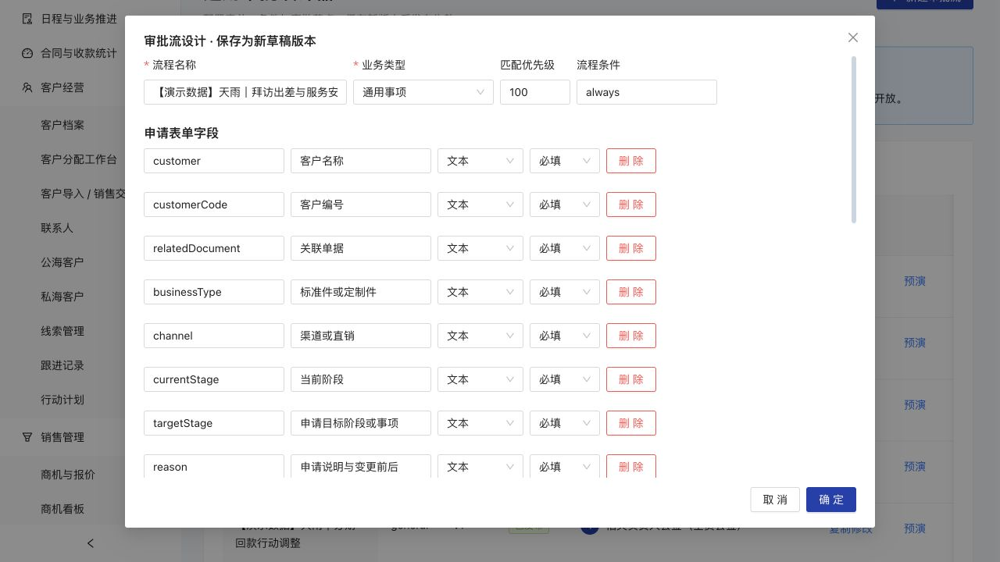

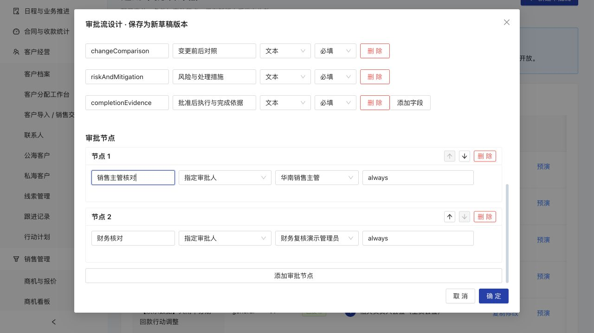

### A10  设计审批表单与节点

**适用人员：** 管理员。入口：审批设计器 → 新建审批流 或 复制修改

**完成目标：** 按业务类型建立可实际提交的表单及通过规则。

**开始之前：** 审批人已启用、所属部门有效且具备所需审批资格。

1. 新建流程或对已有流程“复制修改”，填写流程名称、业务类型、匹配条件及优先级。

2. 按“添加字段”设置字段键、中文名称、文本／数字／日期和必填状态；字段键保持唯一。

3. 天雨示例可参考客户、编号、关联单据、事项、规格图纸、数量、付款条款、变更对照、风险及完成依据等16项内容。

4. 为每个步骤命名，选择指定审批人、按角色或部门负责人，或选择多人会签／多人或签。

5. 会签和或签明确选择2至8位有效人员；按顺序移动节点，检查申请人不能审批自己的申请。

6. 保存为新的草稿版本，再进行预演和发布。

**完成后核对：** 出现可审阅的草稿版本，字段和节点明确，尚未影响新申请。

**遇到问题：** 无法保存：检查字段重名、必填、人数及节点条件；自定义字段最多20项。；多人员角色解析不明确：改为明确指定人员，不依赖随机选人。

**操作提示：** 天雨16项是示例表单内容，不是所有自建流程必须固定16项。；单步或签任一人同意即可推进；会签需全员同意；任一驳回结束申请。

### A11  预演发布和停用审批版本

**适用人员：** 管理员。入口：审批设计器 → 预演／发布／停用

**完成目标：** 确认条件和节点后启用版本，并安全调整后续新申请。

**开始之前：** 流程草稿已经保存；审批人资格已核对。

1. 对目标流程点击“预演”，输入申请金额，检查是否匹配以及解析出的步骤和人员。

2. 按典型金额边界重复预演，检查金额条件是否符合内部制度。

3. 确认后点击“发布”，核对流程名称及版本后确认。

4. 需要修改时使用“复制修改”保存新草稿，再预演和发布，不覆盖已发生的决定。

5. 不再接收新申请时点击“停用”；查询在途审批，确认仍按提交时快照流转。

**完成后核对：** 新申请使用当前发布的匹配版本；旧实例保留原节点和表单快照。

**遇到问题：** 流程未匹配：核对业务类型、申请金额、条件及优先级。；真实发起仍被拒绝：实际提交还会检查发起人、人员状态和权限，预演不代替提交校验。

**操作提示：** 预演不创建真实审批实例。；发布、停用均不会把在途申请自动改成新人员或已通过。

### A12  提交通用事项和业务审批

**适用人员：** 有申请权限的人员。入口：审批中心 → 发起通用申请；合同／订单／项目原单

**完成目标：** 把事项送入正确流程，并保留完整申请依据。

**开始之前：** 已发布相应流程；源业务单据已保存且满足提交条件。

1. 一般事项进入审批中心，点击“发起通用申请”，选择流程和申请标题。

2. 填写“申请金额（用于条件匹配）”及流程所有必填字段，明确客户、单据、原因和证据。

3. 提交前检查规格、数量、付款条件、变更前后和责任日期，避免只有“请同意”等空泛内容。

4. 合同、订单或项目立项须回到原业务单据提交，不能用通用事项替代原单业务校验。

5. 提交后进入“我发起的”，打开申请查看流程、当前节点和表单。

**完成后核对：** 申请显示待处理及正确审批人员；源业务仍按自身状态规则推进。

**遇到问题：** 提示申请人不能自批：调整人员或选择符合制度的流程。；缺必填或流程不可用：补齐资料，确认管理员已发布该业务类型流程。

**操作提示：** 通用审批通过代表内部决定，不会自动造出发货、开票、验收或银行到账事实。；申请内容里的建议日期不是客户已经确认的承诺。

### A13  处理或签会签并查看历史

**适用人员：** 当前实际审批人；管理员可审计。入口：审批中心 → 待我审批 → 查看申请

**完成目标：** 依据完整表单作出自己的真实决定，并理解多人节点状态。

**开始之前：** 流程已轮到本人节点；本人具备有效审批权限。

1. 在“待我审批”打开申请，查看关联单据、表单和变更对照。

2. 核对自己所在步骤及通过规则，确认是否属于顺序、全员会签或任意一人或签。

3. 点击通过或驳回；驳回必须写明具体补充事项，意见提交前再次核对单据。

4. 返回申请详情查看“节点与交接”和“处理与转审历史”，区分实际决定和未处理记录。

5. 或签一人同意后，确认同组其他人显示“未审核（或签已结束，无需处理）”；会签则等待全员同意。

**完成后核对：** 系统保存实际人员、意见及时间；只有满足该组规则后才推进下一步。

**遇到问题：** 没有待我审批：可能尚未轮到、已被他人或签完成、已转交或已结束。；显示已连接钉钉：按页面指引到钉钉原生审批处理，避免两个结果来源。

**操作提示：** 管理员可读和交接，不等于可以代替其他人通过审批。；“未审核、无需处理”不是另一人同意，不能当成两票通过。

### A14  转审撤回和退回后重提

**适用人员：** 当前审批人；申请人；管理员按各自职责。入口：审批中心 → 待我审批／我发起的／企业审批与交接

**完成目标：** 处理出差、人员变化或申请资料不足，保留完整过程。

**开始之前：** 申请状态仍允许相应操作；接收人已具备审批资格。

1. 当前审批人需要他人接续时，在待办或申请详情选择“转审”，选择接收人并填原因。

2. 管理员从“企业审批与交接”进入，可转交当前或后续尚未处理的节点；后续节点不会提前激活。

3. 申请人主动终止待审申请时，在“我发起的”点击“撤回”并确认。

4. 被驳回后先查看具体意见，补齐原业务单据或新通用申请的资料，再重新提交；在说明中引用原申请编号。

5. 重新提交后核对新申请和原退回记录都能查询，不能删除旧记录冒充一次通过。

**完成后核对：** 原意见、原审批人、转交原因、旧表单快照和新申请各自保留。

**遇到问题：** 接收人不在列表：核对权限、启用状态和是否为申请人；会签不能转给同组已占用成员。；本地操作被阻止：如申请已连接钉钉，先按原生审批结果同步规则处理。

**操作提示：** 转审不代表同意；撤回和驳回后不能继续在旧实例上审批。；当前不是“原单一键自动修改重提”通用能力；根据业务入口重新提交并保留原编号关联。

### A15  配置新商机提醒和新合同自动送审

**适用人员：** 管理员；服务器运维配合启用。入口：钉钉 / 飞书 → 钉钉原生审批（局域网） → 商机提醒与自动送审规则

**完成目标：** 把新建业务纳入站内提醒和既定合同审批。

**开始之前：** 服务器已为当前公司启用业务规则；已发布合同流程；接收人员有效。

1. 进入“商机提醒与合同审批规则”，核对服务器是否已启用此公司业务规则开关。

2. 开启“启用内部业务规则”，选择1至8名有效管理员作为新建商机通知人员。

3. 如需新合同立即送审，开启对应开关并选择已发布的合同审批流。

4. 设置生效日期，检查历史补录不外发的规则，然后点击“保存规则”。

5. 用标注测试的新业务验证站内通知及审批实例；分别确认没有误把站内通知视为钉钉群消息。

**完成后核对：** 生效后的新业务按规则产生站内提醒或CRM合同审批，历史资料保持静默。

**遇到问题：** 页面提示本机未启用：由运维核对公司专属开关；仅保存网页配置不会突破服务器开关。；未出现审批：核对生效日期、业务创建入口、已发布流程及实际人员资格。

**操作提示：** 新合同自动进入CRM审批，不等于自动外发到钉钉；原生审批仍需逐单预演和确认。；本功能不启用群机器人。

## 08  合同签约订单与变更

合同草稿、审批通过、实际签约和交付是不同状态。先完成必要核对，再沿状态允许的按钮继续。

### B20  建立合同草稿并提交审批

**适用人员：** 管理员、销售主管、销售。入口：合同与订单 → 合同管理

**完成目标：** 把已确认方案、签约主体、金额和付款条款送审。

**开始之前：** 客户存在；有合同创建权限；审批设计器已有适用已发布流程

1. 点“新建合同”，填合同名称、我方签约主体、客户、合同类型、含税金额、税率及付款约定。

2. 若关联商机，核对所选当前报价；合同金额应与选用报价一致，并保存对应产品与版本快照。

3. 保存草稿，打开详情检查客户、主体和条款；草稿或被驳回合同可编辑，已签合同不能直接改原值。

4. 点“提交审批”，核对显示的流程名称和版本，填写本流程的必填业务表单。

5. 提交后到审批中心查看节点与进度；需要调整时依规定撤回或在驳回后修改再提交。

**完成后核对：** 合同进入待审批，保留选用报价及审批表单；尚未产生真实签署事实。

**遇到问题：** 缺少适用流程或审批人时先由管理员配置，不伪造批准状态。；同客户有多个合同主体时确认“我方签约主体”逐单正确，不根据客户简称猜测。

**操作提示：** 合同类型“渠道”本身不自动等于软件返佣，交易性质另行确认。；审批通过仍不等于已经实际签约或已经收到首款。

### B21  确认签约并建立真实分期计划

**适用人员：** 管理员、销售主管、销售。入口：已批准合同 → 确认签约

**完成目标：** 按实际签约和付款条款建立各期应收计划。

**开始之前：** 合同审批已通过；已经有真实签约依据；各期金额、约定日期和条件可确认

1. 在已批准合同点“确认签约”，核对页面合同总额。

2. 逐期填写“本期金额”“约定收款日期”“付款条件”，如签约首款、供货款、验收款、质保款。

3. 需要增加分期时点“追加一期”，最多24期；删除不适用空行。

4. 逐期相加核对合计必须等于合同金额，日期及条件按合同填写，不能用系统默认30天替代。

5. 确认后打开合同详情的回款计划页签核对每期金额和条件，再按需要创建订单或项目。

**完成后核对：** 合同显示已签约，各期计划与总额一致；计划金额不是实际到账。

**遇到问题：** 合计不等于合同额或任一期为空时会阻止签约，先修正。；实际付款日期未知时，不应凭空确认签约计划；历史材料可由管理员保留待核语义后补录。

**操作提示：** 新签约不会自动表示首款已到，也不自动开具税务发票。；确认签约是内部业务登记，不代替外部电子签章或客户签署。

### B22  从合同生成订单并确认交付

**适用人员：** 管理员、销售主管、销售。入口：已签约合同 → 创建订单；合同与订单 → 订单管理

**完成目标：** 将签约范围转为可审批、确认和交付的订单。

**开始之前：** 合同为已签约或执行中；没有待处理合同变更；有订单操作权限

1. 从合同点“创建订单”，或在订单管理新建并选择有效合同，核对继承范围与备注。

2. 打开订单详情检查客户、合同及产品明细，点击“提交审批”并填写必填业务字段。

3. 审批通过后点击“确认订单”。

4. 实际交付完成且依据已确认时点击“确认交付”，再查看状态和关联单据。

**完成后核对：** 订单按草稿、待审批、已批准、已确认、已交付顺序推进。

**遇到问题：** 确认按钮未出现：先检查是否批准；交付按钮需已确认状态。；合同处于变更处理中时不允许新建下游订单，应先处理变更。

**操作提示：** 当前订单“确认交付”不是完整仓储、物流、分批发运或库存管理。；不能根据订单已交付自动宣称银行到账、税务开票或项目验收完成。

### B23  申请合同变更或终止

**适用人员：** 管理员、按当前授权可发起变更人员。入口：合同列表 → 合同变更/记录

**完成目标：** 保留前后对照并经审批处理，避免直接覆盖已签合同。

**开始之前：** 已有已发布合同变更/终止流程；合同符合当前有限变更条件

1. 从合同列表进入“合同变更/记录”，点发起变更或终止。

2. 选择金额、税率、日期、付款条款等实际变化，写清原因与凭据。

3. 先预检影响，核对服务端生成的前后对照及自定义必填表单。

4. 确认提交后查看审批，批准前原合同不提前改写；需要重做时撤回或在驳回后重新准备。

5. 批准后检查合同、回款计划及变更历史；终止也保留原合同和审批记录。

**完成后核对：** 适用变更经审批原子生效，前后值和决定可以追溯。

**遇到问题：** 已有订单、项目、发票、核销或已拆分/执行计划会被拒绝：不能直接改原合同抹平下游数据。；审批期间源合同版本变化会阻止批准，须撤回后重新预检。

**操作提示：** 当前仅支持无下游业务、单笔未执行计划的已签/执行中合同等受限情形。；终止的内部状态不代替法律手续、退款和会计冲销。

## 09  项目任务交付验收与售后

立项审批、实际启动、任务完成、里程碑和双人验收形成交付链。完成任务不代表能跳过验收，已验收项目的后续问题进入独立工单。

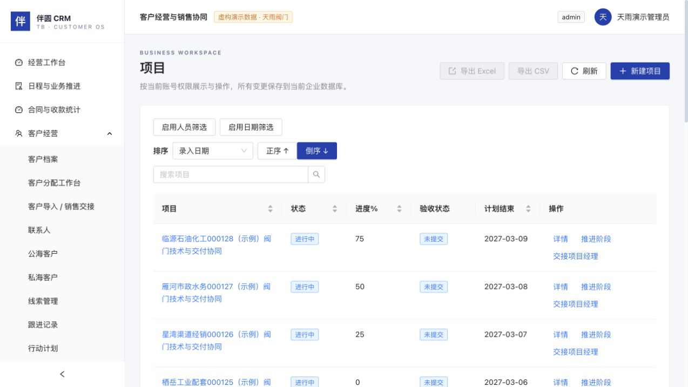

### B24  建立项目并完成立项启动

**适用人员：** 管理员、销售主管、有项目操作权销售或项目经理。入口：项目交付 → 项目总览

**完成目标：** 让签约范围进入可追踪交付项目。

**开始之前：** 关联合同已签约且无待处理变更，或具有独立新建项目依据；有项目创建权限和适用立项流程

1. 从合同点“创建项目”，或在项目总览点新建，填写客户、计划开始结束、预算和必要说明。

2. 核对客户、关联合同和项目经理/销售责任，不把销售负责人自动当全部任务执行人。

3. 点“提交审批”，填写立项流程要求并等待审批通过。

4. 批准后由有权限的项目管理人员点“启动项目”，再安排项目任务和里程碑推进。

**完成后核对：** 项目进入可执行状态；未批准或未启动的项目不能直接执行交付任务。

**遇到问题：** 计划结束早于开始、合同状态不允许或审批未通过时先修正。；老板默认是经营只读角色，不能因能看全公司就代替启动交付。

**操作提示：** 计划日期是排期，不是实际开工或完工证据。；历史在建资料另用管理员受控登记，不借新立项流程伪造历史开工。

### B25  安排并执行项目任务

**适用人员：** 项目经理、销售主管、任务当前执行人、管理员。入口：项目交付 → 项目任务

**完成目标：** 把交付拆成可执行且有结果依据的任务。

**开始之前：** 项目已批准并启动；有项目任务创建或执行权限

1. 点“新建项目任务”，选择项目，填写任务名称、计划完成日和说明。

2. 可选关联该项目尚未完成的里程碑；新任务默认由创建人执行，需他人执行时由项目经理或管理人转派。

3. 当前执行人点“开始任务”，按页面要求写工作说明。

4. 实际完成后点“完成”，填写交付结果或依据，以及本任务累计实际工时。

5. 回到任务详情检查状态及执行记录；已完成任务不可直接覆盖修改。

**完成后核对：** 任务从待办到进行中再到完成，执行人、时间、累计工时及结果保留。

**遇到问题：** 完成按钮没有出现：任务须先开始；验收处理中不能执行或编辑。；累计工时支持0.1至9999.9小时、最多一位小数，不是本次新增工时。

**操作提示：** 任务执行权只针对被指派任务，不自动授予管理整个客户或项目的权限。；工时为交付记录，不是工资、扣费或完整工时计费单。

### B26  按顺序确认里程碑

**适用人员：** 项目经理、有范围权限销售主管、管理员。入口：项目总览 → 推进阶段

**完成目标：** 根据完成任务和交付证据推进项目，不跳过关键工作。

**开始之前：** 项目已启动且未关闭；当前里程碑关联任务已完成

1. 打开项目详情，核对当前阶段、里程碑和待完成任务。

2. 处理完当前里程碑关联的全部任务，最终交付前还要完成未绑定里程碑的任务。

3. 在项目列表点“推进阶段”，填写交付结果和依据。

4. 提交后检查项目进度、下一里程碑和“交付与验收记录”。

**完成后核对：** 系统按顺序完成当前里程碑，重算进度并保留推进依据。

**遇到问题：** 有未完成任务时不能推进，先按任务清单查遗漏。；验收待处理期间冻结推进，应等验收决定或按整改流程处理。

**操作提示：** 手工写100%进度不能替代任务与里程碑完成。；里程碑确认属于内部交付记录，不是客户外部签署。

### B27  提交项目验收并独立确认

**适用人员：** 项目经理、其他有范围权限主管、管理员。入口：项目总览 → 提交验收 / 确认验收

**完成目标：** 用独立复核关闭交付，保留材料和实际决定。

**开始之前：** 所有里程碑和任务完成，项目进度100%；另有一名合格主管或管理员可复核

1. 项目经理核对任务、里程碑和附件，从项目点“提交验收”。

2. 填写本次验收材料说明，提交后暂停任务创建、编辑和里程碑推进，避免依据变化。

3. 另一名有该项目范围权限的主管或管理员登录，打开项目及交付记录核验材料。

4. 同意时点“确认验收”，填写依据；不满足时点“拒收并整改”，写明问题和整改要求。

5. 查看验收状态、日期及结项说明，并保留本次提交和决定。

**完成后核对：** 通过后项目完成并关闭阶段；拒收保留历史，项目继续按整改要求处理。

**遇到问题：** 项目经理或提交人不能确认本人项目，单管理员不能自验收。；老板的业务只读和审批权不等于本入口的项目验收操作权。

**操作提示：** 内部验收记录不代替客户签署、外部盖章或财务收入确认。；历史完成但没有新版验收记录的项目会明确标识，不补造决定。

### B28  拒收后发起整改并再次验收

**适用人员：** 项目经理、项目主管、管理员、整改任务执行人。入口：项目任务 → 发起整改；项目总览 → 提交验收

**完成目标：** 保留第一次交付与拒收记录，修复后重新提交。

**开始之前：** 项目验收已驳回；需要整改的任务已完成且允许重新打开

1. 先阅读项目“交付与验收记录”中的拒收原因与整改要求。

2. 在相关已完成任务点“发起整改”，写清整改内容和责任。

3. 系统重开该任务关联及后续里程碑；未绑定任务则重开最后里程碑。

4. 执行人重新开始并完成任务，提交修复结果及更新后的累计实际工时。

5. 管理人按顺序重新确认里程碑，再提交新一轮验收，由合格他人复核。

**完成后核对：** 新旧交付、工时、整改和验收决定分别保留，最终进度按当前完成情况计算。

**遇到问题：** 只是补充验收材料时可保留已完成任务，重新提交说明，不一定重开任务。；已经最终验收关闭的项目不能随意重写旧任务，后续问题走售后。

**操作提示：** 整改工时填写累计值，不把每次工时错误相加。；不删除旧拒收记录来伪装首次就通过。

### B29  交接项目经理或转派未完成任务

**适用人员：** 管理员、有范围权限销售主管、项目经理。入口：项目总览 → 交接项目经理；项目任务 → 转派任务

**完成目标：** 人员调整时持续交付，同时保留已完成工作的原执行人。

**开始之前：** 接收人启用、部门有效且有适用项目权限；项目未关闭且非审批/验收处理中

1. 项目经理变更时点“交接项目经理”，选择合格接收人并写交接原因和待办。

2. 提交前核对说明：原经理名下未完成任务及其负责的未完成里程碑一起交接。

3. 仅一项未完成任务换人时，项目经理或有权限主管从任务点“转派任务”，选接收人并写说明。

4. 提交后在项目、任务和交付记录中检查接收人及转移数量。

5. 办理人员停用、离职或调岗前，再检查其未完成项目、任务和工单是否全部交接。

**完成后核对：** 未完成责任转给接收人，其他执行人的任务及已完成历史不被改写。

**遇到问题：** 普通任务执行人不能自行转派；已完成/取消任务不能转派。；候选为空时检查部门、角色和实际执行权限，不临时复用他人账号。

**操作提示：** 交接项目经理不自动修改客户及销售负责人。；销售整体交接、项目交接、审批转审和工单转派应分别核对。

### B30  保存交付或工单证据附件

**适用人员：** 管理员、有当前对象写入权人员。入口：项目或任务详情；售后工单详情 → 附件

**完成目标：** 将实际说明文件与业务对象关联，并保留校验摘要。

**开始之前：** 对象在当前可写状态；文件为系统允许的PDF、PNG或JPEG

1. 打开项目、任务或工单详情，找到私有附件区。

2. 核对文件实际内容与所关联对象一致，选择允许格式的文件。

3. 按页面大小及数量提示上传，提交后检查文件名称和关联对象。

4. 有读取权限时下载或预览核对；验收或工单解决时结合附件说明依据，不只写“见附件”。

**完成后核对：** 文件保存在本地受控证据存储，并按当前业务对象权限访问。

**遇到问题：** 验收处理中、已完成任务或关闭对象可能不允许继续上传，先按正确流程处理。；不支持任意文件类型或无限大小；按页面提示准备PDF或图片。

**操作提示：** 附件不是公开网盘链接，不能因知道文件编号就绕过权限下载。；文件上传不代替客户签名、印章或人工验收决定。

### B31  处理售后工单并由他人关闭

**适用人员：** 项目经理、售后处理人、有项目管理权限主管、管理员。入口：项目交付 → 售后服务工单

**完成目标：** 把已验收后的问题与原项目验收分开，形成处理和复核过程。

**开始之前：** 项目已通过新版独立验收且为已完成；有适用项目读取及操作权

1. 点“提交工单”，选择可见已验收项目，填标题、优先级、问题和复现步骤。

2. 由项目管理人指派有效接收人，当前处理人点“开始处理”。

3. 处理期间追加记录，完成后提交解决方案及验证结果。

4. 另一位有项目管理权限的人员复核后关闭；不满足时退回重办，关闭后确需再处理可带原因重开。

5. 人员调整时先转派未关闭工单；需要取消时填写原因，取消后不继续修改。

**完成后核对：** 工单保留提交、指派、处理、方案、独立关闭及重开历史，不改原项目验收或财务。

**遇到问题：** 历史完成但没有新版验收的项目不能跳过验收直接提交。；解决人即使是管理员也不能自己关闭；老板只读。

**操作提示：** 工单指派只授予该工单协作处理，不自动授予整个客户或项目的全部权限。；当前是内部服务台，没有客户门户、客户签名或自动SLA承诺。

## 10  开票资料收款登记核销与更正

发票资料查询、银行到账登记、独立复核和核销分别处理。收款计划是该收的钱，核销才把已确认到账分配到相应应收。

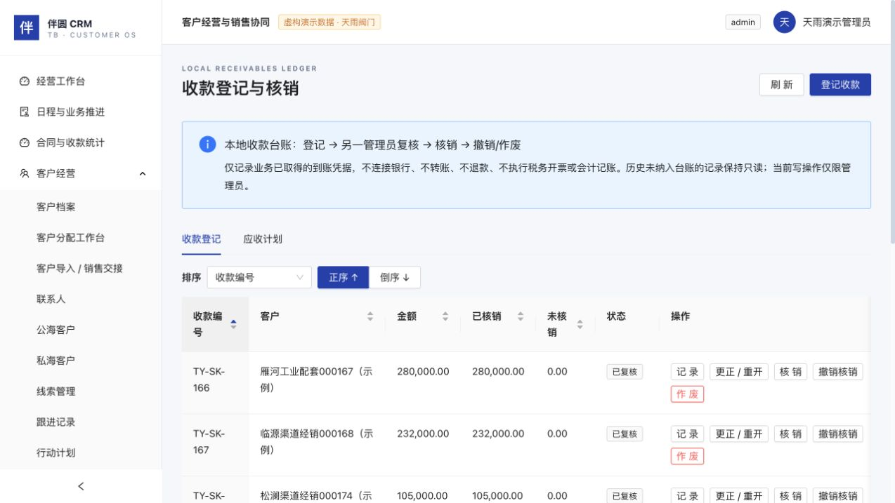

### B32  查询发票历史收款及收款计划

**适用人员：** 管理员、老板、销售主管、销售。入口：财务中心 → 发票记录 / 历史收款记录 / 收款计划

**完成目标：** 查询已有单据，核对客户、合同、日期和状态。

**开始之前：** 具有财务读取权和相应客户/合同可见范围

1. 选择所需列表，按客户或单据编号搜索。

2. 启用日期筛选并确认日期依据：发票用开票日期，收款用到账日期，计划用预计收款日。

3. 查看金额、已收、未收、状态和合同关联，点击详情进一步核对。

4. 需要实际登记到账时进入“收款登记与核销”，不要尝试在只读发票或历史列表直接记收。

**完成后核对：** 能分清历史资料、当前计划和本地受控收款登记，不会把查询操作当作业务执行。

**遇到问题：** 页面提示“税务开票服务尚未开通”是当前能力边界，并非遗漏操作按钮。；日期待核的历史单据可能不会进入指定月份，应检查未填日期提示和来源材料。

**操作提示：** 发票记录不是税务系统实际开票入口；系统不自动拉取银行流水。；历史只读收款不能直接转成可复核可核销的新登记来重复计算。

### B33  登记一笔有凭据的实际到账

**适用人员：** 管理员。入口：财务中心 → 收款登记与核销 → 登记收款

**完成目标：** 把已确认银行到账作为独立待复核登记保存。

**开始之前：** 有实际到账凭据；有另一位有效管理员可独立复核

1. 点击“登记收款”，选择客户，可选绑定同客户的有效合同。

2. 填写人民币凭据金额、到账日期及外部到账凭据编号，写登记说明。

3. 绑定合同后只允许向该合同计划核销；未绑定时可在同客户有效合同计划之间分摊。

4. 核对金额、客户、日期、编号后提交，保存后查看“待独立复核”状态。

5. 将原始凭据交给另一位管理员核对，不使用登记人的账号自行复核。

**完成后核对：** 登记生成不可随意改写的待复核记录，尚未直接增加合同已收款。

**遇到问题：** 同一凭据编号重复会被拒绝，包括已作废历史；先核对是否已登记。；编号实际录错不能通过更改原凭据编号掩盖，保留作废依据再按真实编号登记。

**操作提示：** 目前仅人民币手工台账，不发起银行转账、退款或自动鉴权。；登记成功不代表系统独立核验银行真实性。

### B34  独立复核后分摊核销到应收计划

**适用人员：** 管理员、具有管理员角色的另一位财务复核人员。入口：收款登记与核销 → 复核 / 核销

**完成目标：** 把真实到账合理分配到客户合同各期应收。

**开始之前：** 收款为本地管理台账；复核者与本次登记人不同；目标计划有余额且合同不在变更中

1. 另一管理员登录，打开待复核收款的记录与凭据，核对客户、金额、日期和外部编号。

2. 填写复核说明并确认；登记人本人对应复核按钮不可用。

3. 在已复核收款点“核销”，选择同客户、符合合同绑定限制的收款计划。

4. 填写本次核销金额及依据，核对不超过收款可用余额和计划剩余。

5. 提交后查看收款已核销/未核销、计划已收/剩余、合同累计已收/待收及处理记录。

**完成后核对：** 同一笔到账可多次分摊，每笔留痕；余额与有效核销明细同步更新。

**遇到问题：** 提示旧账不平：先核对原始单据，不通过改浏览器金额或重试抹平差异。；另一人已操作余额或版本变化时刷新再核对，不照旧金额重复提交。

**操作提示：** 销售、主管和老板有权读取不等于有财务写入或复核权。；已开票与计划的关联需完整核对，不能仅凭客户同名随意跨合同核销。

### B35  撤销错误核销并保留更正链

**适用人员：** 管理员。入口：收款登记与核销 → 撤销核销 / 更正 重开 / 记录

**完成目标：** 纠正分类或分摊错误，同时保留原登记、原金额和完整处理历史。

**开始之前：** 已核对错误原因；更正前全部有效核销已撤销；合同没有待处理变更

1. 只是分摊错时点“撤销核销”，选择该笔有效明细并填原因；当前按整笔撤销，不是部分撤销。

2. 确认余额退回收款、计划和合同后，按正确计划重新核销，生成新明细。

3. 登记客户、合同绑定、金额或到账日期本身错误时，从当前记录点“更正 / 重开”，填写新内容及更正原因；原凭据编号不可改。

4. 提交后检查原记录作废、新记录待独立复核及前后继链接，再由另一位管理员重新复核。

5. 仅需作废时先撤销全部核销，再作废登记；从“记录”查看原值、原因与操作者。

**完成后核对：** 旧登记及撤销历史不删除，新登记单独待复核；同凭据只有一个当前有效指向。

**遇到问题：** 不能从中间历史版本分叉更正，先通过记录链进入当前登记。；未作废且内容完全没变化的更正会被拒绝；历史只读收款不能按此入口直接改写。

**操作提示：** 撤销核销不是退款，作废和更正不向银行发送付款指令。；真正退款、会计冲销、跨凭据合并及修改银行凭据编号不在本流程内。

## 11  经营统计预测漏斗与回款分析

先确定统计对象和日期口径，再看金额与人员。报表每个金额应能回到合同或单据核对；未知不等于零，计划不等于已收。

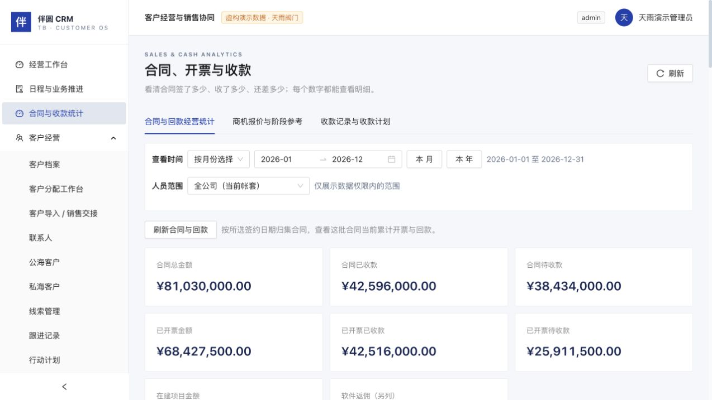

### B36  读懂合同开票和收款七项金额

**适用人员：** 管理员、老板、销售主管、销售。入口：合同与收款统计 → 合同与回款经营统计

**完成目标：** 用同一批合同解释签了多少、已收多少、还差多少。

**开始之前：** 同时拥有合同和财务读取权限；已选择签约日期与人员范围

1. 选择日期和人员；此页按这段时间签约的我方业务合同归集。

2. 查看合同总金额、合同已收款、合同待收款、已开票金额、已开票已收款、已开票待收款和在建项目金额。

3. 点金额卡片，下方切换到同口径合同明细，检查客户、负责人、合同、开票和已收待收列。

4. 需要核对个别单据时打开合同链接，再查看回款计划、开票及收款关联。

5. 见到“待核实”“待授权”或未分类提示时先补依据或权限，不把它解释成0。

**完成后核对：** 业务合同总额与当前累计开票、回款在同一合同批次中核对，软件返佣另列。

**遇到问题：** 已开票待收属于合同待收的一部分，两项不能相加。；按签约日期选择的合同批次，展示当前累计值，不是截止所选结束日的历史期末快照。

**操作提示：** 在建金额按可见的在建或暂停项目关联合同去重，同一合同只算一次。；经营金额不是会计收入、利润或税务认证数；其他币种不直接相加。

### B37  查看预计收款安排及每笔权重依据

**适用人员：** 管理员、老板、销售主管、销售。入口：合同与回款经营统计 → 预计收款安排 / 回款安排与权重

**完成目标：** 用应收事实安排催收优先级，理解每笔谨慎预计金额。

**开始之前：** 有权读取合同及财务资料；合同、计划和发票关联已尽量核对

1. 在经营统计页查看未来30天、31至60天、61至90天及以后的预计收款分组。

2. 切换“回款安排与权重”，查看每笔待收款、预计日期、权重和谨慎预计收款。

3. 展开或阅读每笔依据，核对是否有已收款、有效发票、项目验收、约定日期或拖延情况。

4. 对日期不明、余额不一致或长时间未收的记录，进入合同和计划核对材料，再制定具体联系人、动作与日期。

5. 把催收安排落实为行动计划或日程，执行后记录客户反馈；不要把规则预计值直接登记成到账。

**完成后核对：** 每笔估计能说明原因，谨慎金额为待收余额乘规则权重，金额与原余额分开显示。

**遇到问题：** 权重20%至90%是规则参考，不是通过真实样本校准的收款概率。；同合同已开票待收不再加到合同待收上，防止重复预测。

**操作提示：** 规则起点50，已有收款加10、有效销项发票加15、可见项目已完成/验收加10、有预计日加5；严重拖延、日期不明或余额不一致会降低参考。；预计日期是推进安排，不是客户付款承诺，也不是系统已确认的银行到账日。

### B38  查看渠道作为甲方的往来金额

**适用人员：** 管理员、老板、销售主管、销售。入口：合同与回款经营统计 → 渠道客户往来

**完成目标：** 区分渠道给我方付的钱、终端项目背景与产品返佣。

**开始之前：** 客户渠道标记和合同交易性质已核对；有经营统计读取权限

1. 在客户档案确认真正的渠道甲方标记和品牌；终端客户即使来自渠道仍保留自身身份。

2. 管理员逐单确认合同或商机交易性质，必要时拆分我方服务金额与厂商产品部分。

3. 进入“渠道客户往来 · 渠道为甲方付款”，按日期、人员和可选排序查看。

4. 对照渠道业务金额、已收、待收及另列的软件返佣，不把渠道来源的所有终端合同都算到厂商名下。

5. 需要看返佣依据时点“查看软件返佣合同（不计我方业务业绩）”并穿透合同。

**完成后核对：** 渠道作为付款甲方的实施、开发、外包等计入我方业务；软件返佣单独统计。

**遇到问题：** 汇总不符合预期时先核对合同实际客户、客户标记及逐单性质，而不是只改品牌名称。；终端项目背景金额大于我方外包金额时，业务业绩只纳入我方已确认范围。

**操作提示：** 渠道来源是线索来源，渠道客户是交易身份，两者不是同一字段含义。；未分类合同有待核标识，不能仅按合同类型“渠道”猜为返佣。

### B39  从销售漏斗查看商机阶段和掉单明细

**适用人员：** 管理员、老板、销售主管、销售。入口：合同与收款统计 → 商机报价与阶段参考 → 销售漏斗统计

**完成目标：** 看清哪些线索走到商务、哪些掉单，以及客户和原因。

**开始之前：** 有商机读取权限；选择与业务问题一致的日期和人员

1. 打开“商机报价与阶段参考”，设置时间和人员，先阅读页面口径提示。

2. 在“销售漏斗统计”查看各层数量及金额，点击对应数量打开明细。

3. 查看未成交明细中的客户、渠道来源、报价、最后达到阶段、输单原因及关联单据。

4. 按阶段、负责人或月份比较，进入商机核对多轮报价与跟进，再判断资源不足、技术范围、交期或竞争影响。

5. 查看“按商机进度折算金额”时把它当阶段参考；未知金额或价格冲突保留待核，不计入确定金额。

**完成后核对：** 汇总能穿透到具名机会，关闭结果与仍在跟进的机会分开，不用一个赢单率解释全部管道。

**遇到问题：** 历史来源补录按资料日期，日常新建按创建日期；其他预测明细可能按预计成交日筛选，跨表先核对日期依据。；看板当前100条的合计不等于全量漏斗。

**操作提示：** 阶段折算是规则参考，不能当作已签合同、实际收入或收款概率。；报价未知、单价期限不明或待核状态不强行年化为总额。

### B40  核对每月收款计划实际到账与待催收

**适用人员：** 管理员、老板、销售主管、销售。入口：合同与收款统计 → 收款记录与收款计划

**完成目标：** 按月份和合同核对该收、已登记到账和当前未收，安排跟催。

**开始之前：** 有财务读取权限；知道要查本地管理台账还是历史只读记录

1. 切换“收款记录与收款计划”，设置时间和人员，并选择“本地管理台账”或“历史只读记录”。

2. 查看每月计划收款与实际收款、负责人回款与应收；没有合同绑定的收款单独说明，不强行分给销售。

3. 在明细切换“合同每月收款表”“收款计划”“收款记录”“计划待收款”或“需要跟催的收款”。

4. 按预计收款日、到账日或金额排序，打开一条合同、计划或收款详情核对原依据。

5. 逐笔核对拖延天数、剩余金额和付款触发条件，形成具体行动；需要留存时导出当前页Excel。

**完成后核对：** 计划、实际到账和当前未收各自有单据依据，能找到需要催办的客户和合同。

**遇到问题：** 历史只读与本地管理台账来源不同，选错来源会以为没有记录。；未填写预计日期的计划不应被强行算成某月已到期；应保留日期待补并核实。

**操作提示：** 当前未收和当前逾期不是所选日期结束时的历史余额。；已登记收款、已核销到合同及已开票已收款是不同关系层次，应回到核销和发票关联核对。

## 12  钉钉和飞书连接

组织同步、个人日程、审批提醒及原生审批是不同链路，需分别配置并验证。演示帐套没有真实企业授权时，保持未连接状态，不把虚拟销售映射到真实员工。

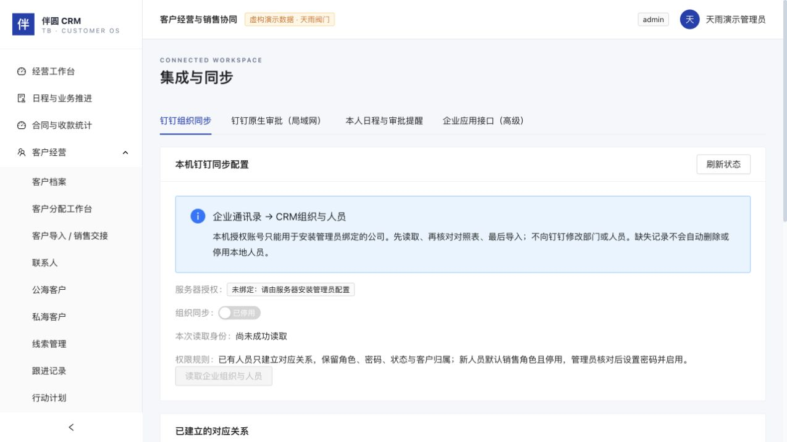

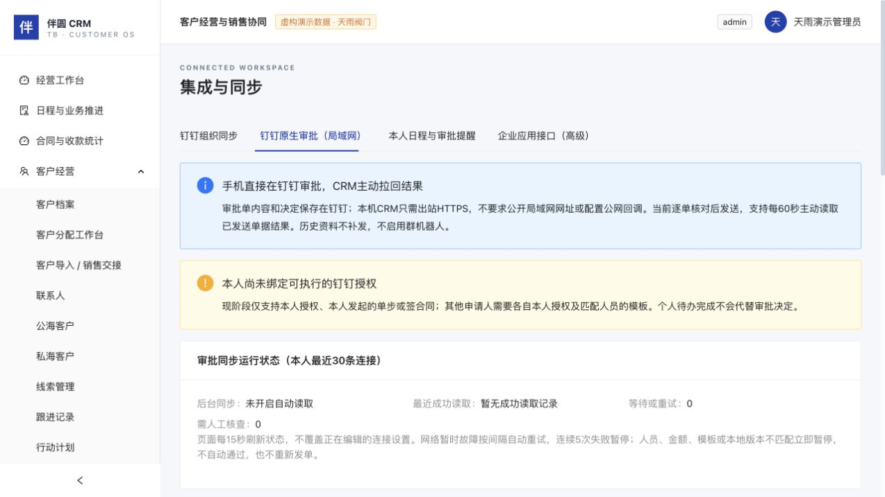

### A23  配置企业应用并测试只读接口

**适用人员：** 管理员；企业应用管理员；运维。入口：钉钉 / 飞书 → 企业应用接口（高级）

**完成目标：** 验证应用鉴权与部门、成员读取权限。

**开始之前：** 企业应用已创建；获得所需通讯录权限和可见范围；凭证由运维安全写入当前公司服务配置。

1. 让运维为当前公司配置钉钉AppKey/AppSecret或飞书AppID/AppSecret及所属CRM租户，重启相应公司服务。

2. 打开“企业应用接口（高级）”，核对平台状态是否已配置。

3. 点击“真实连接测试”，检查鉴权是否成功。

4. 输入必要的部门ID，点击“部门预览”或“成员预览”，核对返回企业和范围。

5. 留意是否只显示第一页及是否仍有后续游标，不把第一页当成完整通讯录导入。

**完成后核对：** 能区分未配置、鉴权失败、通讯录读取失败和实际只读预览成功。

**遇到问题：** 连接成功但部门读取失败：检查通讯录权限、可见范围和钉钉IP白名单等平台设置。；未配置按钮禁用：运维核对公司专属服务配置，不把凭证粘到业务表单或聊天里。

**操作提示：** 此高级入口是连接测试和只读预览，不会自动建用户、发消息或回写审批。；多公司网关使用公司私有配置；不要靠把密钥放进共享全局配置来跨公司复用。

### A24  同步钉钉部门人员并维护对照

**适用人员：** 管理员；服务器本机安装管理员。入口：钉钉 / 飞书 → 钉钉组织同步

**完成目标：** 从已授权企业读取组织和人员，并显式建立一对一对应。

**开始之前：** 服务器DWS已由同一系统用户独立登录；安装管理员已按公司精确绑定。

1. 核对“服务器授权”是否绑定本公司，再开启“组织同步”。

2. 点击“读取企业组织与人员”，等待完整读取结果，核对企业名称及本次读取人。

3. 在“导入前对照表”为部门和人员逐项选择新建、已有记录或本次跳过。

4. 同名人员以外部编号和真实身份核对；多部门人员明确选择一个已导入的CRM部门，或暂不分配并保持停用。

5. 核对完成后点击“核对完成，导入组织人员”，确认整批导入。

6. 检查“已建立的对应关系”和“同步记录”；到系统管理为新人员核定角色、部门、密码及启用状态。

**完成后核对：** 部门、人员和对应关系一致；已有人员权限、密码及客户归属不被外部身份覆盖。

**遇到问题：** 显示读取不完整：禁止导入，先解决权限、分页、失败或读取预算问题。；跳过父部门：同时处理下级部门；不能把跳过上级的树直接导入。

**操作提示：** 新账号默认销售且停用，随机未知口令不返回，不自动通知员工。；外部缺失记录不会自动删除或停用本地人员；后续调岗离职仍按本地交接规则处理。

### A25  读取本人近期钉钉日程

**适用人员：** 有日程编辑权限且已本人授权的人员。入口：日程与业务推进 → 读取近期钉钉日程

**完成目标：** 把本人已授权的近期钉钉主日历读入CRM，避免重复登记。

**开始之前：** 当前CRM人员与本人钉钉账号已精确对应；公司服务出站网络可用。

1. 进入“日程与业务推进”，核对当前人员和日期视图。

2. 点击“读取近期钉钉日程”，等待读取完成。

3. 查看新增、更新和未变数量，再切到列表或相应日期检查主题、时间及“钉钉”来源标记。

4. 再次读取时核对按原日程编号更新，不因同名重复创建。

5. 需要更改钉钉来源日程时回钉钉修改，再次读取；不要在CRM另建同一条再向外发送。

**完成后核对：** 生效日期及以后的本人近期日程可查，来源和编号保留。

**遇到问题：** 按钮不可用或报未绑定：核对本人授权与精确人员对照，不借管理员身份读取别人日历。；缺少远期事项：网页读取范围为未来31天；更长完整区间需管理员明确授权后使用专门导入工具。

**操作提示：** 生效日以前的历史不导入，未配置生效日则从当天开始；不自动读取共享日历。；老板和管理员的公司业务查看权不等于查看所有人的私人或钉钉日历。

### A26  同步本人日程和审批提醒并处理失败

**适用人员：** 已本人授权的人员；管理员可查看配置入口。入口：日程与业务推进 → 本人钉钉同步；或钉钉 / 飞书 → 本人日程与审批提醒

**完成目标：** 把允许的个人日程或本人待办提醒发送到钉钉，并核对实际结果。

**开始之前：** 个人DWS授权及CRM人员对应已配置；当前人员具备相关日程或审批权限。

1. 先核对页面是否显示“本人钉钉授权及CRM人员对应已配置”，再选择日程同步和／或审批提醒同步。

2. 点击“保存同步配置”；如需持续同步，明确确认“每60秒自动同步”，不要把默认关闭当自动开启。

3. 点击“扫描变化”，核对主题、时间、状态及接收人，选择1至50条加入发送队列。

4. 在发送记录对目标任务选择“发送并核验”，核对已验证、发送前拒绝或结果不确定。

5. 结果不确定时只做“只读对账”，核对原远端编号和来源标记；不能重新创建一条试试。

6. 需要停止后续同步时关闭开关，或停止本条同步；已发历史保留，必要时恢复只读核对。

**完成后核对：** 本人收到已验证的日程或简要审批待办提醒，发送及对账状态可追查。

**遇到问题：** 外部记录被修改：先核对差异，只有允许且明确选择时才以CRM为准覆盖。；自动同步停了：检查本人状态、权限、授权、队列及错误；关闭网页不等于关闭已保存的后台授权。

**操作提示：** 外部待办勾选完成不会批准CRM业务；普通提醒仍需回CRM处理。；业务计划来源crm_plan不进入该外发扫描；钉钉来源日程也不反向重复创建。；不预订会议室、不邀请其他人；发现外部日程已有其他参会人时停止更新。

### A27  连接局域网合同与钉钉原生审批

**适用人员：** 管理员配置；本人申请人确认发送；实际审批人在钉钉处理。入口：钉钉 / 飞书 → 钉钉原生审批（局域网）

**完成目标：** 让外出人员在钉钉原生单据处理已核对的合同或签，本地出站读取结果。

**开始之前：** 本人DWS授权；精确组织人员对照；已发布单步固定人员合同或签流程；真实钉钉模板匹配。

1. 管理员填写CRM已发布合同或签流程、钉钉审批模板编码、本人所属发起部门编号、生效日期及自动读取选项，点击“保存连接”。

2. 点击“验证真实模板、人员和部门”，核对模板必填控件、人工固定审批人员及申请人不自批规则。

3. 申请人先在CRM合同发起审批，再在“审批对照与发送”选择本人待审批合同。

4. 点击“读取钉钉流程并预演”，逐项核对完整客户、合同、金额、签约主体、人员和审核指纹；预演10分钟有效。

5. 本人点击“核对并确认发送”；审批人进入钉钉实际作决定，不使用CRM账号代批。

6. 在“真实连接、外发与回写记录”查看结果；自动读取或“读取钉钉结果”核定后，回CRM检查实际决定、同组无需处理状态及业务回调。

**完成后核对：** 钉钉真实决定经完整核对后回写CRM，保留两端实例、人员、时间和同步状态。

**遇到问题：** 结果不明或暂停：按原模板、申请人、时间和指纹核对原单，禁止删除记录后重发。；审批人外出不能打开CRM：原生单在钉钉处理即可；完整CRM网页仍需VPN或HTTPS入口。

**操作提示：** 当前连接限定本人发起、单步固定人员或签合同；不支持把管理员授权借给其他申请人。；此连接不要求公网入站回调或群机器人，本机服务和出站HTTPS仍须持续可用。；审批通过不等于已签章、已开票或银行到账；普通钉钉待办提醒不是原生审批。

## 13  部署维护与故障处理

本节给服务器安装和运维人员使用。浏览器业务管理员不自动拥有MySQL建库、恢复和本机管理控制面的权限。

### A28  配置外出访问入口

**适用人员：** 服务器本机安装管理员；网络运维。入口：系统管理 → 公司帐套 / 外网配置 → 打开外网配置页面

**完成目标：** 预留VPN或HTTPS入口，并在真实网络完成联通核验。

**开始之前：** 已有实际域名／HTTPS入口或VPN方案；证书和网络配置由有权运维管理。

1. 从服务器本机进入帐套管理控制面，使用独立管理口令，再打开外网配置页。

2. 选择暂不启用、HTTPS反向代理或VPN内HTTPS，填写规范HTTPS域名或IP及可选端口。

3. 保存后回载，核对状态为已保存、待外部验证；检查本机公司服务就绪。

4. 读取生成的Nginx代理文本，由运维配置真实证书路径，测试配置后加载代理。

5. 确认不转发帐套管理控制面、数据库和公司内部API端口，再用手机关闭Wi-Fi实测登录及业务读取。

**完成后核对：** 入口配置可回读，只有真实外网测试通过后才能认定远程可用。

**遇到问题：** 保存成功但外网打不开：继续检查DNS、证书、代理、路由、防火墙或VPN，不把保存当联网通过。；局域网无法打开控制面：这是本机管理限制，应回服务器操作。

**操作提示：** 页面不会自动购买域名、签发证书、安装代理、开路由器端口或创建VPN。；不通过绕过证书安全警告来完成验收。

### A29  备份并在新库恢复核对

**适用人员：** 服务器本机运维人员。入口：本机运维命令；恢复后的隔离测试入口

**完成目标：** 保留完整可恢复副本，并在替换原站前验证业务关系。

**开始之前：** 具有匹配版本工程、原备份密钥和安全保存位置；备份期间暂停写入。

1. 保留源代码版本和公司配置清单；单公司可运行company-backup工具，整套备份须先停网关及所有公司进程，MySQL保持运行。

2. 将加密归档和独立密钥分别妥善保管并做离机副本；检查备份回执，不覆盖旧文件。

3. 恢复时使用匹配结构版本、全新帐套目录和新数据库，绝不覆盖原库。

4. 核对恢复回执为verified-offline、全部公司verified，并逐项检查表数量和附件哈希。

5. 启动隔离端口的恢复副本，用原人员核对客户、合同、审批、应收、核销及角色范围，同时确认旧会话已失效。

6. 经明确验收和停写安排后再切换入口；恢复后的第三方授权和同步开关需重新核定。

**完成后核对：** 得到验证过的新库副本；原站及原库仍保留，未自动提升为正式入口。

**遇到问题：** 密码或密钥错误、版本不匹配、数量不符：停止恢复，保留失败证据，不能绕过校验。；恢复站和原站同时录入：两边数据不会自动合并，应立即明确唯一正式入口。

**操作提示：** 整套归档可包含恢复所需解密材料，仅交给有权恢复整套安装的人，不提交GitHub或发聊天。；恢复后旧会话、委托和自动外发授权失效或关闭；恢复不是自动切换上线。

### A30  启动服务审计和常见故障定位

**适用人员：** 服务器运维；管理员按权限查审计。入口：启动系统.command；本机服务工具；系统管理 → 业务审计（最近50条）

**完成目标：** 区分网站、公司服务、账号权限和单据状态问题，避免用删库或重复提交处理。

**开始之前：** 已保存当前版本和备份；明确实际访问入口。

1. 网站打不开时先核对服务器开机、网关端口和公司服务就绪，再查局域网地址是否变化。

2. 本机已有配套环境可用“启动系统.command”；关闭手工启动终端会停站，需长期运行时由运维按文档安装守护服务。

3. 能登录但无菜单或无数据时，依次核对公司、账号状态、角色、日期、人员范围和记录当前负责人。

4. 写入提示版本冲突时刷新原单并核对变化，不用删除重建或盲目重复提交。

5. 管理员在“业务审计（最近50条）”查看近期人员、组织和业务变更；较旧或专用链路查对应单据历史及运维记录。

6. 同步失败按发送记录区分未发送、已验证和结果不确定，先只读核对；必要时将不含凭证的错误、时间和单据编号交运维处理。

**完成后核对：** 能定位是入口、身份、数据范围、版本冲突或外部同步问题，并保留证据。

**遇到问题：** 多个启动器争用端口：按原安装服务方式停止重复进程，不能随意杀未知服务。；服务反复重启：由运维查看本机公司日志、服务日志及结构迁移，不把页面可打开视为全部业务就绪。

**操作提示：** 业务审计最近50条不是全系统历史总量；审批、委托、发送历史有各自继续加载入口。；当前未承诺自动日志轮转、断电自动切换和固定RPO/RTO。

## 附录一 业务闭环核对表

| 环节 | 应保留的依据 | 下一步核对 |
| --- | --- | --- |
| 客户与线索 | 客户主体、归属、来源材料 | 同名与证照提示，未知主体先待核实 |
| 商机与报价 | 实际范围、版本、金额口径 | 需求、决策人、交付资源及付款条件 |
| 合同与审批 | 签署依据、分期、审批历史 | 审批不代替签署，草稿不成为应收 |
| 交付与验收 | 任务证据、里程碑、独立验收 | 驳回整改，实际完成后再确认 |
| 开票与收款 | 发票资料、到账凭据、复核与核销 | 合同待收和开票待收不得重复相加 |
| 行动与日程 | 责任人、目标日期、来源和完成依据 | 拟定时段不等于客户已确认会议 |

## 附录二 70个操作任务索引

登录与个人安全

A01 登录与切换公司帐套；A02 修改密码与退出设备；A03 用手机H5访问与核对

查找筛选排序与导出

B01 查找记录并限定日期与人员；B02 将最新记录排到前面；B03 导出当前页Excel或CSV

公司组织与访问权限

A04 建立独立公司帐套；A05 建立部门层级和负责人；A06 添加人员并设置角色；A07 配置功能权限并核对数据范围；A08 批量给销售分配客户；A09 调岗离职前完成职责交接

客户档案联系人与归属

B04 新建客户并核对重复主体；B05 维护客户联系人；B06 用CSV批量导入客户；B07 领取公海客户或退回公海；B08 单条或批量分配无下游业务客户；B09 整体交接客户及销售归属；B10 从客户详情穿透完整业务过程

线索商机报价与日常推进

B11 建立线索并转成客户；B12 建立有依据的商机；B13 用商机看板查看客户并推进阶段；B14 报价并保留每轮版本；B15 记录商机跟进并同时安排下一步；B16 执行行动计划并查看本地日程；B17 记录输单原因并保留商务过程；B18 维护标准产品与按范围核价服务；B19 区分我方业务金额与软件返佣

AI资料整理和受控执行

A16 把授权资料整理成历史和未来计划；A17 创建限时智能体委托；A18 核对AI建议并执行行动；A19 停止AI委托并取消未完成行动；A20 查询产品报价和客户项目知识；A21 预演并保存知识导入包；A22 核对历史原件并进行业务补录

审批设计和实际流转

A10 设计审批表单与节点；A11 预演发布和停用审批版本；A12 提交通用事项和业务审批；A13 处理或签会签并查看历史；A14 转审撤回和退回后重提；A15 配置新商机提醒和新合同自动送审

合同签约订单与变更

B20 建立合同草稿并提交审批；B21 确认签约并建立真实分期计划；B22 从合同生成订单并确认交付；B23 申请合同变更或终止

项目任务交付验收与售后

B24 建立项目并完成立项启动；B25 安排并执行项目任务；B26 按顺序确认里程碑；B27 提交项目验收并独立确认；B28 拒收后发起整改并再次验收；B29 交接项目经理或转派未完成任务；B30 保存交付或工单证据附件；B31 处理售后工单并由他人关闭

开票资料收款登记核销与更正

B32 查询发票历史收款及收款计划；B33 登记一笔有凭据的实际到账；B34 独立复核后分摊核销到应收计划；B35 撤销错误核销并保留更正链

经营统计预测漏斗与回款分析

B36 读懂合同开票和收款七项金额；B37 查看预计收款安排及每笔权重依据；B38 查看渠道作为甲方的往来金额；B39 从销售漏斗查看商机阶段和掉单明细；B40 核对每月收款计划实际到账与待催收

钉钉和飞书连接

A23 配置企业应用并测试只读接口；A24 同步钉钉部门人员并维护对照；A25 读取本人近期钉钉日程；A26 同步本人日程和审批提醒并处理失败；A27 连接局域网合同与钉钉原生审批

部署维护与故障处理

A28 配置外出访问入口；A29 备份并在新库恢复核对；A30 启动服务审计和常见故障定位
